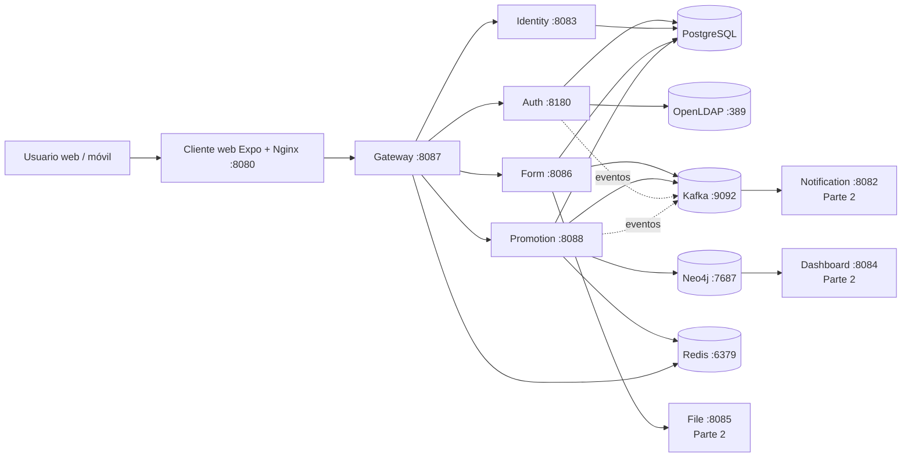

<!-- CG-DOC: Arquitectura CircleGuard — Parte 1. -->
# Arquitectura CircleGuard — Parte 1

> **Parte 2 (vigente).** La plataforma actual corre on-premise en un único host: Compose `cg-tools` + k3d `cg` con namespaces `cg-dev`/`cg-stage`/`cg-prod` y Traefik `:30080` por header `Host`. Ver [`deploy/k8s/K8S.md`](../../deploy/k8s/K8S.md) y [`infra/onpremise/ONPREMISE.md`](../../infra/onpremise/ONPREMISE.md); el despliegue pasa por `kubectl`/Kustomize desde la canalización. Este documento describe la Parte 1 y se conserva como referencia histórica.

CircleGuard es un monorepo de ocho microservicios Spring Boot/Kotlin, un cliente web Expo
y una plataforma CI/CD sobre AWS. La Parte 1 despliega los cinco servicios núcleo más el
middleware y el cliente web; notification, file y dashboard se empaquetan y publican, pero
su despliegue queda para la Parte 2.

## Vista de contenedores

## Servicios y puertos

| Microservicio | Puerto | Responsabilidad |
|---|---:|---|
| `auth-service` | 8180 | Autenticación dual LDAP/local y RBAC dinámico. |
| `identity-service` | 8083 | Bóveda criptográfica que anonimiza identidades reales. |
| `promotion-service` | -- | Motor de estados Sospechoso → Probable → Confirmado sobre Neo4j. |
| `notification-service` | 8082 | Despacho multicanal (push, correo, SMS) a partir de eventos Kafka. |
| `form-service` | 8086 | Cuestionarios de salud dinámicos; publica eventos en Kafka. |
| `file-service` | 8085 | Almacenamiento de certificados y documentos (compatible S3). |
| `gateway-service` | 8087 | Validación de ingreso al campus con QR firmados y de vida corta (Redis). |
| `dashboard-service` | 8084 | Analítica geoespacial de focos que preserva la privacidad. |

El cliente `web` (Expo + Nginx) queda fuera de la tabla porque es el frontend, no un
microservicio. El puerto `8088` es el puerto técnico de `promotion-service`, usado por
las sondas y por la ruta `/api/v1/health-status` del Ingress; en la tabla canónica su
puerto se registra como `--`.

## Ambientes

| Ambiente | Host | Stack | Promoción |
|---|---|---|---|
| tools | `cg-tools` | Jenkins, SonarQube, Nexus, registro, Ingress | N/A |
| dev | `cg-dev` | 5 núcleos + middleware + web | Automático tras la publicación |
| stage | `cg-stage` | 5 núcleos + middleware + web | Tras E2E de dev |
| prod | `cg-prod` | 5 núcleos + middleware + web | Aprobación manual |

Cada ambiente tiene su propia red Docker, volúmenes y archivo `.env`; no comparte base de
datos ni broker con otro ambiente.

## Decisiones relevantes

- **Inmutabilidad:** cada imagen se publica con tag semver; nunca `latest`.
- **Sin usuario root:** todos los Dockerfiles crean un usuario sin privilegios.
- **Comprobaciones de salud:** servicios y middleware exponen comprobaciones para que Compose espere.
- **Aislamiento:** dev/stage/prod usan puertos y redes independientes en hosts distintos.
- **Promoción:** el mismo artefacto viaja de dev a stage y prod; no se reconstruye por ambiente.
- **Privacidad:** identity guarda el mapeo cifrado; promotion solo maneja identificadores anónimos.

## Documentos relacionados

- [Canalización CI/CD](pipeline.md)
- [Entornos](../infra/environments.md)
- [Runbook](../infra/runbook.md)
- [Gestión de cambios](../change-management.md)
- [Backlog](../agil/backlog.md)
