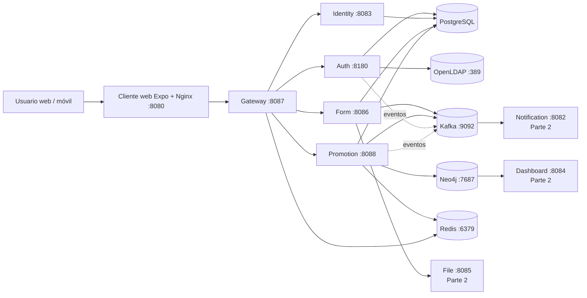

# Arquitectura CircleGuard — Parte 1

**Actualizado:** 9 de noviembre de 2026

CircleGuard es un monorepo de ocho microservicios Spring Boot/Kotlin, un cliente web Expo
y una plataforma CI/CD sobre AWS. La Parte 1 despliega los cinco servicios núcleo más el
middleware y el cliente web; notification, file y dashboard se empaquetan y publican, pero
su despliegue queda para la Parte 2.

## Vista de contenedores

## Servicios y puertos

| Servicio | Puerto | Dependencias | Parte 1 |
|---|---:|---|---|
| auth | 8180 | PostgreSQL, OpenLDAP | Desplegado |
| identity | 8083 | PostgreSQL | Desplegado |
| promotion | 8088 | PostgreSQL, Neo4j, Kafka, Redis | Desplegado |
| form | 8086 | PostgreSQL, Kafka | Desplegado |
| gateway | 8087 | Redis | Desplegado |
| notification | 8082 | Kafka, SMTP/SMS | Empaquetado |
| file | 8085 | S3-compatible | Empaquetado |
| dashboard | 8084 | Neo4j/PostgreSQL | Empaquetado |
| web | 8080 | gateway | Desplegado |

## Ambientes

| Ambiente | Host | Stack | Promoción |
|---|---|---|---|
| tools | `cg-tools` | Jenkins, SonarQube, Nexus, registry, ingress | N/A |
| dev | `cg-dev` | 5 núcleos + middleware + web | Automático tras publish |
| stage | `cg-stage` | 5 núcleos + middleware + web | Tras E2E de dev |
| prod | `cg-prod` | 5 núcleos + middleware + web | Aprobación manual |

Cada ambiente tiene su propia red Docker, volúmenes y archivo `.env`; no comparte base de
datos ni broker con otro ambiente.

## Decisiones relevantes

- **Inmutabilidad:** cada imagen se publica con tag semver; nunca `latest`.
- **No root:** todos los Dockerfiles crean un usuario sin privilegios.
- **Healthchecks:** servicios y middleware exponen healthcheck para que Compose espere.
- **Aislamiento:** dev/stage/prod usan puertos y redes independientes en hosts distintos.
- **Promoción:** el mismo artefacto viaja de dev a stage y prod; no se reconstruye por ambiente.
- **Privacidad:** identity guarda el mapeo cifrado; promotion solo maneja identificadores anónimos.

## Documentos relacionados

- [Pipeline CI/CD](pipeline.md)
- [Entornos](../infra/environments.md)
- [Runbook](../infra/runbook.md)
- [Change management](../change-management.md)
- [Backlog](../agil/backlog.md)
