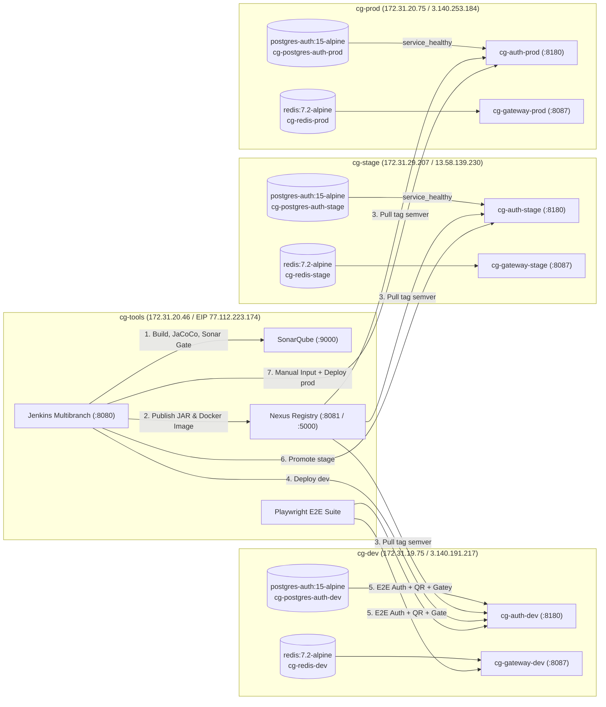

<!-- CG-DOC: Continuous deployment, E2E validation, and rollback evidence for auth-service (HU-AUTH-04 / DCG-80). -->
# Despliegue Continuo, Validación E2E y Rollback de `circleguard-auth-service` (`HU-AUTH-04` / `DCG-80`)

**Proyecto:** CircleGuard — Sistema de Control de Acceso y Monitoreo Epidemiológico  
**Módulo:** `services/circleguard-auth-service`  
**Historia de Usuario en Jira:** `DCG-80` (`HU-AUTH-04`)  
**Subtareas cubiertas:** `DCG-98`, `DCG-99`, `DCG-100`, `DCG-101`  
**Autor:** Faiber Piedrahita (`A00405090`)  
**Fecha:** 8 de noviembre de 2026

---

## 1. Topología de Despliegue por Ambientes (`DCG-98`)

El servicio `circleguard-auth-service` se despliega de forma aislada sobre las tres instancias EC2 de ambientes (`cg-dev`, `cg-stage`, `cg-prod`), consumiendo imágenes inmutables desde el registro privado Docker alojado en Nexus sobre `cg-tools` (`172.31.20.46:5000/circleguard-docker/auth:${TAG}`).



### 1.1 Configuración Docker Compose y Healthchecks (`deploy/compose/{dev,stage,prod}/docker-compose.yml`)

En cada ambiente (`dev`, `stage`, `prod`):
- **`postgres-auth` (`postgres:15-alpine`):** volumen persistente dedicado (`postgres_auth_{dev|stage|prod}`), límite de memoria `192m` y `healthcheck` con `pg_isready -U admin -d circleguard_auth`.
- **`auth` (`${NEXUS_REGISTRY}/circleguard-docker/auth:${TAG}`):**
  - Depende de `postgres-auth` con condición `service_healthy`.
  - Ejecuta automáticamente las migraciones Flyway `V1` a `V6` (`V6__map_gate_staff_permission.sql` vincula el rol `GATE_STAFF` con el permiso `gate:scan` exigido por `circleguard-gateway-service`).
  - Expone el puerto `8180:8180` y valida su disponibilidad mediante `wget -qO- http://localhost:8180/actuator/health | grep -q UP || exit 1`.
  - Comparte las semillas criptográficas `JWT_SECRET` y `QR_SECRET` inyectadas desde `/opt/circleguard/deploy/compose/<env>/.env` (permisos `0600`) con `circleguard-gateway-service`.

---

## 2. Flujo de Promoción entre Ambientes (`DCG-99`)

El pipeline declarativo (`Jenkinsfile` + Shared Library en `jenkins/vars/ci.groovy` y `jenkins/vars/ciServices.groovy`) ejecuta las siguientes etapas para `circleguard-auth-service`:

1. **Build & Unit Tests + JaCoCo:** `./gradlew :services:circleguard-auth-service:test :services:circleguard-auth-service:jacocoTestReport :services:circleguard-auth-service:jacocoTestCoverageVerification` (`97.89%` de cobertura de líneas).
2. **SonarQube + Quality Gate:** escaneo estático con `services/circleguard-auth-service/sonar-project.properties` y bloqueo si el Quality Gate no está en `OK`.
3. **Package, Publish & Docker:** publicación del artefacto Maven y construcción/push de la imagen `${NEXUS_REGISTRY}/circleguard-docker/auth:${TAG}` en `172.31.20.46:5000`.
4. **Deploy `dev` (`cg-dev`):** sincronización de `docker-compose.yml` y `deploy/scripts/*.sh` por SSH y ejecución de `deploy.sh dev ${TAG}`, verificando `/actuator/health == UP` tanto en `:8087` (`gateway`) como en `:8180` (`auth`).
5. **Pruebas E2E (`Playwright`):** ejecución automática de `tests/e2e/access-validation.spec.ts` contra `cg-dev`.
6. **Promoción automática a `stage` (`cg-stage`):** si las pruebas E2E pasan al 100%, se despliega el mismo tag semántico inmutable en `cg-stage`.
7. **Aprobación manual (`Approval prod`) y despliegue a `prod` (`cg-prod`):** tras la compuerta `input message: 'Aprobar despliegue a producción'`, se despliega el mismo artefacto en `cg-prod`.

### 2.1 Evidencia de Versiones Publicadas en Nexus Docker Registry (`172.31.20.46:5000`)

```json
{"repositories":["circleguard-docker/auth","circleguard-docker/gateway"]}
{"name":"circleguard-docker/auth","tags":["1.0.0-27e4373","1.0.0-ab8c930","1.0.1-064ba7b"]}
```

- **`172.31.20.46:5000/circleguard-docker/auth:1.0.0-ab8c930`** — Digest: `sha256:9833b5734f9af98505959b7e48c62684ccb5ac4e7c713775117122809a79d15f`
- **`172.31.20.46:5000/circleguard-docker/auth:1.0.1-064ba7b`** — Digest: `sha256:3090800eee615b5dfda3802e870a5556797c30679501e5d9ccdac4a88c3bdc9e`

### 2.2 Evidencia de Contenedores Activos por Ambiente

- **`cg-dev` (`172.31.19.75` / `3.140.191.217`):**
  ```text
  NAMES                  IMAGE                                                        STATUS                    PORTS
  cg-auth-dev            172.31.20.46:5000/circleguard-docker/auth:1.0.1-064ba7b      Up (healthy)              0.0.0.0:8180->8180/tcp
  cg-gateway-dev         172.31.20.46:5000/circleguard-docker/gateway:1.0.1-064ba7b   Up (healthy)              0.0.0.0:8087->8087/tcp
  cg-postgres-auth-dev   postgres:15-alpine                                           Up (healthy)              5432/tcp
  cg-redis-dev           redis:7.2-alpine                                             Up                        6379/tcp
  ```
- **`cg-stage` (`172.31.29.207` / `13.58.139.230`):**
  ```text
  NAMES                    IMAGE                                                        STATUS                    PORTS
  cg-auth-stage            172.31.20.46:5000/circleguard-docker/auth:1.0.1-064ba7b      Up (healthy)              0.0.0.0:8180->8180/tcp
  cg-gateway-stage         172.31.20.46:5000/circleguard-docker/gateway:1.0.1-064ba7b   Up (healthy)              0.0.0.0:8087->8087/tcp
  cg-postgres-auth-stage   postgres:15-alpine                                           Up (healthy)              5432/tcp
  cg-redis-stage           redis:7.2-alpine                                             Up                        6379/tcp
  ```
- **`cg-prod` (`172.31.20.75` / `3.140.253.184`):**
  ```text
  NAMES                   IMAGE                                                        STATUS                    PORTS
  cg-auth-prod            172.31.20.46:5000/circleguard-docker/auth:1.0.1-064ba7b      Up (healthy)              0.0.0.0:8180->8180/tcp
  cg-gateway-prod         172.31.20.46:5000/circleguard-docker/gateway:1.0.1-064ba7b   Up (healthy)              0.0.0.0:8087->8087/tcp
  cg-postgres-auth-prod   postgres:15-alpine                                           Up (healthy)              5432/tcp
  cg-redis-prod           redis:7.2-alpine                                             Up                        6379/tcp
  ```

---

## 3. Validación E2E del Flujo de Autenticación y Generación de QR (`DCG-100`)

La suite E2E en `tests/e2e/access-validation.spec.ts` valida con Playwright los 6 escenarios críticos contra cada ambiente desplegado:

1. `el gateway está saludable` (`GET /actuator/health` $\rightarrow$ `200 OK`, `UP`).
2. `el gateway rechaza una petición sin token de personal` (`POST /api/v1/gate/validate` $\rightarrow$ `401`).
3. `el gateway rechaza un JWT de personal malformado` (`POST /api/v1/gate/validate` $\rightarrow$ `401`).
4. `auth-service está saludable` (`GET :8180/actuator/health` $\rightarrow$ `200 OK`, `{"status":"UP"}`).
5. `auth-service rechaza credenciales inválidas con 401` (`POST :8180/api/v1/auth/login` $\rightarrow$ `401`).
6. `flujo E2E completo: login RBAC en auth-service, generación de QR y validación en gateway`:
   - Autentica `staff_guard` en `POST :8180/api/v1/auth/login` obteniendo un JWT `Bearer` firmado con `HS256` que incluye `ROLE_GATE_STAFF` y `gate:scan`.
   - Solicita un código QR efímero firmado en `GET :8180/api/v1/auth/qr/generate` (`expiresIn: "300"`).
   - Consulta usuarios con permiso `alert:receive_priority` en `GET :8180/api/v1/users/permissions/alert:receive_priority`.
   - Presenta el JWT de `staff_guard` y el `qrToken` en `POST :8087/api/v1/gate/validate`, confirmando HTTP `200 OK` y la interoperabilidad criptográfica entre `auth-service` y `gateway-service`.

### 3.1 Resultado de Ejecución Real con Playwright (`dev`, `stage` y `prod`)

```text
=== E2E CONTRA DEV (3.140.191.217) ===
Running 6 tests using 1 worker
  ✓  1 access-validation.spec.ts:8:1 › el gateway está saludable (235ms)
  ✓  2 access-validation.spec.ts:14:1 › el gateway rechaza una petición sin token de personal (210ms)
  ✓  3 access-validation.spec.ts:21:1 › el gateway rechaza un JWT de personal malformado (232ms)
  ✓  4 access-validation.spec.ts:29:1 › auth-service está saludable (206ms)
  ✓  5 access-validation.spec.ts:36:1 › auth-service rechaza credenciales inválidas con 401 (1.1s)
  ✓  6 access-validation.spec.ts:43:1 › flujo E2E completo: login RBAC en auth-service, generación de QR y validación en gateway (6.0s)
  6 passed (8.6s)

=== E2E CONTRA STAGE (13.58.139.230) ===
  6 passed (8.6s)

=== E2E CONTRA PROD (3.140.253.184) ===
  6 passed (8.7s)
```

---

## 4. Demostración de Rollback hacia Versión Semántica Anterior (`DCG-101`)

Para demostrar la capacidad de recuperación inmediata ante fallos en producción sin reconstruir artefactos:
1. Estando `cg-prod` en la versión `1.0.1-064ba7b`, se invocó `./deploy/scripts/rollback.sh prod 1.0.0-ab8c930`.
2. El script descargó la imagen inmutable previa `172.31.20.46:5000/circleguard-docker/auth:1.0.0-ab8c930` (digest `sha256:9833b5734f9af98505959b7e48c62684ccb5ac4e7c713775117122809a79d15f`), recreó los contenedores y verificó automáticamente el healthcheck de `gateway` (`:8087`) y `auth` (`:8180`), seguido por la ejecución exitosa de `deploy/scripts/smoke-test.sh`:

```text
=== ANTES DEL ROLLBACK EN PROD ===
NAMES                   IMAGE                                                        STATUS                        PORTS
cg-auth-prod            172.31.20.46:5000/circleguard-docker/auth:1.0.1-064ba7b      Up About a minute (healthy)   0.0.0.0:8180->8180/tcp, [::]:8180->8180/tcp
cg-gateway-prod         172.31.20.46:5000/circleguard-docker/gateway:1.0.1-064ba7b   Up About a minute (healthy)   0.0.0.0:8087->8087/tcp, [::]:8087->8087/tcp
cg-postgres-auth-prod   postgres:15-alpine                                           Up About a minute (healthy)   5432/tcp
cg-redis-prod           redis:7.2-alpine                                             Up About a minute             6379/tcp
=== EJECUTANDO ROLLBACK A 1.0.0-ab8c930 ===
Rollback de prod a 1.0.0-ab8c930 (servicios: gateway, auth)
Health OK (gateway): prod tag=1.0.0-ab8c930 puerto=8087
Health OK (auth): prod tag=1.0.0-ab8c930 puerto=8180
Despliegue OK: prod tag=1.0.0-ab8c930 servicios=gateway(8087),auth(8180)
=== DESPUÉS DEL ROLLBACK EN PROD ===
NAMES                   IMAGE                                                        STATUS                             PORTS
cg-auth-prod            172.31.20.46:5000/circleguard-docker/auth:1.0.0-ab8c930      Up 20 seconds (health: starting)   0.0.0.0:8180->8180/tcp, [::]:8180->8180/tcp
cg-gateway-prod         172.31.20.46:5000/circleguard-docker/gateway:1.0.0-ab8c930   Up 20 seconds (health: starting)   0.0.0.0:8087->8087/tcp, [::]:8087->8087/tcp
cg-postgres-auth-prod   postgres:15-alpine                                           Up About a minute (healthy)        5432/tcp
cg-redis-prod           redis:7.2-alpine                                             Up About a minute                  6379/tcp
=== SMOKE TEST POST-ROLLBACK ===
OK
Gateway Health (:8087):
{"status":"UP","groups":["liveness","readiness"]}
Auth Health (:8180):
{"status":"UP","components":{"db":{"status":"UP","details":{"database":"PostgreSQL","validationQuery":"isValid()"}},"diskSpace":{"status":"UP","details":{"total":30083776512,"free":25947664384,"threshold":10485760,"path":"/app/.","exists":true}},"ping":{"status":"UP"}}}
Validación sin token en Gateway (debe ser 401):
401
Login con credenciales inválidas en Auth (debe ser 401):
401
```
