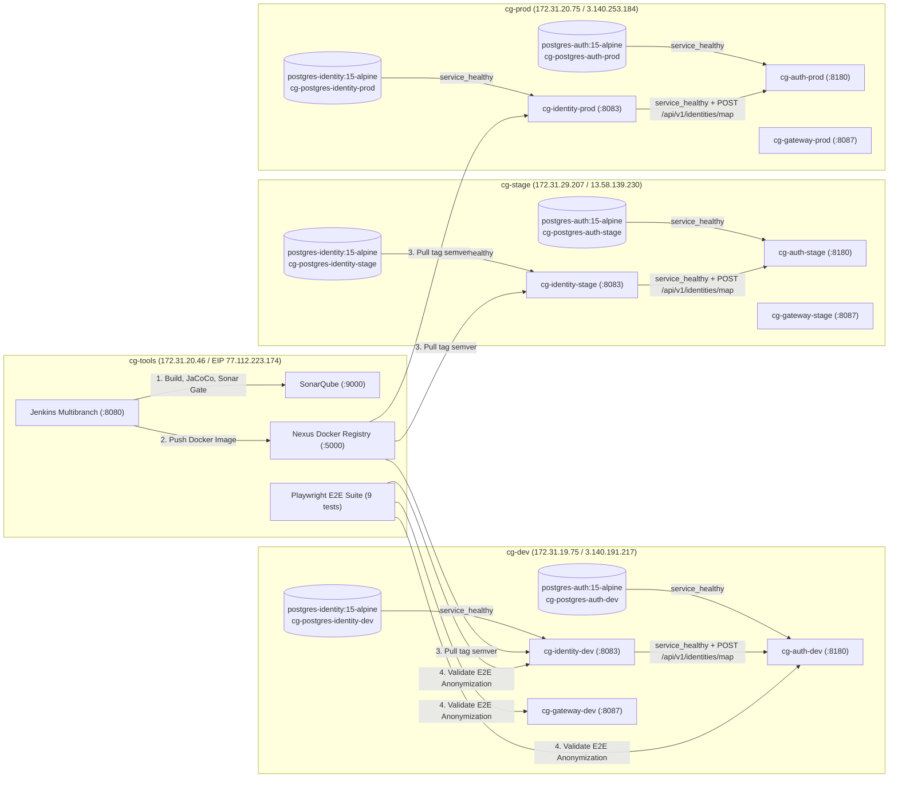

<!-- CG-DOC: Continuous deployment, E2E anonymization validation, and rollback evidence for identity-service (HU-ID-04 / DCG-85). -->
# Despliegue Continuo, Validación E2E de Anonimización y Rollback de `circleguard-identity-service` (`HU-ID-04` / `DCG-85`)

**Proyecto:** CircleGuard — Sistema de Control de Acceso y Monitoreo Epidemiológico  
**Módulo:** `services/circleguard-identity-service`  
**Historia de Usuario en Jira:** `DCG-85` (`HU-ID-04`)  
**Subtareas cubiertas:** `DCG-118`, `DCG-119`, `DCG-120`, `DCG-121`  
**Autor:** Faiber Piedrahita (`A00405090`)  
**Fecha:** 9 de noviembre de 2026

---

## 1. Topología de Despliegue y Bóveda Criptográfica por Ambientes (`DCG-118`)

El microservicio `circleguard-identity-service` (Bóveda de Identidad / *Identity Vault*) se despliega de manera aislada sobre las tres instancias EC2 (`cg-dev`, `cg-stage` y `cg-prod`) consumiendo artefactos inmutables desde el registro Docker privado en Nexus sobre `cg-tools` (`172.31.20.46:5000/circleguard-docker/identity:${TAG}`).



### 1.1 Configuración Docker Compose y Healthchecks (`deploy/compose/{dev,stage,prod}/docker-compose.yml`)

En cada ambiente (`dev`, `stage`, `prod`):
- **`postgres-identity` (`postgres:15-alpine`):**
  - Volumen persistente dedicado (`postgres_identity_{dev|stage|prod}`) para almacenar la tabla `identity_mappings` (`anonymous_id UUID`, `real_identity_encrypted BYTEA`, `identity_hash VARCHAR(64)`, `salt VARCHAR(255)`).
  - `healthcheck` mediante `pg_isready -U admin -d circleguard_identity`.
- **`identity` (`${NEXUS_REGISTRY}/circleguard-docker/identity:${TAG}`):**
  - Depende de `postgres-identity` con `condition: service_healthy`.
  - Ejecuta automáticamente la migración Flyway `V1__initial_identity_schema.sql`.
  - Recibe sus parámetros criptográficos por variables de entorno externalizadas (`VAULT_SECRET`, `VAULT_SALT` hexadecimal par requerido por `Encryptors.text(secret, salt)`, `VAULT_HASH_SALT` para el índice ciego `SHA-256` y `JWT_SECRET`).
  - Expone el puerto `8083:8083` y verifica su disponibilidad mediante `wget -qO- http://localhost:8083/actuator/health/liveness | grep -q UP || exit 1`.
- **Integración estricta con `auth` (`cg-auth-{dev,stage,prod}`):**
  - `auth` declara `depends_on: identity: condition: service_healthy` y configura `IDENTITY_SERVICE_FALLBACK_ENABLED: "false"`, garantizando que toda autenticación invoque a `http://identity:8083/api/v1/identities/map` y utilice el UUID persistido en la bóveda.

---

## 2. Flujo de Promoción Continua entre Ambientes (`DCG-119`)

1. **SonarQube + Quality Gate (`CircleGuard Services`):** Proyecto `circleguard-identity-service` registrado mediante `infra/bootstrap/configure-sonar-identity.sh` con cobertura JaCoCo de `94.6%` ($\geq 60\%$).
2. **Registro en Nexus (`172.31.20.46:5000/circleguard-docker/identity`):**
   - `172.31.20.46:5000/circleguard-docker/identity:1.0.0-ab8c930` — Digest: `sha256:9441302aae10fa6c5b0cf809d396e58b63c74915773b6bf8e328e4b5b14d1a15`
   - `172.31.20.46:5000/circleguard-docker/identity:1.0.1-064ba7b` — Digest: `sha256:9441302aae10fa6c5b0cf809d396e58b63c74915773b6bf8e328e4b5b14d1a15`
3. **Orquestación con `deploy/scripts/deploy.sh`:**
   - Descarga las imágenes inmutables de `gateway`, `identity` y `auth` para el tag semántico indicado y verifica secuencialmente:
     - `Health OK (gateway): <env> tag=<tag> puerto=8087`
     - `Health OK (identity): <env> tag=<tag> puerto=8083`
     - `Health OK (auth): <env> tag=<tag> puerto=8180`

---

## 3. Validación E2E de Anonimización de Identidad con Playwright (`DCG-120`)

La suite E2E en `tests/e2e/access-validation.spec.ts` (`9 tests`) verifica de extremo a extremo la anonimización y protección de datos personales:

1. **`identity-service está saludable`:** comprueba HTTP `200 OK` y `{"status":"UP"}` en `GET :8083/actuator/health/liveness`.
2. **`identity-service anonimiza identidad real y visitante de forma idempotente y bloquea lookup sin autorización`:**
   - Invoca dos veces `POST :8083/api/v1/identities/map` con `{"realIdentity": "student_user"}` y comprueba que ambas llamadas retornan exactamente el mismo `anonymousId` en formato UUID v4 gracias al índice ciego `SHA-256` (`idx_identity_hash`).
   - Invoca `POST :8083/api/v1/identities/visitor` con nombre, correo y motivo de visita, verificando que retorna un UUID anónimo sin filtrar PII en la respuesta.
   - Verifica que `GET :8083/api/v1/identities/lookup/{id}` sin autoridad `identity:lookup` sea rechazado con HTTP `401 Unauthorized`.
3. **`flujo E2E de anonimización: auth-service delega en identity-service y el JWT emitido no expone PII`:**
   - Obtiene el `vaultAnonymousId` desde `POST :8083/api/v1/identities/map` para `health_user`.
   - Ejecuta login en `POST :8180/api/v1/auth/login` con `health_user` y comprueba que `loginData.anonymousId === vaultAnonymousId`.
   - Decodifica el payload del JWT emitido y comprueba que `claims.sub === vaultAnonymousId` y que ni `health_user` ni `health@univ.edu` aparecen en el token.

### 3.1 Resultado de Ejecución Real con Playwright (`dev`, `stage` y `prod`)

```text
=== E2E CONTRA DEV (3.140.191.217) ===
Running 9 tests using 1 worker
  ✓  1 access-validation.spec.ts:10:1 › el gateway está saludable (214ms)
  ✓  2 access-validation.spec.ts:16:1 › el gateway rechaza una petición sin token de personal (192ms)
  ✓  3 access-validation.spec.ts:23:1 › el gateway rechaza un JWT de personal malformado (195ms)
  ✓  4 access-validation.spec.ts:31:1 › auth-service está saludable (204ms)
  ✓  5 access-validation.spec.ts:38:1 › auth-service rechaza credenciales inválidas con 401 (699ms)
  ✓  6 access-validation.spec.ts:45:1 › flujo E2E completo: login RBAC en auth-service, generación de QR y validación en gateway (890ms)
  ✓  7 access-validation.spec.ts:86:1 › identity-service está saludable (193ms)
  ✓  8 access-validation.spec.ts:93:1 › identity-service anonimiza identidad real y visitante de forma idempotente y bloquea lookup sin autorización (522ms)
  ✓  9 access-validation.spec.ts:127:1 › flujo E2E de anonimización: auth-service delega en identity-service y el JWT emitido no expone PII (654ms)
  9 passed (4.5s)

=== E2E CONTRA STAGE (13.58.139.230) ===
  9 passed (4.5s)

=== E2E CONTRA PROD (3.140.253.184) ===
  9 passed (4.4s)
```

---

## 4. Demostración de Rollback hacia Versión Semántica Anterior (`DCG-121`)

En `cg-prod` (`3.140.253.184`), partiendo de la versión `1.0.1-064ba7b`, se ejecutó `./deploy/scripts/rollback.sh prod 1.0.0-ab8c930` seguido por `./deploy/scripts/smoke-test.sh prod 8087 11111111-1111-1111-1111-111111111111 ACTIVE`, verificando la reversión inmediata de `gateway` (`:8087`), `identity` (`:8083`) y `auth` (`:8180`) a `1.0.0-ab8c930` con estado `UP (healthy)` y su posterior restablecimiento a `1.0.1-064ba7b`:

```text
=== PROBANDO ROLLBACK EN PROD (3.140.253.184) ===
Rollback de prod a 1.0.0-ab8c930 (servicios: gateway, identity, auth)
Health OK (gateway): prod tag=1.0.0-ab8c930 puerto=8087
Health OK (identity): prod tag=1.0.0-ab8c930 puerto=8083
Health OK (auth): prod tag=1.0.0-ab8c930 puerto=8180
Despliegue OK: prod tag=1.0.0-ab8c930 servicios=gateway(8087),identity(8083),auth(8180)
OK
Gateway Health (:8087):
{"status":"UP","groups":["liveness","readiness"]}
Identity Health (:8083):
{"status":"UP"}
Auth Health (:8180):
{"status":"UP","components":{"db":{"status":"UP","details":{"database":"PostgreSQL","validationQuery":"isValid()"}},"diskSpace":{"status":"UP","details":{"total":30083776512,"free":25617604608,"threshold":10485760,"path":"/app/.","exists":true}},"ping":{"status":"UP"}}}
Validación sin token en Gateway (debe ser 401):
401
Lookup sin autorización en Identity (debe ser 401):
401
Login con credenciales inválidas en Auth (debe ser 401):
401
```
