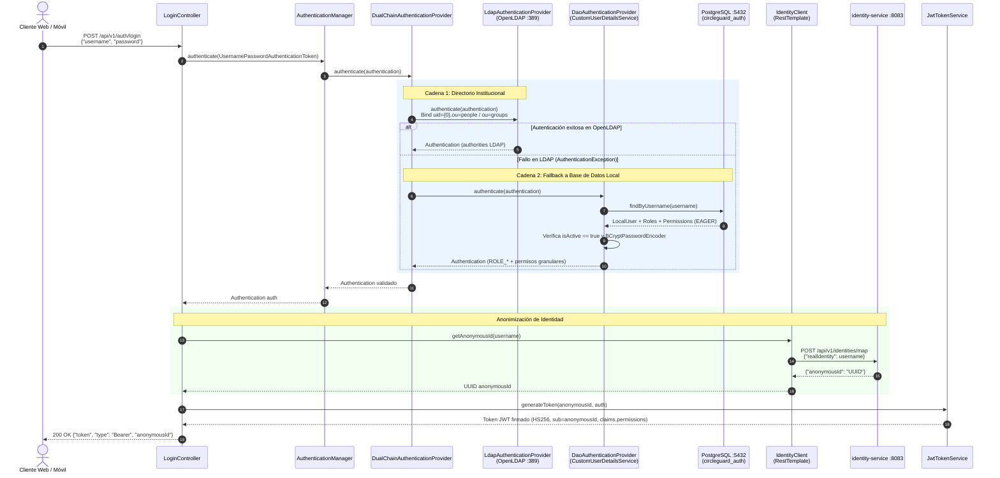
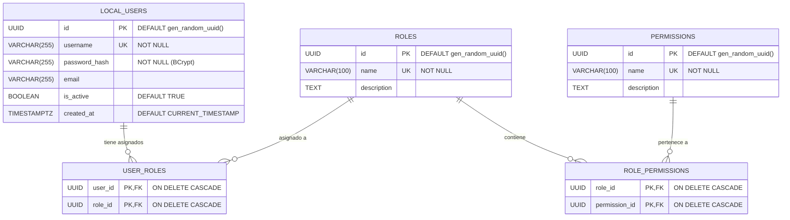

<!-- CG-DOC: Documentation file: diagnostico-auth-service. -->
# Diagnóstico Técnico y Arquitectónico: `circleguard-auth-service`

**Historia de Usuario:** `HU-AUTH-01 (DCG-77)` — Diagnosticar la estructura y dependencias de `auth-service`  
**Subtareas cubiertas:** `DCG-87`, `DCG-88`, `DCG-89`  
**Módulo Gradle:** `:services:circleguard-auth-service`  
**Ubicación en el monorepo:** `services/circleguard-auth-service/`

---

## 1. Resumen Arquitectónico (`DCG-87`)

El microservicio **`circleguard-auth-service`** es el componente encargado de la **autenticación híbrida (institucional y local)**, la **integración con la bóveda de anonimización** y el **control de acceso basado en roles y permisos dinámicos (RBAC)** dentro de la plataforma **CircleGuard**.

### 1.1 Especificaciones Técnicas Base

| Atributo | Valor / Detalle | Fuente verificada |
| :--- | :--- | :--- |
| **Nombre de la aplicación** | `circleguard-auth-service` | `src/main/resources/application.yml` |
| **Grupo / Versión** | `com.circleguard` / `1.0.0-SNAPSHOT` | `build.gradle.kts` (raíz) |
| **Lenguaje y Toolchain** | Java 21 (`JavaLanguageVersion.of(21)`) + plugins Kotlin JVM/Spring/JPA `1.9.24` | `build.gradle.kts` (raíz y módulo) |
| **Framework Principal** | Spring Boot `3.2.4` (`spring-boot-starter-web`, `data-jpa`, `security`, `data-ldap`) | `services/circleguard-auth-service/build.gradle.kts` |
| **Puerto HTTP** | `8180` | `src/main/resources/application.yml` (`server.port: 8180`) |
| **Librería de Tokens** | `io.jsonwebtoken:jjwt-api / jjwt-impl / jjwt-jackson:0.11.5` (algoritmo `HS256`) | `build.gradle.kts`, `JwtTokenService.java`, `QrTokenService.java` |
| **Migraciones de Esquema** | Flyway (`org.flywaydb:flyway-core`) con 5 scripts (`V1` a `V5`) | `src/main/resources/db/migration/` |
| **Base de Datos Relacional** | PostgreSQL 16 (producción/dev: `circleguard_auth`) / H2 en memoria (test) | `application.yml`, `deploy/compose/dev/docker-compose.yml`, `init-db.sql` |
| **Directorio Institucional** | OpenLDAP `1.5.0` (`dc=circleguard,dc=edu`, puerto `389`) | `SecurityConfig.java`, `application.yml`, `deploy/compose/dev/docker-compose.yml` |

### 1.2 Estructura de Paquetes y Componentes (`com.circleguard.auth`)

```text
services/circleguard-auth-service/
├── build.gradle.kts
└── src/
    ├── main/
    │   ├── java/com/circleguard/auth/
    │   │   ├── AuthServiceApplication.java              # Punto de entrada @SpringBootApplication
    │   │   ├── client/
    │   │   │   └── IdentityClient.java                  # Cliente HTTP (RestTemplate) hacia identity-service (:8083)
    │   │   ├── controller/
    │   │   │   ├── LoginController.java                 # Endpoints de login dual y handoff de visitantes
    │   │   │   ├── QrTokenController.java               # Emisión de tokens QR de corta duración para ingreso al campus
    │   │   │   └── UserController.java                  # Consulta interna de usuarios por permiso RBAC
    │   │   ├── model/
    │   │   │   ├── LocalUser.java                       # Entidad JPA: tabla local_users
    │   │   │   ├── Role.java                            # Entidad JPA: tabla roles
    │   │   │   └── Permission.java                      # Entidad JPA: tabla permissions
    │   │   ├── repository/
    │   │   │   └── LocalUserRepository.java             # Repositorio Spring Data JPA + query JPQL por permiso
    │   │   ├── security/
    │   │   │   ├── DualChainAuthenticationProvider.java # Proveedor de autenticación en cadena: LDAP -> Fallback BD Local
    │   │   │   ├── JwtAuthenticationFilter.java         # Filtro OncePerRequestFilter para validar Bearer JWT
    │   │   │   └── SecurityConfig.java                  # Configuración Spring Security, CORS, Beans LDAP y DAO
    │   │   └── service/
    │   │       ├── CustomUserDetailsService.java        # Carga de usuarios locales y aplanado de ROLE_* + permisos
    │   │       ├── JwtTokenService.java                 # Firma de JWT de sesión con subject=anonymousId y claim permissions
    │   │       └── QrTokenService.java                  # Firma de JWT de corta duración para código QR
    │   └── resources/
    │       ├── application.yml
    │       └── db/migration/
    │           ├── V1__initial_auth_schema.sql
    │           ├── V2__seed_test_users.sql
    │           ├── V3__fix_user_passwords.sql
    │           ├── V4__add_alert_permission.sql
    │           └── V5__add_dashboard_permission.sql
    └── test/
        ├── java/com/circleguard/auth/controller/
        │   └── LoginControllerTest.java                 # Prueba @WebMvcTest del flujo exitoso de /api/v1/auth/login
        └── resources/
            └── application.yml                          # Configuración de pruebas con H2 en memoria
```

### 1.3 Flujo Arquitectónico de Autenticación Dual y Emisión de JWT

El diseño de `circleguard-auth-service` garantiza el principio de **privacidad por diseño** de CircleGuard: la identidad real (`username`) solo se utiliza durante el proceso de autenticación y resolución en `identity-service`, pero **nunca se incluye dentro del JWT emitido**. El `sub` (*subject*) del JWT es siempre el `anonymousId` (UUID).



---

## 2. Catálogo Completo de Endpoints HTTP (`DCG-87`)

| Método | Ruta Completa | Controlador y Método | Entrada (Request) | Salida (Response) | Regla de Seguridad (`SecurityConfig`) |
| :--- | :--- | :--- | :--- | :--- | :--- |
| **`POST`** | `/api/v1/auth/login` | `LoginController#login` | **Body JSON:** `{"username": "<str>", "password": "<str>"}` | **200 OK:** `{"token": "<jwt>", "type": "Bearer", "anonymousId": "<uuid>"}`<br/>**401 Unauthorized:** `{"message": "Invalid username or password"}`<br/>**500 Internal Error:** `{"message": "Internal server error: ..."}` | Público (`.requestMatchers("/api/v1/auth/login", ...).permitAll()`) |
| **`POST`** | `/api/v1/auth/visitor/handoff` | `LoginController#generateVisitorHandoff` | **Body JSON:** `{"anonymousId": "<uuid-str>"}` | **200 OK:** `{"token": "<jwt>", "handoffPayload": "HANDOFF_TOKEN:<uuid>:<jwt>"}` (con autoridad `"VISITOR"`)<br/>**400 Bad Request:** cuerpo vacío si falta `anonymousId` | Público por `.anyRequest().permitAll()` |
| **`GET`** | `/api/v1/auth/qr/generate` | `QrTokenController#generateToken` | **Header:** `Authorization: Bearer <jwt>` (extrae `auth.getName()` que corresponde al `anonymousId` en `sub`) | **200 OK:** `{"qrToken": "<jwt-qr>", "expiresIn": "60"}`<br/>**403 Forbidden:** si no envía un JWT válido | Autenticado (`.requestMatchers("/api/v1/auth/qr/generate").authenticated()`) + `JwtAuthenticationFilter` |
| **`GET`** | `/api/v1/users/permissions/{permissionName}` | `UserController#getUsersByPermission` | **Path Variable:** `permissionName` (ej. `alert:receive_priority`) | **200 OK:** `[{"username": "<str>", "email": "<str>"}]` | Público por `.anyRequest().permitAll()` (pensado para consumo interno entre microservicios, ej. `notification-service`) |

> [!NOTE]
> **Hallazgos de contraste en `SecurityConfig.java` y `JwtAuthenticationFilter.java` (`DCG-89`):**
> 1. **Ruta huérfana en el matcher:** `SecurityConfig` declara `.requestMatchers("/api/v1/auth/login", "/api/v1/auth/qr/verify").permitAll()`, pero `/api/v1/auth/qr/verify` no existe en `auth-service` (la validación de QR se realiza en `gateway-service`).
> 2. **Política `.anyRequest().permitAll()`:** La cadena de filtros termina en `.anyRequest().permitAll()`, dejando abiertos `/api/v1/auth/visitor/handoff` y `/api/v1/users/permissions/{permissionName}` sin requerir token ni rol interno, aunque en `UserController.java` está importado `@PreAuthorize` sin llegar a utilizarse (tampoco está activo `@EnableMethodSecurity`).
> 3. **Filtro JWT (`JwtAuthenticationFilter`):** Extiende `OncePerRequestFilter`, se registra antes de `UsernamePasswordAuthenticationFilter`, valida tokens con `${jwt.secret}`, asigna `claims.getSubject()` (`anonymousId`) como principal y convierte la lista `claims.get("permissions")` en `SimpleGrantedAuthority`. Si el token falla o expira, ejecuta `SecurityContextHolder.clearContext()` y delega al siguiente filtro.
> 4. **Discrepancia en el tiempo de expiración del QR (`QrTokenService`):** En `QrTokenService.java`, el parámetro `@Value("${qr.expiration:60000}") long expiration` se suma directamente a `System.currentTimeMillis()` (milisegundos). Sin embargo, en `src/main/resources/application.yml` está definido `qr.expiration: 300` (300 milisegundos en vez de 300 segundos / 60000 ms), mientras que `QrTokenController` responde de forma estática `"expiresIn": "60"`.

---

## 3. Modelo de Datos RBAC y Migraciones Flyway (`DCG-87`)

### 3.1 Diagrama Entidad-Relación (`circleguard_auth`)



### 3.2 Mapeo en Entidades JPA y Carga de Autoridades

- **`LocalUser` (`local_users`)**: Relación `@ManyToMany(fetch = FetchType.EAGER)` con `Role` mediante la tabla puente `user_roles`. Nota: la columna `created_at` existe en el DDL SQL pero no está mapeada como atributo en `LocalUser.java`.
- **`Role` (`roles`)**: Relación `@ManyToMany(fetch = FetchType.EAGER)` con `Permission` mediante la tabla puente `role_permissions`.
- **`Permission` (`permissions`)**: Representa permisos atómicos con nomenclatura `<dominio>:<acción>` (p. ej. `gate:scan`, `identity:lookup`).
- **Aplanado en `CustomUserDetailsService`**: Al autenticar por base de datos local, `loadUserByUsername()` verifica que `user.getIsActive()` sea verdadero (de lo contrario lanza `DisabledException`) y construye un `Set<GrantedAuthority>` combinando:
  1. Cada rol con prefijo `ROLE_` (ej. `ROLE_HEALTH_CENTER`, `ROLE_GATE_STAFF`, `ROLE_STUDENT`).
  2. Cada permiso granular asociado a dichos roles (ej. `identity:lookup`, `symptom:report`, `alert:receive_priority`, `dashboard:view`).

### 3.3 Detalle de las 5 Migraciones Flyway (`V1` a `V5`)

| Versión | Archivo | Propósito y Operaciones SQL | Estado Resultante en BD |
| :--- | :--- | :--- | :--- |
| **`V1`** | `V1__initial_auth_schema.sql` | Crea las 5 tablas (`permissions`, `roles`, `role_permissions`, `local_users`, `user_roles`). Inserta 4 permisos base (`gate:scan`, `identity:lookup`, `circle:checkin`, `symptom:report`), 3 roles (`HEALTH_CENTER`, `GATE_STAFF`, `STUDENT`) y asocia `HEALTH_CENTER` con `identity:lookup` y `symptom:report`. | Esquema RBAC creado; `HEALTH_CENTER` tiene 2 permisos; `GATE_STAFF` y `STUDENT` aún no tienen permisos en `role_permissions`. |
| **`V2`** | `V2__seed_test_users.sql` | Inserta 3 usuarios semilla (`staff_guard`, `health_user`, `super_admin`) con hash inicial `$2a$10$8.UnVuG9...`. Asigna `GATE_STAFF` a `staff_guard`, `HEALTH_CENTER` a `health_user` y **todos los roles** a `super_admin`. | Usuarios de prueba creados y vinculados en `user_roles`. |
| **`V3`** | `V3__fix_user_passwords.sql` | Ejecuta `UPDATE local_users SET password_hash = '$2b$12$91ldmSUu...'` para los 3 usuarios semilla (`staff_guard`, `health_user`, `super_admin`). | Corrige el hash BCrypt para que coincida con la contraseña en texto plano `"password"`. |
| **`V4`** | `V4__add_alert_permission.sql` | Inserta el permiso `alert:receive_priority` y lo vincula al rol `HEALTH_CENTER` en `role_permissions`. | `health_user` y `super_admin` adquieren `alert:receive_priority` (consultado por `UserController`). |
| **`V5`** | `V5__add_dashboard_permission.sql` | Inserta de forma idempotente (`ON CONFLICT DO NOTHING`) el permiso `dashboard:view` y lo vincula al rol `HEALTH_CENTER`. | `health_user` y `super_admin` adquieren `dashboard:view` (total: 4 permisos en `HEALTH_CENTER`). |

> [!WARNING]
> **Observaciones técnicas sobre la persistencia (`DCG-89`):**
> - En `src/main/resources/application.yml` está configurado `spring.jpa.hibernate.ddl-auto: update` junto con Flyway. En entornos productivos o contenerizados se recomienda usar `validate` (o `none`) para evitar que Hibernate modifique el esquema al margen de Flyway.
> - En las migraciones `V1` a `V5`, el permiso `gate:scan` fue creado en `permissions` (`V1`), pero nunca se insertó su relación con el rol `GATE_STAFF` en `role_permissions`.

---

## 4. Matriz de Dependencias Externas y Parametrización (`DCG-88`)

### 4.1 Dependencias de Infraestructura y Servicios

| Sistema Externo | Tipo | Protocolo / Puerto | Uso en `circleguard-auth-service` | Comportamiento ante Fallo |
| :--- | :--- | :--- | :--- | :--- |
| **PostgreSQL 16** (`circleguard_auth`) | Base de datos relacional | TCP / `5432` (JDBC) | Ejecución de migraciones Flyway al arranque, autenticación local de respaldo (`CustomUserDetailsService`) y consulta de usuarios por permiso (`UserController`). | **Crítico en el arranque** (Flyway y DataSource requieren conexión activa) y en el fallback de login si LDAP falla. |
| **OpenLDAP 1.5.0** (`dc=circleguard,dc=edu`) | Directorio LDAP | TCP / `389` (LDAP) | Primer eslabón de autenticación en `DualChainAuthenticationProvider` (`uid={0},ou=people`, grupos en `ou=groups`). | **Tolerado por diseño en login:** `DualChainAuthenticationProvider` captura `AuthenticationException` y delega a PostgreSQL (`DaoAuthenticationProvider`). |
| **`identity-service`** (`circleguard-identity-service`) | Microservicio interno | HTTP REST / `8083` | `IdentityClient` invoca `POST /api/v1/identities/map` enviando `{"realIdentity": username}` para obtener el `anonymousId` (UUID) antes de firmar el JWT. | **Crítico en `/api/v1/auth/login`:** sin respuesta de `identity-service`, `LoginController` captura `Exception` y devuelve `500 Internal Server Error` (no tiene timeout ni Circuit Breaker configurado aún). |

### 4.2 Problemas Detectados para Contenerización y CI/CD

1. **URL quemada en `IdentityClient.java` (línea 11):**
   ```java
   private static final String IDENTITY_URL = "http://localhost:8083/api/v1/identities/map";
   ```
   Dentro de un contenedor Docker o pod de Kubernetes, `localhost:8083` apunta al propio contenedor de `auth-service` (`8180`), provocando `Connection refused` al intentar autenticar cualquier usuario.
2. **Doble quemado de credenciales y URL de OpenLDAP en `SecurityConfig.java` (líneas 57–64) y `application.yml`:**
   Además de estar en texto plano en `application.yml`, el método `@Bean public LdapContextSource contextSource()` en `SecurityConfig.java` tiene quemados en código Java `"ldap://localhost:389"`, `"dc=circleguard,dc=edu"`, `"cn=admin,dc=circleguard,dc=edu"` y `"admin"`. Incluso si se modificara `application.yml`, `SecurityConfig` sobrescribe dichos valores a menos que se inyecten mediante `@Value("${spring.ldap.*}")`.
3. **Orígenes CORS quemados en `SecurityConfig.java` (línea 40):**
   `configuration.setAllowedOrigins(List.of("http://localhost:8081", "http://localhost:8080"))` impedirá peticiones del navegador cuando el frontend web (`mobile/`) se sirva desde un dominio o IP de `dev`, `stage` o `prod`.
4. **Secretos criptográficos y credenciales de BD en texto plano en `application.yml`:**
   `spring.datasource.password`, `spring.ldap.password`, `jwt.secret` y `qr.secret` están expuestos sin interpolación de variables de entorno (`${VAR:default}`).
5. **Ausencia de Actuator y JaCoCo en `build.gradle.kts`:**
   - Falta `implementation("org.springframework.boot:spring-boot-starter-actuator")`, requerido por **E1.3** (healthchecks en Docker Compose) y **E2.2** (sondas `liveness`/`readiness` en Kubernetes).
   - Falta el plugin `jacoco` y su configuración de reporte XML/HTML y verificación de cobertura mínima ($\geq 60\%$) requerida por **E1.4** (SonarQube) y **E1.6** (`HU-AUTH-02`).

### 4.3 Tabla de Variables de Entorno a Parametrizar (`application.yml`, `IdentityClient.java`, `SecurityConfig.java`)

| Variable de Entorno Propuesta | Propiedad en Spring (`application.yml`) | Archivos Afectados | Valor por Defecto (Local Dev) | Sensibilidad |
| :--- | :--- | :--- | :--- | :--- |
| `SERVER_PORT` | `server.port` | `application.yml` | `8180` | Pública |
| `SPRING_DATASOURCE_URL` | `spring.datasource.url` | `application.yml` | `jdbc:postgresql://localhost:5432/circleguard_auth` | Configuración |
| `SPRING_DATASOURCE_USERNAME` | `spring.datasource.username` | `application.yml` | `admin` | Secreto |
| `SPRING_DATASOURCE_PASSWORD` | `spring.datasource.password` | `application.yml` | `password` | **Secreto Crítico** |
| `SPRING_LDAP_URLS` | `spring.ldap.urls` | `application.yml`, `SecurityConfig.java` | `ldap://localhost:389` | Configuración |
| `SPRING_LDAP_BASE` | `spring.ldap.base` | `application.yml`, `SecurityConfig.java` | `dc=circleguard,dc=edu` | Configuración |
| `SPRING_LDAP_USERNAME` | `spring.ldap.username` | `application.yml`, `SecurityConfig.java` | `cn=admin,dc=circleguard,dc=edu` | Secreto |
| `SPRING_LDAP_PASSWORD` | `spring.ldap.password` | `application.yml`, `SecurityConfig.java` | `admin` | **Secreto Crítico** |
| `IDENTITY_SERVICE_URL` | `identity.service.url` *(nueva)* | `application.yml`, `IdentityClient.java`, `test/application.yml` | `http://localhost:8083/api/v1/identities/map` | Configuración |
| `JWT_SECRET` | `jwt.secret` | `application.yml` (`JwtTokenService`, `JwtAuthenticationFilter`) | *(solo fallback en local/test; inyectar en CI/CD)* | **Secreto Crítico** |
| `JWT_EXPIRATION` | `jwt.expiration` | `application.yml` (`JwtTokenService`) | `3600000` (1 hora en ms) | Configuración |
| `QR_SECRET` | `qr.secret` | `application.yml` (`QrTokenService`, `test/application.yml`) | *(solo fallback en local/test; inyectar en CI/CD)* | **Secreto Crítico** |
| `QR_EXPIRATION` | `qr.expiration` | `application.yml` (`QrTokenService`) | `60000` (60 segundos en ms) | Configuración |
| `CORS_ALLOWED_ORIGINS` | `cors.allowed-origins` *(nueva)* | `application.yml`, `SecurityConfig.java` | `http://localhost:8081,http://localhost:8080` | Configuración |

---

## 5. Verificación de Compilación, Pruebas y Preparación CI/CD (`DCG-89`)

### 5.1 Hallazgos del Entorno de Construcción (Gradle y JDK)

Durante la verificación en consola se identificaron dos condiciones clave del repositorio base que deben tenerse en cuenta para el agente de Jenkins y los entornos locales:

1. **Ausencia de `gradle/wrapper/gradle-wrapper.jar` en Git:** El archivo `.gitignore` en la raíz contiene la regla `*.jar` (línea 9) sin excluir `!gradle/wrapper/gradle-wrapper.jar`. Como consecuencia, al clonar el repositorio solo existe `gradle/wrapper/gradle-wrapper.properties` y la invocación directa de `./gradlew` arroja `Error: Could not find or load main class org.gradle.wrapper.GradleWrapperMain` hasta que se restaure `gradle-wrapper.jar` y se agregue `!gradle/wrapper/gradle-wrapper.jar` en `.gitignore`.
2. **Requisito estricto de Java 21 Toolchain:** El `build.gradle.kts` raíz declara `languageVersion.set(JavaLanguageVersion.of(21))` y `jvmTarget = "21"`. Es indispensable ejecutar Gradle con `JAVA_HOME=/usr/lib/jvm/java-21-openjdk` (OpenJDK 21).

### 5.2 Evidencia Real de Compilación y Ejecución de Pruebas

**Comando ejecutado:**

```bash
JAVA_HOME=/usr/lib/jvm/java-21-openjdk gradle :services:circleguard-auth-service:test :services:circleguard-auth-service:assemble
```

**Salida real obtenida:**

```text
> Task :services:circleguard-auth-service:checkKotlinGradlePluginConfigurationErrors
> Task :services:circleguard-auth-service:compileKotlin NO-SOURCE
> Task :services:circleguard-auth-service:compileJava
> Task :services:circleguard-auth-service:processResources
> Task :services:circleguard-auth-service:classes
> Task :services:circleguard-auth-service:resolveMainClassName
> Task :services:circleguard-auth-service:bootJar
> Task :services:circleguard-auth-service:jar
> Task :services:circleguard-auth-service:compileTestKotlin NO-SOURCE
> Task :services:circleguard-auth-service:compileTestJava
> Task :services:circleguard-auth-service:processTestResources
> Task :services:circleguard-auth-service:testClasses
OpenJDK 64-Bit Server VM warning: Sharing is only supported for boot loader classes because bootstrap classpath has been appended
> Task :services:circleguard-auth-service:test
> Task :services:circleguard-auth-service:assemble

BUILD SUCCESSFUL in 23s
9 actionable tasks: 9 executed
```

**Artefactos generados y verificados en `services/circleguard-auth-service/build/`:**
- **Fat JAR ejecutable (Spring Boot):** `build/libs/circleguard-auth-service-1.0.0-SNAPSHOT.jar` (`54 MB`)
- **Plain JAR:** `build/libs/circleguard-auth-service-1.0.0-SNAPSHOT-plain.jar` (`33 KB`)
- **Reporte JUnit XML (`build/test-results/test/TEST-com.circleguard.auth.controller.LoginControllerTest.xml`):**
  - Suite: `com.circleguard.auth.controller.LoginControllerTest`
  - Tests ejecutados: `1` (`shouldLoginSuccessfullyAndReturnAnonymizedToken()`)
  - Fallos: `0` | Errores: `0` | Ignorados: `0` | Tiempo: `0.194s`

---

## 6. Hoja de Ruta y Lista de Preparación para `HU-AUTH-02` y `HU-AUTH-03`

### 6.1 Preparación para `HU-AUTH-02` (Calidad de Código, Cobertura JaCoCo $\geq 60\%$ y Pruebas Unitarias)

- [ ] **Habilitar JaCoCo en `services/circleguard-auth-service/build.gradle.kts`:**
  - Declarar el plugin `jacoco`.
  - Configurar `jacocoTestReport` con salida XML (`xml.required.set(true)`) para consumo de SonarQube y HTML para inspección local.
  - Configurar `jacocoTestCoverageVerification` con umbral mínimo `0.60` (`60%` de cobertura de líneas, según entregable **E1.6**).
- [ ] **Ampliar la batería de pruebas unitarias en `src/test/java/com/circleguard/auth/`:**
  - `LoginControllerTest`: agregar casos de credenciales inválidas (`401`), error de `IdentityClient` (`500`), generación de handoff de visitante (`200`) y handoff sin `anonymousId` (`400`).
  - `QrTokenControllerTest`: probar `/api/v1/auth/qr/generate` con usuario autenticado (`200`) y sin token (`403`).
  - `UserControllerTest`: probar `/api/v1/users/permissions/{permissionName}` retornando lista de usuarios mapeados.
  - `DualChainAuthenticationProviderTest`: probar éxito en primario (LDAP), fallback exitoso a secundario (DAO local) cuando LDAP lanza `AuthenticationException`, y fallo en ambos proveedores.
  - `CustomUserDetailsServiceTest`: probar usuario activo con roles y permisos aplanados (`ROLE_*` + permisos), usuario inactivo (`DisabledException`) y usuario inexistente (`UsernameNotFoundException`).
  - `JwtTokenServiceTest` y `QrTokenServiceTest`: verificar generación de tokens, firma `HS256`, `subject` y `claims`.
  - `JwtAuthenticationFilterTest`: verificar población del `SecurityContextHolder` con un JWT válido y limpieza del contexto ante un JWT malformado o expirado.
  - `IdentityClientTest`: verificar llamada a `RestTemplate` parametrizada.

### 6.2 Preparación para `HU-AUTH-03` (Externalización de Configuración, Healthchecks y Contenerización)

- [ ] **Externalizar configuración y secretos:**
  - Parametrizar `src/main/resources/application.yml` con variables de entorno y valores por defecto seguros solo para desarrollo local.
  - Inyectar `@Value("${identity.service.url:http://localhost:8083/api/v1/identities/map}")` en `IdentityClient.java` (y constructor/RestTemplate inyectable para facilitar pruebas).
  - Inyectar `@Value("${spring.ldap.urls}")`, `@Value("${spring.ldap.base}")`, `@Value("${spring.ldap.username}")` y `@Value("${spring.ldap.password}")` en `SecurityConfig#contextSource()`, además de `@Value("${cors.allowed-origins}")` en `SecurityConfig#corsConfigurationSource()`.
- [ ] **Agregar Spring Boot Actuator:**
  - Incluir `implementation("org.springframework.boot:spring-boot-starter-actuator")` en `services/circleguard-auth-service/build.gradle.kts`.
  - Exponer `/actuator/health` y `/actuator/info` (y `/actuator/prometheus` para la Parte 2) en `application.yml` y permitir `/actuator/health/**` en `SecurityConfig.java`.
- [ ] **Construir `Dockerfile` multi-stage inmutable (Entregable E1.3):**
  - Etapa 1 (`builder`): imagen con JDK 21 para compilar `:services:circleguard-auth-service:bootJar`.
  - Etapa 2 (`runtime`): imagen ligera `eclipse-temurin:21-jre-alpine`, ejecución con usuario no-root (`circleguard`), exposición del puerto `8180` y `HEALTHCHECK` apuntando a `http://localhost:8180/actuator/health`.
- [ ] **Restaurar el Gradle Wrapper en el repositorio:**
  - Agregar `!gradle/wrapper/gradle-wrapper.jar` en `.gitignore` y versionar `gradle/wrapper/gradle-wrapper.jar` para que `./gradlew` funcione de forma autónoma en los agentes de Jenkins.
