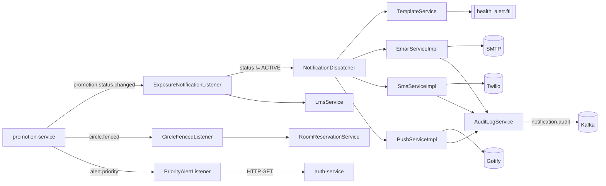

# Diagnóstico Técnico y Arquitectónico: `circleguard-notification-service`

**Historia de Usuario:** `HU-NOTIF-01 (DCG-314)` — Diagnosticar la estructura y dependencias de `notification-service`
**Subtareas cubiertas:** `DCG-343`, `DCG-344`, `DCG-345`
**Módulo Gradle:** `:services:circleguard-notification-service`
**Ubicación en el monorepo:** `services/circleguard-notification-service/`

---

## 1. Resumen Arquitectónico (`DCG-343`)

El microservicio **`circleguard-notification-service`** es el **despachador de notificaciones multicanal** de CircleGuard. No expone lógica de negocio propia: su función es **traducir eventos de salud** publicados por `promotion-service` en **entregas concretas** por correo electrónico, SMS y notificación push, registrar cada intento en un topic de auditoría y sincronizar la asistencia remota con el LMS universitario.

El servicio es **consumidor puro de Kafka en su camino principal**: los tres listeners son el único punto de entrada de la lógica de notificación, y **no existe ningún controlador REST** en el módulo (los 15 archivos Java del `main` son la aplicación, tres listeners y diez colaboradores de servicio). El servidor HTTP en el puerto `8082` existe únicamente para servir los endpoints de Actuator.

### 1.1 Especificaciones Técnicas Base

| Atributo | Valor / Detalle | Fuente verificada |
| :--- | :--- | :--- |
| **Nombre de la aplicación** | `circleguard-notification-service` | `src/main/resources/application.yml:4` |
| **Grupo / Versión** | `com.circleguard` / `1.0.0-SNAPSHOT` | `build.gradle.kts` (raíz) |
| **Lenguaje y Toolchain** | Java 21 (`JavaLanguageVersion.of(21)`) + plugins Kotlin JVM/Spring `1.9.24` | `build.gradle.kts` (raíz) |
| **Framework Principal** | Spring Boot `3.2.4` (`web`, `webflux`, `actuator`, `mail`, `freemarker`, `kafka`) | `services/circleguard-notification-service/build.gradle.kts:10-26` |
| **Puerto HTTP** | `8082` | `application.yml:42` |
| **Persistencia** | **Ninguna** — sin JPA, sin Flyway, sin base de datos | `build.gradle.kts` (sin dependencias de datos) |
| **Mensajería (consume)** | Kafka `localhost:9092`, grupos `notification-group` y `notification-priority-group` | `application.yml:6-11`, anotaciones `@KafkaListener` |
| **Mensajería (produce)** | `notification.audit` (auditoría de entregas) | `service/AuditLogService.java:22` |
| **Canales de salida** | SMTP (`JavaMailSender`), Twilio (SMS), Gotify (push), LMS/Identity/room-booking (HTTP) | `service/*ServiceImpl.java` |
| **Asincronía y reintentos** | `@EnableAsync` + `@EnableRetry` + `@Retryable`/`@Recover` | `NotificationApplication.java:11-12`, `service/*ServiceImpl.java` |
| **Seguridad** | **Ausente** — sin `spring-boot-starter-security`, sin filtros JWT | `build.gradle.kts` |
| **Healthcheck** | `/actuator/health` en `:8082`, con el health indicator de mail desactivado | `Dockerfile:32-33`, `application.yml:34-39` |

### 1.2 Estructura de Paquetes y Componentes (`com.circleguard.notification`)

```text
services/circleguard-notification-service/
├── build.gradle.kts
├── Dockerfile                                            # Multi-stage, usuario no root `app`, HEALTHCHECK :8082
└── src/
    ├── main/
    │   ├── java/com/circleguard/notification/
    │   │   ├── NotificationApplication.java              # @SpringBootApplication + @EnableAsync + @EnableRetry
    │   │   ├── package-info.java
    │   │   └── service/
    │   │       ├── package-info.java
    │   │       ├── ExposureNotificationListener.java     # Kafka: promotion.status.changed
    │   │       ├── CircleFencedListener.java             # Kafka: circle.fenced
    │   │       ├── PriorityAlertListener.java            # Kafka: alert.priority
    │   │       ├── NotificationDispatcher.java           # Orquestador del fan-out multicanal
    │   │       ├── EmailService.java                     # Interfaz del canal email
    │   │       ├── EmailServiceImpl.java                 # JavaMailSender + @Retryable
    │   │       ├── SmsService.java                       # Interfaz del canal SMS
    │   │       ├── SmsServiceImpl.java                   # Twilio + @Retryable
    │   │       ├── PushService.java                      # Interfaz del canal push (2 sobrecargas)
    │   │       ├── PushServiceImpl.java                  # WebClient/Gotify + @Retryable
    │   │       ├── LmsService.java                       # Interfaz de sincronización LMS
    │   │       ├── LmsServiceImpl.java                   # Simulación de asistencia remota
    │   │       ├── TemplateService.java                  # FreeMarker + contenido push/SMS
    │   │       ├── AuditLogService.java                  # Productor Kafka: notification.audit
    │   │       ├── RoomReservationService.java           # Interfaz de liberación de aulas
    │   │       └── RoomReservationServiceImpl.java       # Simulación de cancelación
    │   └── resources/
    │       ├── application.yml
    │       └── templates/health_alert.ftl                # Plantilla del correo de alerta de salud
    └── test/java/com/circleguard/notification/service/
        ├── ExposureNotificationListenerTest.java        # @Tag("integration")
        ├── NotificationRetryTest.java                   # @Tag("integration")
        ├── NotificationDispatcherTest.java              # @SpringBootTest (contexto completo)
        ├── PriorityAlertListenerTest.java
        ├── TemplateServiceTest.java
        ├── LmsServiceTest.java
        └── RoomReservationServiceTest.java
```

El módulo **no declara ninguna clase `@Configuration` ni ningún `@Bean`**. Todo el cableado es autoconfiguración de Spring Boot más inyección por constructor (`@RequiredArgsConstructor` de Lombok); el único `@Bean` implícito que consume `PushServiceImpl` es el `WebClient.Builder` que aporta `spring-boot-starter-webflux`.

### 1.3 Rol Real de Cada Clase

| Clase | Anotación / estereotipo | Rol verificado en el código |
| :--- | :--- | :--- |
| `NotificationApplication` | `@SpringBootApplication`, `@EnableAsync`, `@EnableRetry` | Punto de entrada; habilita el procesamiento asíncrono y el tejido de `@Retryable`. Sin `@EnableKafka` explícito (lo aporta la autoconfiguración de Spring Boot). |
| `ExposureNotificationListener` | `@Service` | Consume `promotion.status.changed`; filtra estados y dispara `NotificationDispatcher#dispatch` **más** `LmsService#syncRemoteAttendance`. |
| `CircleFencedListener` | `@Service` | Consume `circle.fenced`; solicita la liberación del aula vía `RoomReservationService#cancelReservation`. No envía notificaciones a usuarios. |
| `PriorityAlertListener` | `@Service` | Consume `alert.priority`; consulta por HTTP a `auth-service` qué usuarios tienen el permiso `alert:receive_priority` y arma (sin enviar) el contenido de correo para cada uno. |
| `NotificationDispatcher` | `@Service` | Único orquestador del fan-out: genera los cuatro textos a partir de `TemplateService` y lanza en paralelo email + SMS + push con `CompletableFuture.allOf`. |
| `EmailService` / `EmailServiceImpl` | Interfaz + `@Service` | Envío SMTP con `SimpleMailMessage`; `@Async` + `@Retryable(maxAttempts=3)` + `@Recover`; audita `SUCCESS`/`RETRY`/`FAILED`. |
| `SmsService` / `SmsServiceImpl` | Interfaz + `@Service` | Envío por Twilio; `@PostConstruct` inicializa el SDK **solo** si el SID no empieza por `AC_MOCK`; mismo esquema de reintento y auditoría. |
| `PushService` / `PushServiceImpl` | Interfaz + `@Service` | Envío por HTTP a un gateway Gotify con `WebClient`; misma política de reintento y auditoría; admite `metadata` como extras de la notificación. |
| `LmsService` / `LmsServiceImpl` | Interfaz + `@Service` | Sincronización de asistencia remota con el LMS. **Es una simulación**: construye el identificador real y registra el intento, sin llamada HTTP saliente. |
| `TemplateService` | `@Service` | Renderiza `health_alert.ftl` con `FreeMarkerTemplateUtils` y compone los textos de push y SMS en Java. |
| `AuditLogService` | `@Service` | Publica en `notification.audit` un mapa con `eventId`, `timestamp`, `userId`, `channel`, `status` y `correlationId`. |
| `RoomReservationService` / `RoomReservationServiceImpl` | Interfaz + `@Service` | Liberación de reservas de aula. **Es una simulación**: registra el intento y devuelve un futuro completado. |

### 1.4 Flujo Arquitectónico de Notificación



> [!IMPORTANT]
> **El despacho no es selectivo por canal: es fan-out fijo.** `NotificationDispatcher#dispatch` invoca siempre los tres canales; ninguna propiedad de configuración, ningún perfil y ningún estado elige un canal. La única decisión condicional ocurre **antes**, en `ExposureNotificationListener#handleStatusChange`, y es binaria sobre el estado: si el evento trae `ACTIVE` o un estado ilegible (`UNKNOWN`), **no se despacha nada**; en cualquier otro caso se despachan los tres canales a la vez.

---

## 2. Listeners Kafka y Topics Consumidos (`DCG-343`)

Los tres listeners comparten el mismo patrón: reciben el payload como `String`, lo parsean manualmente con `ObjectMapper` y capturan **cualquier** excepción para registrarla con `log.error`, sin relanzar.

### 2.1 Catálogo de Listeners

| Listener | Topic | Grupo | Tipo de evento consumido | Acción al recibir |
| :--- | :--- | :--- | :--- | :--- |
| `ExposureNotificationListener#handleStatusChange` | `promotion.status.changed` | `notification-group` | Cambio de estado de salud (`anonymousId`, `status`) | Si `status` no es `ACTIVE` ni `UNKNOWN`: `dispatcher.dispatch(userId, status)` + `lmsService.syncRemoteAttendance(userId, status)` |
| `CircleFencedListener#handleCircleFenced` | `circle.fenced` | `notification-group` | Cercado de un círculo (`circleId`, `locationId`) | Si `locationId` está presente y no vacío: `roomReservationService.cancelReservation(circleId, locationId)`; si falta, solo `log.warn` |
| `PriorityAlertListener#handlePriorityAlert` | `alert.priority` | `notification-priority-group` | Alerta de prioridad (`eventType`, `affectedCount`) | Consulta `GET {auth.api.url}/api/v1/users/permissions/alert:receive_priority`, itera los administradores y genera el contenido de correo con `templateService.generateEmailContent(eventType, username)` |

### 2.2 Detalle de Cada Consumo

**`ExposureNotificationListener`** (`service/ExposureNotificationListener.java:25-40`)

```java
@KafkaListener(topics = "promotion.status.changed", groupId = "notification-group")
```

Parsea el JSON como árbol y lee `anonymousId` y `status` con valores por defecto `"unknown"` / `"UNKNOWN"` (`:30-31`). La condición de despacho es `!"ACTIVE".equals(status) && !"UNKNOWN".equals(status)` (`:33`). Es el **único** listener que activa el envío de notificaciones a usuarios.

**`CircleFencedListener`** (`service/CircleFencedListener.java:23-39`)

```java
@KafkaListener(topics = "circle.fenced", groupId = "notification-group")
```

Deserializa a `Map<String, Object>` con `TypeReference` y extrae `circleId` y `locationId` (`:27-29`). **No notifica a ninguna persona**: su única consecuencia es disparar la liberación del aula. Si el evento no trae `locationId`, la operación se omite con `log.warn` (`:34`), de modo que un `circle.fenced` sin ubicación **no produce ningún efecto observable**.

**`PriorityAlertListener`** (`service/PriorityAlertListener.java:30-61`)

```java
@KafkaListener(topics = "alert.priority", groupId = "notification-priority-group")
```

Usa un `RestTemplate` construido **en el campo** (`:25`), no inyectado, y resuelve el destino con `@Value("${auth.api.url:http://circleguard-auth-service:8080}")` (`:27`). El valor efectivo en ejecución **no es ese default**, porque `application.yml:22-24` define la propiedad con su propio default: `${AUTH_API_URL:http://localhost:8180}`.

> [!WARNING]
> **`PriorityAlertListener` no entrega ninguna notificación.** El bucle sobre los administradores (`:46-54`) obtiene `email` y `username`, registra el envío en el log y llama a `templateService.generateEmailContent(eventType, username)` **descartando el resultado**: no invoca `EmailService`, ni `NotificationDispatcher`, ni ningún canal. El comentario del propio código lo reconoce (`:51`, *"Using TemplateService to mock the dispatch for now"*). Un evento `alert.priority` produce hoy llamadas HTTP a `auth-service` y líneas de log, nada más.

### 2.3 Topics Producidos

| Topic | Productor | Payload | Consumidor en el repositorio |
| :--- | :--- | :--- | :--- |
| `notification.audit` | `AuditLogService#logDelivery` (`:22`, `:36`) | `Map` con `eventId`, `timestamp`, `userId`, `status`, `channel`, `correlationId`; clave = `anonymousId` | **Ninguno** — no hay `@KafkaListener` sobre este topic en los 8 servicios |

### 2.4 Contratos y Consumidores de los Topics Entrantes

| Topic | Productor verificado | Clave de mensaje usada por el productor |
| :--- | :--- | :--- |
| `promotion.status.changed` | `HealthStatusService` (`:31`) y `StatusLifecycleService` (`:30`) de `promotion-service` | `anonymousId` |
| `circle.fenced` | `HealthStatusService:153` de `promotion-service` | `circle.getId().toString()` |
| `alert.priority` | `HealthStatusService:138` de `promotion-service` | `anonymousId` |

No hay contratos versionados ni esquemas registrados (ni Avro ni JSON Schema): el acoplamiento es **por nombre de topic y por nombres de campo en el JSON**, con deserializadores `StringDeserializer` para clave y valor (`application.yml:10-11`).

> [!WARNING]
> **Configuración de deserialización y grupo.** `application.yml` fija `spring.kafka.consumer.group-id: notification-group`, pero las tres anotaciones declaran su `groupId` explícito, así que la propiedad del YAML solo aplica al listener que **no** la sobreescribe — es decir, a ninguno. En la práctica los grupos efectivos son los de las anotaciones: `notification-group` para dos listeners y `notification-priority-group` para el de alertas. Además, el módulo **no configura `spring.kafka.producer`**, mientras `AuditLogService` publica `Map<String, Object>` por un `KafkaTemplate<String, Object>`: sin un serializador de valor configurado, el productor no tiene el contrato que su tipo declara.

### 2.5 Robustez del Consumo

| Aspecto | Estado real | Consecuencia |
| :--- | :--- | :--- |
| Reintento por listener | `@KafkaListener` sin `errorHandler`, sin `DefaultErrorHandler`, sin `@RetryableTopic` | Un fallo de parseo o de negocio no se reintenta en Kafka |
| Dead Letter Topic | No existe | Un evento malformado se pierde tras el `log.error` |
| Idempotencia | No hay deduplicación ni control de offsets manual | Un reproceso reenvía las notificaciones |
| Manejo de excepciones | `catch (Exception e)` con `log.error` en los tres listeners | El consumidor siempre confirma el offset: **fallo silencioso** |

---

## 3. Canales y Despacho Multicanal (`DCG-343`)

### 3.1 El Orquestador

`NotificationDispatcher#dispatch(String userId, String status)` (`service/NotificationDispatcher.java:23-43`) es el único punto que compone y lanza los envíos:

1. Genera cuatro piezas desde `TemplateService`: `generateEmailContent(status, userId)`, `generatePushContent(status)`, `generatePushMetadata(status)` y `generateSmsContent(status)` (`:26-29`).
2. Lanza los tres canales en paralelo dentro de un `CompletableFuture.allOf(...)` (`:31-34`).
3. Encadena un `.handle(...)` que registra el éxito o el error del conjunto (`:35-42`).

El método devuelve `void`: **el listener no recibe confirmación** del resultado del despacho.

> [!NOTE]
> `allOf` completa de forma excepcional en cuanto **una** de las tres ramas falla, aunque las otras dos sigan en vuelo. El `.handle` se ejecuta con `ex != null` y registra un único `log.error`, sin distinguir qué canal falló y sin compensación alguna. La trazabilidad individual existe solo por el topic de auditoría, que cada canal escribe por separado.

### 3.2 Canales Implementados

| Canal | Implementación | Transporte | Destino resuelto | Reintento | Mock local |
| :--- | :--- | :--- | :--- | :--- | :--- |
| **Email** | `EmailServiceImpl` | `JavaMailSender` / `SimpleMailMessage` | `userId + "@example.com"` **literal** (`:35`) | `@Retryable(maxAttempts=3, delay=2000)` + `@Recover` | No: requiere SMTP |
| **SMS** | `SmsServiceImpl` | Twilio `Message.creator(...)` | Teléfono **fijo** `+15551112222` (`:58`) | `@Retryable(maxAttempts=3, delay=2000)` + `@Recover` | Sí: SID que empieza por `AC_MOCK` |
| **Push** | `PushServiceImpl` | `WebClient` → gateway Gotify `POST /message?token=...` | Gateway, con `title`, `message`, `priority: 5` y `extras` (`:61-73`) | `@Retryable(maxAttempts=3, delay=2000)` + `@Recover` | Sí: token `MOCK_TOKEN` |
| **LMS** | `LmsServiceImpl` | **Ninguno** — solo log | `student@{8 primeros caracteres del anonymousId}.university.edu` (`:30`) | **Ninguno** | Simulación permanente |

> [!WARNING]
> **Ningún canal resuelve el destinatario real.** Los tres canales de despacho reciben un `anonymousId`, no un dato de contacto. `EmailServiceImpl:35` compone la dirección concatenando `@example.com`, y `SmsServiceImpl:58` usa un número de teléfono hardcodeado con el comentario explícito *"Mocking phone number lookup"*. La resolución de identidad real —que es lo que `LmsServiceImpl` sí menciona pero tampoco ejecuta— **no está implementada en ningún canal**. Antes de `HU-NOTIF-04`, un despliegue real no entregaría nada a un usuario real.

### 3.3 Mecánica de Reintento

`NotificationApplication` habilita las dos infraestructuras necesarias (`:11-12`):

```java
@EnableAsync
@org.springframework.retry.annotation.EnableRetry
```

Cada canal de despacho declara la misma política sobre la **implementación** del método:

```java
@Async
@Retryable(retryFor = { Exception.class }, maxAttempts = 3,
           backoff = @Backoff(delay = 2000))
public CompletableFuture<Void> sendAsync(String userId, String message) { ... }
```

| Elemento | Comportamiento verificado |
| :--- | :--- |
| **Intentos** | 3 por canal y por entrega |
| **Backoff** | Fijo, 2000 ms entre intentos (sin multiplicador ni jitter) |
| **Excepciones reintentadas** | Todas (`retryFor = Exception.class`) |
| **Agotamiento** | `@Recover` registra `FAILED` en auditoría y devuelve `CompletableFuture.failedFuture(e)` |
| **Auditoría por intento** | `SUCCESS` al enviar, `RETRY` en cada fallo antes del último intento, `FAILED` en el `@Recover` |
| **Correlación** | Cada invocación genera un `correlationId` (`UUID.randomUUID()`); el `FAILED` del `@Recover` lo pierde porque pasa `null` (`EmailServiceImpl:53`) |

> [!NOTE]
> `PushServiceImpl` sincroniza deliberadamente el hilo asíncrono con `.join()` sobre el `Mono` (`:77`) y lo documenta: *"Block in the @Async thread to support @Retryable"*. Sin esa sincronización, el `WebClient` devolvería el futuro antes de conocer el fallo y `@Retryable` no tendría excepción que reintentar. Es la razón por la que ese canal necesita `spring-boot-starter-webflux` aunque el servicio no sea reactivo en ningún otro punto.

---

## 4. Plantillas (`DCG-343`)

El servicio usa **FreeMarker para el correo** y **texto construido en Java para push y SMS**. Existe una sola plantilla.

### 4.1 `templates/health_alert.ftl`

| Aspecto | Detalle | Fuente |
| :--- | :--- | :--- |
| **Formato** | HTML completo (`<!DOCTYPE html>`, `<head>`, `<body>`) | `src/main/resources/templates/health_alert.ftl:2-31` |
| **Variables del modelo** | `userName`, `status`, `testingUrl`, `isolationUrl` | `TemplateService.java:35-39` |
| **Valores por defecto en la plantilla** | `userName!"User"`, `status!"UNKNOWN"`, `testingUrl!"#"`, `isolationUrl!"#"` | `health_alert.ftl:8`, `:15-16` |
| **Ramas de contenido** | `SUSPECT` → pasos de aislamiento obligatorio + enlaces de test y guías; `PROBABLE` → precauciones; cualquier otro → remisión a la app | `health_alert.ftl:11-27` |
| **Resolución** | `freemarkerConfig.getTemplate("health_alert.ftl")` sobre el `Configuration` que aporta `spring-boot-starter-freemarker` | `TemplateService.java:41` |
| **Render** | `FreeMarkerTemplateUtils.processTemplateIntoString(t, model)` | `TemplateService.java:42` |

`guidelinesDeepLink` **no** forma parte del modelo del correo: se usa solo como `metadata` de push (`TemplateService.java:57-62`).

### 4.2 Modelo y Composición de los Otros Canales

| Método | Entrada | Salida | Naturaleza |
| :--- | :--- | :--- | :--- |
| `generateEmailContent(status, userName)` | estado + nombre | HTML renderizado | FreeMarker, con fallback textual |
| `generatePushContent(status)` | estado | Título de push específico para `SUSPECT` y `PROBABLE`; genérico para el resto | Concatenación en Java |
| `generatePushMetadata(status)` | estado | `{"url": guidelinesDeepLink}` para `SUSPECT`/`PROBABLE`; mapa vacío | Concatenación en Java |
| `generateSmsContent(status)` | estado | Texto plano que remite al correo | Concatenación en Java |

> [!NOTE]
> **La plantilla nunca rompe el despacho.** Si FreeMarker falla —plantilla ausente, error de sintaxis, modelo inválido—, `generateEmailContent` captura la excepción y devuelve un texto plano de respaldo (`TemplateService.java:43-45`). El fallo se produce en silencio: no se registra log ni se audita, y el correo sale con el contenido genérico.

Propiedades que alimentan el modelo (`application.yml` no las define; se usan los defaults del `@Value`):

| Propiedad | Default en código |
| :--- | :--- |
| `notification.url.testing` | `https://circleguard.example.com/testing` |
| `notification.url.isolation` | `https://circleguard.example.com/isolation` |
| `notification.url.guidelines` | `circleguard://guidelines` |

### 4.3 Cobertura de Pruebas de Plantillas

`TemplateServiceTest` cubre los cuatro métodos (`:18`, `:26`, `:32`, `:41`): generación de email, de push, de metadata y de SMS. Es la clase con más casos del módulo (4 de 9).

---

## 5. Matriz de Dependencias Externas y Parametrización (`DCG-344`)

### 5.1 Dependencias Declaradas en `build.gradle.kts`

| Dependencia | Coordenada | Uso real en el código | Claves de configuración |
| :--- | :--- | :--- | :--- |
| **Kafka** | `org.springframework.kafka:spring-kafka` | Los tres listeners (`@KafkaListener`) y el productor de auditoría (`KafkaTemplate`) | `spring.kafka.bootstrap-servers` = `localhost:9092`; `spring.kafka.consumer.group-id` = `notification-group`; `auto-offset-reset` = `earliest`; deserializadores `String` |
| **SMTP** | `org.springframework.boot:spring-boot-starter-mail` | `EmailServiceImpl` vía `JavaMailSender` | `spring.mail.host` = `localhost`; `spring.mail.port` = `25`; `spring.mail.properties.mail.smtp.auth` = `false`; `starttls.enable` = `false` |
| **Twilio** | `com.twilio.sdk:twilio:10.1.1` | `SmsServiceImpl`: `Twilio.init`, `Message.creator`, `PhoneNumber` | `twilio.account-sid` (default `AC_MOCK_SID`), `twilio.auth-token` (`MOCK_TOKEN`), `twilio.from-number` (`+15550000000`) — **ninguna presente en `application.yml`** |
| **WebFlux** | `org.springframework.boot:spring-boot-starter-webflux` | `PushServiceImpl`: `WebClient.Builder` y `WebClient` | `push.gotify.url` (default `http://localhost:8080`), `push.gotify.token` (`MOCK_TOKEN`) — **no presentes en `application.yml`** |
| **FreeMarker** | `org.springframework.boot:spring-boot-starter-freemarker` | `TemplateService`: `Configuration`, `Template`, `FreeMarkerTemplateUtils` | Sin claves explícitas; autoconfiguración sobre `classpath:/templates/` |
| **Spring Retry** | `org.springframework.retry:spring-retry` + `org.springframework:spring-aspects` | `@EnableRetry`, `@Retryable`, `@Recover`, `@Backoff` en los tres canales | Sin claves; política fijada en las anotaciones |
| **Actuator** | `org.springframework.boot:spring-boot-starter-actuator` | Healthcheck del contenedor | `management.health.mail.enabled` = `false`; puerto `8082` |
| **Web** | `org.springframework.boot:spring-boot-starter-web` | Servidor HTTP para Actuator; `RestTemplate` en `PriorityAlertListener` | `server.port` = `8082` |
| **Lombok** | `org.projectlombok:lombok` (`compileOnly` + `annotationProcessor`) | `@RequiredArgsConstructor`, `@Slf4j` | — |

### 5.2 Dependencias Externas Consumidas por HTTP

| Dependencia | Origen de la URL | Endpoint / uso | Estado |
| :--- | :--- | :--- | :--- |
| **auth-service** | `auth.api.url` (`application.yml:22-24`, `${AUTH_API_URL:http://localhost:8180}`) | `GET /api/v1/users/permissions/alert:receive_priority` — resolución de administradores para alertas de prioridad | **Único consumidor HTTP real del servicio** (`PriorityAlertListener:41-43`) |
| **Gotify** | `push.gotify.url` | `POST /message?token={token}` — gateway de notificaciones push | Activo si el token no es `MOCK_TOKEN` |
| **Twilio API** | SDK | `Message.creator(...).create()` | Activo si el SID no empieza por `AC_MOCK`. Sin región ni endpoint configurables |
| **LMS universitario** | `lms.api.url` (default `https://lms.university.edu/api/v1`) | Sincronización de asistencia remota | **Sin llamada saliente**: solo se registra en el log |
| **Identity Vault** | `identity.api.url` (default `http://circleguard-identity-service:8081`) | Resolución de identidad real | **Sin llamada saliente**: solo se registra en el log |
| **Room booking** | `room.booking.api.url` (default `https://facilities.university.edu/api/v1/rooms`) | Cancelación de reserva de aula | **Sin llamada saliente**: solo se registra en el log |
| **SMTP** | `spring.mail.*` | Envío de correo | Activo |

### 5.3 Propiedades Declaradas pero No Consumidas

| Propiedad en `application.yml` | Línea | Consumidor en el código |
| :--- | :--- | :--- |
| `jwt.secret` | `:27` | **Ninguno** — el módulo no tiene seguridad ni valida tokens |
| `jwt.expiration` | `:28` | **Ninguno** |
| `qr.secret` | `:31` | **Ninguno** |
| `qr.expiration` | `:32` | **Ninguno** |
| `spring.kafka.consumer.group-id` | `:8` | **Ninguno** — los tres listeners declaran `groupId` propio |

> [!WARNING]
> **Dos secretos en texto plano sin uso.** `application.yml:27` y `:31` contienen `jwt.secret` y `qr.secret` con valores literales. Ningún código del módulo los lee: son residuo de un esqueleto compartido. Además de ser material sensible innecesario en el repositorio, incumplen el invariante *"No secret material in repo"* que `HU-NOTIF-04` debe sostener, y su eliminación es un cambio de bajo riesgo con evidencia verificable — búsqueda de `jwt`/`qr` en `src/main` no devuelve ninguna referencia.

### 5.4 Diagnóstico de Integración para Contenerización y CI/CD

| # | Hallazgo | Evidencia | Impacto en el pipeline |
| :--- | :--- | :--- | :--- |
| 1 | **Hosts fijos a `localhost`** | `spring.kafka.bootstrap-servers: localhost:9092`, `spring.mail.host: localhost` (`application.yml:6`, `:13`) | Dentro de una red de Compose el servicio no alcanza ni Kafka ni SMTP; `HU-NOTIF-04` debe externalizarlos |
| 2 | **Credenciales de canal ausentes del YAML** | Twilio y Gotify solo tienen defaults en `@Value` | El servicio arranca en modo mock por omisión; un despliegue real necesita inyectar cuatro propiedades que hoy nadie documenta |
| 3 | **Healthcheck insensible al SMTP** | `management.health.mail.enabled: false` (`:34-39`) | Deliberado y correcto: el contenedor mide el proceso, no la dependencia de correo (comentario en `:36-37`) |
| 4 | **Sin JaCoCo** | `build.gradle.kts` no aplica la tarea de cobertura | La meta de ≥ 60 % de `HU-NOTIF-02` no es medible todavía |
| 5 | **Pruebas de integración separadas por tag** | `tasks.test` ejecuta `excludeTags("integration")` (`:28-32`); `integrationTest` las incluye (`:35-44`) | `build` **no** ejecuta las dos pruebas de integración: `ExposureNotificationListenerTest` y `NotificationRetryTest` quedan fuera del build por defecto |
| 6 | **Publicación a Nexus con credenciales por defecto** | `NEXUS_USER`/`NEXUS_PASSWORD` con fallback `jenkins`/`change-me` (`:61-64`) | Correcto para CI; el fallback no debe usarse en un release real |
| 7 | **El contexto completo arranca durante las pruebas unitarias** | `NotificationDispatcherTest` es `@SpringBootTest` + `@ActiveProfiles("test")` sin `application-test.yml` | Cada ejecución de `test` levanta los tres listeners y registra avisos de conexión a Kafka; la suite pasa igual porque ningún test espera al broker |

---

## 6. Requisitos de Ejecución Local (`DCG-344` / `DCG-345`)

### 6.1 Prerrequisitos

| Requisito | Detalle |
| :--- | :--- |
| **JDK** | 21. El toolchain de la raíz fija `JavaLanguageVersion.of(21)`; si el JDK local es anterior, Gradle lo resuelve por `foojay-resolver-convention` en la primera compilación |
| **Wrapper** | `gradlew.bat` (Windows) / `./gradlew` versionados en el repositorio |
| **Kafka** | Un broker accesible en `localhost:9092`. **Opcional para compilar y para correr las pruebas unitarias**; necesario para que los listeners se suscriban y para ver el flujo real |
| **SMTP** | Un servidor en `localhost:25` sin autenticación. **Opcional**: el health indicator de mail está desactivado y el fallo de envío se resuelve por reintento y auditoría |
| **Docker** | Solo necesario para construir la imagen (`Dockerfile`) o para levantar Kafka/SMTP en contenedores. No hay Testcontainers en el módulo |

### 6.2 Variables y Propiedades que Afectan la Ejecución

| Variable / propiedad | Efecto | Default efectivo | ¿Obligatoria en local? |
| :--- | :--- | :--- | :--- |
| `SPRING_KAFKA_BOOTSTRAP_SERVERS` | Broker a consumir/publicar | `localhost:9092` | No — el default ya apunta a un Kafka local; necesaria en contenedor |
| `SPRING_MAIL_HOST` / `SPRING_MAIL_PORT` | Servidor SMTP | `localhost` / `25` | No |
| `AUTH_API_URL` | Base de `auth-service` para `alert.priority` | `http://localhost:8180` (`application.yml:24`) | No arranca el servicio; **sí** la consulta de administradores |
| `twilio.account-sid` | SID de Twilio; si **no** empieza por `AC_MOCK` se inicializa el SDK | `AC_MOCK_SID` | No — el default mantiene el canal en mock |
| `twilio.auth-token` | Token de Twilio | `MOCK_TOKEN` | No |
| `twilio.from-number` | Remitente del SMS | `+15550000000` | No |
| `push.gotify.url` | Base del gateway Gotify (`WebClient`) | `http://localhost:8080` | No |
| `push.gotify.token` | Token de Gotify; `MOCK_TOKEN` mantiene el canal en mock | `MOCK_TOKEN` | No |
| `lms.api.url`, `identity.api.url`, `room.booking.api.url` | URLs de los tres integradores simulados | Valores del `@Value` | No — ninguno se invoca de verdad |
| `notification.url.testing` / `.isolation` / `.guidelines` | Enlaces de la plantilla y del push | URLs de ejemplo / deep link | No |
| `SERVER_PORT` | Puerto HTTP | `8082` (`application.yml:42`) | No |
| `management.health.mail.enabled` | Si el healthcheck incluye SMTP | `false` | No — debe seguir en `false` en local |

> [!NOTE]
> **El servicio arranca sin infraestructura externa alguna.** Con los defaults de `application.yml` y los de los `@Value`, Kafka cae en `localhost:9092`, el correo en `localhost:25` y los tres canales quedan en el estado más permisivo: SMS y push en modo mock, y LMS/room-booking en simulación. Los listeners se suscriben y registran avisos de conexión mientras no haya broker, sin impedir el arranque. Para un ciclo de desarrollo local basta con un broker Kafka; SMTP solo hace falta si se quiere ver un correo salir de verdad.

### 6.3 Comandos de Construcción y Ejecución

```bash
# Compilación + pruebas unitarias + empaquetado del módulo (desde la raíz del repo)
.\gradlew.bat :services:circleguard-notification-service:build --console=plain --no-daemon

# Solo pruebas unitarias (excluye las etiquetadas @Tag("integration"))
.\gradlew.bat :services:circleguard-notification-service:test --console=plain

# Pruebas de integración (tarea dedicada; incluye @Tag("integration"))
.\gradlew.bat :services:circleguard-notification-service:integrationTest --console=plain

# Solo el artefacto ejecutable
.\gradlew.bat :services:circleguard-notification-service:bootJar --console=plain

# Ejecución local
java -jar services/circleguard-notification-service/build/libs/*.jar

# Imagen de contenedor (contexto = raíz del repositorio)
docker build -f services/circleguard-notification-service/Dockerfile -t circleguard-notification-service .
```

Verificación de arranque local:

```bash
curl -s http://localhost:8082/actuator/health
# {"status":"UP"}
```

La imagen se construye en varias etapas (`gradle:8.14-jdk21` → `eclipse-temurin:21-jre-alpine`), corre como usuario `app` no root, expone `8082` y declara un `HEALTHCHECK` contra `/actuator/health` con `start-period` de 45 s (`Dockerfile:21-33`).

---

## 7. Compilación Verificada (`DCG-345`)

### 7.1 Comando Ejecutado

Ejecutado desde la raíz del repositorio, en la rama `feat/HU-NOTIF-01-diagnostico-notification-service`:

```bash
.\gradlew.bat :services:circleguard-notification-service:build --console=plain --no-daemon
```

### 7.2 Resultado Real

```text
> Task :services:circleguard-notification-service:checkKotlinGradlePluginConfigurationErrors
> Task :services:circleguard-notification-service:compileKotlin NO-SOURCE
> Task :services:circleguard-notification-service:compileJava
> Task :services:circleguard-notification-service:processResources
> Task :services:circleguard-notification-service:classes
> Task :services:circleguard-notification-service:resolveMainClassName
> Task :services:circleguard-notification-service:bootJar
> Task :services:circleguard-notification-service:jar
> Task :services:circleguard-notification-service:assemble
> Task :services:circleguard-notification-service:compileTestKotlin NO-SOURCE
> Task :services:circleguard-notification-service:compileTestJava
> Task :services:circleguard-notification-service:processTestResources NO-SOURCE
> Task :services:circleguard-notification-service:testClasses
> Task :services:circleguard-notification-service:test
> Task :services:circleguard-notification-service:check
> Task :services:circleguard-notification-service:build

[Incubating] Problems report is available at: .../build/reports/problems/problems-report.html

Deprecated Gradle features were used in this build, making it incompatible with Gradle 9.0.

BUILD SUCCESSFUL in 19s
8 actionable tasks: 8 executed
```

| Métrica | Valor observado |
| :--- | :--- |
| **Resultado** | `BUILD SUCCESSFUL` |
| **Código de salida** | `0` |
| **Tiempo total** | `19s` (build en frío del módulo, `--no-daemon`) |
| **Tareas ejecutadas** | `8 actionable tasks: 8 executed` |
| **Compilación Java** | `compileJava` y `compileTestJava` sin errores ni warnings de compilador |
| **Empaquetado** | `bootJar` y `jar` generados |
| **Advertencias** | Solo dos, ninguna del código: `Sharing is only supported for boot loader classes` (JVM) y `Deprecated Gradle features were used in this build, making it incompatible with Gradle 9.0` (del build, no del módulo) |

### 7.3 Pruebas Ejecutadas

`tasks.test` excluye las etiquetadas `@Tag("integration")`, así que este build ejecutó **las cinco clases unitarias, 9 pruebas, 0 fallos**:

| Clase de prueba | Casos | Resultado | Tiempo |
| :--- | :--- | :--- | :--- |
| `TemplateServiceTest` | 4 | Verde | 0.073 s |
| `PriorityAlertListenerTest` | 2 | Verde | 0.263 s |
| `NotificationDispatcherTest` | 1 | Verde | 0.031 s |
| `LmsServiceTest` | 1 | Verde | 0.513 s |
| `RoomReservationServiceTest` | 1 | Verde | 0.003 s |
| **Total** | **9** | **0 fallos, 0 errores, 0 omitidas** | — |

**Disponibles en la tarea `integrationTest`**: `ExposureNotificationListenerTest` (1 caso) y `NotificationRetryTest` (1 caso), ambas `@Tag("integration")` y accesibles solo por la tarea `integrationTest`.

### 7.4 Ruido Observado Durante las Pruebas

`NotificationDispatcherTest` es `@SpringBootTest` con `@ActiveProfiles("test")`, y el módulo **no tiene `application-test.yml`**. En consecuencia, el contexto levantado durante la suite arranca los tres listeners reales y emite avisos de conexión:

```text
WARN ... [ntainer#2-0-C-1] o.a.k.c.c.internals.NetworkClient :
  [Consumer clientId=consumer-notification-priority-group-4, groupId=notification-priority-group]
  Conexión al nodo -1 (localhost/127.0.0.1:9092) sin establecer. El broker puede no estar disponible.
```

Los tres consumidores (`notification-group` × 2 y `notification-priority-group`) se crean, fallan al conectar y se cierran limpiamente al terminar el contexto. **La suite pasa igual**: ningún test espera a un broker. Es ruido, no un fallo — pero confirma que el build no es hermético respecto de Kafka y que `HU-NOTIF-02` necesita un perfil de prueba o un broker en Testcontainers para dejar de emitirlo.

### 7.5 Veredicto

**El módulo compila y empaqueta sin errores y sus 9 pruebas unitarias pasan de forma reproducible.** No hay causa de fallo que documentar: `DCG-345` queda satisfecho con un build verde verificado en esta ejecución.

Lo que el build **no** demuestra —y que el diagnóstico ya identificó— es el estado de preparación para las HUs siguientes:

| Requisito de la HU siguiente | Estado tras este diagnóstico |
| :--- | :--- |
| JaCoCo ≥ 60 % (`HU-NOTIF-02`) | **Ausente** — sin plugin en `build.gradle.kts` |
| Prueba de integración Kafka con Testcontainers (`HU-NOTIF-02`) | **Inexistente** — hoy solo hay dos casos `@Tag("integration")` sin broker |
| Despliegue en Compose dev/stage/prod (`HU-NOTIF-04`) | **Ausente** — el servicio no figura en ninguno de los tres compose; hosts fijos a `localhost` |
| Credenciales de canal por secrets (`HU-NOTIF-04`) | **Ausente** — `jwt.secret` y `qr.secret` en texto plano y sin uso; Twilio/Gotify solo por defaults |
| Resolución de destinatario real | **Ausente** — email `userId@example.com`, SMS a número fijo, push a un gateway sin destinatario |
| Entrega efectiva de `alert.priority` | **Ausente** — el listener genera el contenido y lo descarta |
| Métricas Prometheus (`HU-NOTIF-05`) | **Ausente** — Actuator sin exposición de Micrometer |

---

## 8. Resumen de Hallazgos

| # | Hallazgo | Severidad para el pipeline | Referencia |
| :--- | :--- | :--- | :--- |
| 1 | Los tres canales no resuelven destinatario real (email sintético, teléfono fijo, push sin destino) | **Alta** — vinculada a `HU-NOTIF-04` | `EmailServiceImpl:35`, `SmsServiceImpl:58` |
| 2 | `PriorityAlertListener` no entrega la alerta: genera el contenido y lo descarta | **Alta** — funcionalidad anunciada sin efecto | `PriorityAlertListener:51-52` |
| 3 | Kafka sin DLT, sin reintento de listener y con `catch` que confirma el offset | **Alta** — pérdida silenciosa de eventos | los tres listeners |
| 4 | `jwt.secret` y `qr.secret` en texto plano y sin consumidor | **Media** — incumple el invariante de no-secretos | `application.yml:26-32` |
| 5 | Hosts fijos a `localhost` en Kafka y SMTP | **Media** — impide Compose/K8s sin parametrizar | `application.yml:6`, `:13` |
| 6 | Sin serializador de productor configurado para `notification.audit` | **Media** — el contrato del `KafkaTemplate<String,Object>` no está declarado | `AuditLogService:21`, sin `spring.kafka.producer` |
| 7 | `notification.audit` sin consumidor en todo el monorepo | **Media** — auditoría emitida hacia ningún lado | búsqueda en los 8 servicios |
| 8 | `LmsServiceImpl` y `RoomReservationServiceImpl` son simulaciones permanentes | **Media** — dos integraciones anunciadas sin llamada saliente | `LmsServiceImpl:36`, `RoomReservationServiceImpl:27` |
| 9 | Sin JaCoCo, sin Testcontainers, sin perfil `test` | **Media** — vinculada a la meta de cobertura de `HU-NOTIF-02` | `build.gradle.kts:28-44` |
| 10 | `@Retryable` sobre `@Async` en el mismo método, con `correlationId` perdido en `@Recover` | **Baja** — funciona, pero la trazabilidad del fallo final es incompleta | `EmailServiceImpl:50-55` |
| 11 | `group-id` del YAML inerte porque los tres listeners lo sobreescriben | **Baja** — configuración engañosa | `application.yml:8` |
| 12 | FreeMarker degrada a texto plano sin registrar el fallo | **Baja** — el correo sale, pero el error es invisible | `TemplateService:43-45` |

---

## 9. Cobertura de los Criterios de Aceptación de `DCG-314`

| Criterio de aceptación | Dónde queda satisfecho |
| :--- | :--- |
| Diagnóstico con la **estructura** del servicio | §1 — árbol de paquetes, especificaciones base y rol de cada clase |
| Diagnóstico con los **canales** | §3 — los cuatro canales, su transporte, su destino y su política de reintento |
| Diagnóstico con los **topics consumidos** | §2 — topic, grupo, tipo de evento y acción por listener; más los topics producidos y sus productores |
| Diagnóstico con los **puntos de integración** | §5.2 — auth-service, Gotify, Twilio, SMTP, LMS, Identity Vault y room-booking, con su estado real (activo o simulado) |
| **Requisitos de ejecución local** documentados | §6 — prerrequisitos, variables con su default efectivo, qué es opcional y los comandos de build, ejecución y contenedor |
| **Resultado verificable de la compilación** con Gradle | §7 — comando exacto, salida real, `BUILD SUCCESSFUL in 19s`, 9 pruebas verdes y el ruido observado |
| Causa identificada **si falla** | No aplica: el build fue exitoso (código de salida `0`) |
