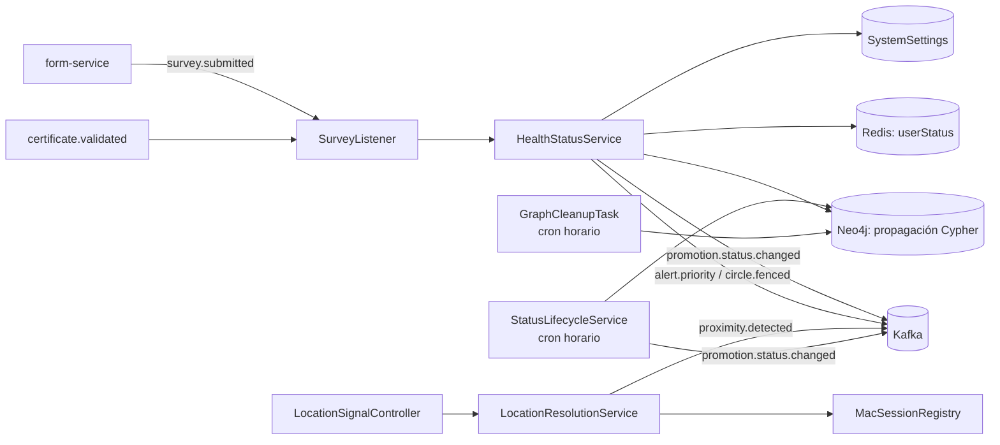
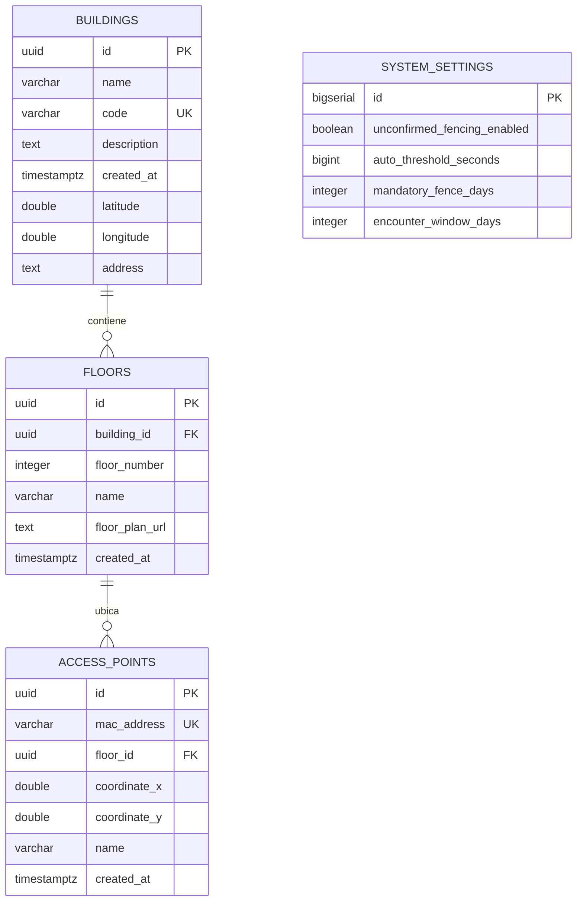

# Diagnóstico Técnico y Arquitectónico: `circleguard-promotion-service`

**Historia de Usuario:** `HU-PROMO-01 (DCG-304)` — Diagnosticar la estructura y dependencias de `promotion-service`
**Subtareas cubiertas:** `DCG-322`, `DCG-323`, `DCG-324`
**Módulo Gradle:** `:services:circleguard-promotion-service`
**Ubicación en el monorepo:** `services/circleguard-promotion-service/`

---

## 1. Resumen Arquitectónico (`DCG-322`)

El microservicio **`circleguard-promotion-service`** es el motor de **promoción de estados de salud** y de **contacto espacial** de CircleGuard. Recibe eventos de cuestionarios y certificados, resuelve la ubicación del usuario en la topología del campus y hace avanzar su estado por la cascada **`SUSPECT` → `PROBABLE` → `CONFIRMED`**, con la relación de encuentros persistida como grafo.

### 1.1 Especificaciones Técnicas Base

| Atributo | Valor / Detalle | Fuente verificada |
| :--- | :--- | :--- |
| **Nombre de la aplicación** | `circleguard-promotion-service` | `src/main/resources/application.yml` |
| **Grupo / Versión** | `com.circleguard` / `1.0.0-SNAPSHOT` | `build.gradle.kts` (raíz) |
| **Lenguaje y Toolchain** | Java 21 (`JavaLanguageVersion.of(21)`) + plugins Kotlin JVM/Spring/JPA `1.9.24` | `build.gradle.kts` (raíz) |
| **Framework Principal** | Spring Boot `3.2.4` (`web`, `data-jpa`, `data-neo4j`, `data-redis`, `kafka`, `cache`, `security`) | `services/circleguard-promotion-service/build.gradle.kts` |
| **Puerto HTTP** | `8088` | `application.yml` (`server.port: 8088`) |
| **Persistencia relacional** | PostgreSQL (`circleguard_promotion`) vía Spring Data JPA + Flyway | `application.yml`, `init-db.sql`, `db/migration/` |
| **Persistencia de grafo** | Neo4j (`bolt://localhost:7687`) vía Spring Data Neo4j | `application.yml`, `config/Neo4jConfig.java` |
| **Caché** | Caffeine (TTL 5 min) + Redis (`StringRedisTemplate` para lotes de estado) | `config/CacheConfig.java`, `service/HealthStatusService.java` |
| **Mensajería** | Kafka `localhost:9092`, grupo `promotion-service-group` | `application.yml`, `listener/SurveyListener.java` |
| **Seguridad** | Spring Security stateless + JWT HS256 (`jjwt 0.11.5`) | `security/SecurityConfig.java`, `security/JwtAuthenticationFilter.java` |
| **Tareas programadas** | `GraphCleanupTask` (`cron = "0 0 * * * *"`, purga del grafo) y `StatusLifecycleService#processAutomaticTransitions` (`cron = "0 0 * * * *"`, expiración de estados) | `task/GraphCleanupTask.java`, `service/StatusLifecycleService.java` |

### 1.2 Estructura de Paquetes y Componentes (`com.circleguard.promotion`)

```text
services/circleguard-promotion-service/
├── build.gradle.kts
└── src/
    ├── main/
    │   ├── java/com/circleguard/promotion/
    │   │   ├── PromotionApplication.java                 # Punto de entrada @SpringBootApplication
    │   │   ├── config/
    │   │   │   ├── CacheConfig.java                      # Caffeine: userStatus, proximityMatches, buildingMetadata, systemSettings
    │   │   │   ├── DataLayerConfig.java                  # Habilitación de repositorios JPA y Neo4j
    │   │   │   ├── JpaConfig.java                        # Configuración de EntityManager / transacciones JPA
    │   │   │   ├── Neo4jConfig.java                      # Bean `neo4jTransactionManager` (Neo4jTransactionManager)
    │   │   │   └── Neo4jSchemaConfig.java                # Índices de Neo4j + MERGE dummy (perfil != test)
    │   │   ├── controller/                               # 11 controladores REST (ver §2)
    │   │   ├── dto/                                      # AccessPointDTO, BuildingDTO, FloorDTO
    │   │   ├── exception/FenceException.java             # Excepción de negocio para cercado obligatorio
    │   │   ├── listener/SurveyListener.java              # Consumo Kafka: survey.submitted, certificate.validated
    │   │   ├── model/
    │   │   │   ├── AccessPoint.java                      # Punto de acceso WiFi (MAC) asociado a un piso
    │   │   │   ├── Building.java                         # Edificio del campus con coordenadas
    │   │   │   ├── Floor.java                            # Piso de un edificio
    │   │   │   ├── jpa/SystemSettings.java               # Parámetros globales de la cascada
    │   │   │   └── graph/
    │   │   │       ├── UserNode.java                     # @Node("User")
    │   │   │       ├── CircleNode.java                   # @Node("Circle")
    │   │   │       └── EncounterRelationship.java        # @RelationshipProperties (ENCOUNTERED)
    │   │   ├── repository/
    │   │   │   ├── jpa/                                  # AccessPoint, Building, Floor, SystemSettings
    │   │   │   └── graph/                                # UserNodeRepository, CircleNodeRepository
    │   │   ├── security/
    │   │   │   ├── JwtAuthenticationFilter.java          # OncePerRequestFilter: Bearer -> SecurityContext
    │   │   │   └── SecurityConfig.java                   # CORS, CSRF off, stateless, @EnableMethodSecurity
    │   │   ├── service/                                  # 11 servicios de dominio (ver §1.3)
    │   │   └── task/GraphCleanupTask.java                # Purga horaria del grafo de encuentros
    │   └── resources/
    │       ├── application.yml
    │       ├── db/migration/
    │       │   ├── V1__initial_spatial_schema.sql
    │       │   ├── V2__add_status_timing_settings.sql
    │       │   └── V3__extend_building_coordinates.sql
    │       └── seed_faculties.cypher
    └── test/java/com/circleguard/promotion/
        ├── controller/HealthStatusControllerTest.java
        ├── listener/SurveyListenerTest.java
        ├── performance/PromotionPerformanceTest.java
        └── service/
            ├── AdministrativeCorrectionTest.java
            ├── FloorServiceTest.java
            ├── HealthStatusReevaluationTest.java
            ├── HealthStatusServiceTest.java
            └── StatusLifecycleTest.java
```

### 1.3 Flujo Arquitectónico de Promoción de Estados

La cascada **no** la orquesta `StatusLifecycleService`: la propaga `HealthStatusService` con Cypher inline sobre `Neo4jClient` en una sola transacción, y `StatusLifecycleService` solo expira estados por reloj.



Reglas reales de propagación, tal como las ejecuta el Cypher de `HealthStatusService#updateStatus`:

| Estado origen | Efecto sobre los contactos |
| :--- | :--- |
| `CONFIRMED` | Contactos directos → `SUSPECT`; contactos de segundo salto en `ACTIVE` → `PROBABLE` |
| `SUSPECT` | Contactos directos → `PROBABLE` |
| Cualquier otro | Sin propagación |

| Estado | Cómo se alcanza en el código revisado |
| :--- | :--- |
| `SUSPECT` | `survey.submitted` con `hasSymptoms = true`; expira a `ACTIVE` |
| `PROBABLE` | Contacto directo de un `SUSPECT`; segundo salto de un `CONFIRMED`; expira a `ACTIVE` |
| `CONFIRMED` | Explícito por el endpoint de actualización de estado |
| `ACTIVE` | `certificate.validated` con `status = APPROVED`; expiración desde `SUSPECT`/`PROBABLE` |
| `RECOVERED` | Presente en el modelo; sin transición automática en el código revisado |

> [!NOTE]
> `StatusLifecycleService#processAutomaticTransitions` corre cada hora y solo aplica la expiración: usuarios `SUSPECT`/`PROBABLE` con `statusUpdatedAt` anterior a `mandatory_fence_days` vuelven a `ACTIVE`, actualizan Redis y emiten `promotion.status.changed`. No llama a `HealthStatusService` ni a `GraphService`.

---

## 2. Catálogo Completo de Endpoints HTTP (`DCG-322`)

**35 rutas en 11 controladores.** La autorización real es **method-level**: `SecurityConfig` habilita `@EnableMethodSecurity` y el servicio declara 15 reglas `@PreAuthorize`.

| Método | Ruta Completa | Controlador | Regla efectiva |
| :--- | :--- | :--- | :--- |
| `GET` | `/api/v1/access-points/{id}` | `AccessPointController` | Abierta |
| `PUT` | `/api/v1/access-points/{id}` | `AccessPointController` | `hasAuthority('ADMIN')` |
| `DELETE` | `/api/v1/access-points/{id}` | `AccessPointController` | `hasAuthority('ADMIN')` |
| `GET` | `/api/v1/admin/settings` | `AdminController` | **Abierta** |
| `POST` | `/api/v1/admin/settings` | `AdminController` | **Abierta** |
| `POST` | `/api/v1/admin/settings/toggle-unconfirmed-fencing` | `AdminController` | **Abierta** |
| `POST` | `/api/v1/buildings` | `BuildingController` | `hasAuthority('ADMIN')` |
| `GET` | `/api/v1/buildings` | `BuildingController` | Abierta |
| `GET` | `/api/v1/buildings/{id}/floors` | `BuildingController` | Abierta |
| `POST` | `/api/v1/buildings/{id}/floors` | `BuildingController` | `hasAuthority('ADMIN')` |
| `PUT` | `/api/v1/buildings/{id}` | `BuildingController` | `hasAuthority('ADMIN')` |
| `DELETE` | `/api/v1/buildings/{id}` | `BuildingController` | **Abierta** |
| `POST` | `/api/v1/circles` | `CircleController` | Abierta |
| `POST` | `/api/v1/circles/join/{code}/user/{anonymousId}` | `CircleController` | Abierta |
| `POST` | `/api/v1/circles/{id}/members/{anonymousId}` | `CircleController` | Abierta |
| `GET` | `/api/v1/circles/user/{anonymousId}` | `CircleController` | Abierta |
| `PATCH` | `/api/v1/circles/{id}/validity` | `CircleController` | `hasRole('HEALTH_CENTER')` |
| `POST` | `/api/v1/circles/{id}/force-fence` | `CircleController` | `hasRole('HEALTH_CENTER')` |
| `POST` | `/api/v1/encounters/report` | `EncounterController` | Abierta |
| `PATCH` | `/api/v1/encounters/{id}/validity` | `EncounterController` | `hasRole('HEALTH_CENTER')` |
| `POST` | `/api/v1/encounters/{id}/force-fence` | `EncounterController` | `hasRole('HEALTH_CENTER')` |
| `POST` | `/api/v1/floors/{id}/access-points` | `FloorController` | `hasAuthority('ADMIN')` |
| `GET` | `/api/v1/floors/{id}/access-points` | `FloorController` | Abierta |
| `PUT` | `/api/v1/floors/{id}` | `FloorController` | `hasAuthority('ADMIN')` |
| `DELETE` | `/api/v1/floors/{id}` | `FloorController` | **Abierta** |
| `GET` | `/api/v1/health-status/stats` | `HealthStatsController` | Abierta |
| `GET` | `/api/v1/health-status/stats/department/{department}` | `HealthStatsController` | Abierta |
| `POST` | `/api/v1/health/report` | `HealthStatusController` | `hasRole('HEALTH_CENTER')` |
| `POST` | `/api/v1/health/confirmed` | `HealthStatusController` | `hasRole('HEALTH_CENTER')` |
| `POST` | `/api/v1/health/recovery/{id}` | `HealthStatusController` | `hasRole('HEALTH_CENTER')` |
| `POST` | `/api/v1/health/resolve` | `HealthStatusController` | `hasRole('HEALTH_CENTER')` |
| `POST` | `/api/v1/location/signal` | `LocationSignalController` | Abierta |
| `GET` | `/api/v1/mesh/stats/{anonymousId}` | `MeshController` | Abierta |
| `POST` | `/api/v1/sessions/handshake` | `SessionHandshakeController` | Abierta |
| `DELETE` | `/api/v1/sessions/{macAddress}` | `SessionHandshakeController` | Abierta |

> [!WARNING]
> **Hallazgo de seguridad (`DCG-322`):** las reglas por URL de `SecurityConfig` terminan en `.anyRequest().permitAll()` y solo exigen autenticación para `/api/v1/health/**`; el resto de la autorización vive en `@PreAuthorize`. Eso deja **sin protección** `AdminController` (lectura y escritura de los parámetros globales de la cascada), los `DELETE` de `buildings` y `floors`, y los endpoints de reporte de encuentros, señal de ubicación, malla y sesiones. Además, `hasRole('HEALTH_CENTER')` exige la autoridad `ROLE_HEALTH_CENTER`, mientras que `JwtAuthenticationFilter` copia los permisos del claim sin prefijo: un token con `HEALTH_CENTER` a secas no autoriza.

---

## 3. Modelo de Datos y Migraciones Flyway (`DCG-322`)

### 3.1 Esquema relacional (`circleguard_promotion`)



`floors` tiene `UNIQUE(building_id, floor_number)`; `access_points` tiene `UNIQUE(mac_address)`; ambas FK usan `ON DELETE CASCADE`.

### 3.2 Grafo de encuentros (Neo4j)

| Elemento | Anotación | Rol |
| :--- | :--- | :--- |
| `UserNode` | `@Node("User")` | Identidad anónima (`anonymousId`) y estado actual |
| `CircleNode` | `@Node("Circle")` | Grupo de convivencia (círculo) con código de invitación |
| `EncounterRelationship` | `@RelationshipProperties` sobre `ENCOUNTERED` | Encuentro entre dos usuarios con timestamp y duración |
| `MEMBER_OF` | `@Relationship(direction = INCOMING)` | Pertenencia de un usuario a un círculo |

### 3.3 Detalle de las 3 migraciones Flyway

| Versión | Archivo | Contenido |
| :--- | :--- | :--- |
| `V1` | `V1__initial_spatial_schema.sql` | Crea `buildings` (UUID PK, `name`, `code` único, `description`, `created_at`), `floors` (UUID PK, `building_id`, `floor_number`, `name`, `floor_plan_url`, `created_at`, único por edificio+piso), `access_points` (UUID PK, `mac_address` único, `floor_id`, `coordinate_x`, `coordinate_y`, `name`, `created_at`) y `system_settings` (`bigserial`, `unconfirmed_fencing_enabled`, `auto_threshold_seconds`); índices `idx_ap_mac` e `idx_floor_building`; semilla `(FALSE, 3600)` |
| `V2` | `V2__add_status_timing_settings.sql` | Agrega a `system_settings` `mandatory_fence_days` y `encounter_window_days`, ambos `INTEGER NOT NULL DEFAULT 14` |
| `V3` | `V3__extend_building_coordinates.sql` | Agrega `latitude`, `longitude` y `address` a `buildings` |

> [!NOTE]
> `Neo4jSchemaConfig` (perfil distinto de `test`) crea cinco índices (`user_anon_id_idx`, `user_status_idx`, `encounter_time_idx`, `circle_invite_idx`, `circle_loc_idx`) y ejecuta un `MERGE` dummy para registrar el tipo de relación `MEMBER_OF`. No crea constraints. El `seed_faculties.cypher` **no** está integrado al arranque: es un script manual.

---

## 4. Matriz de Dependencias Externas y Parametrización (`DCG-323`)

### 4.1 Dependencias de Infraestructura y Servicios

| Dependencia | Endpoint / Coordenada | Uso en el código | Estado actual |
| :--- | :--- | :--- | :--- |
| **PostgreSQL** | `jdbc:postgresql://localhost:5432/circleguard_promotion` | JPA + Flyway: topología (`buildings`, `floors`, `access_points`) y `system_settings` | Credenciales en texto plano (`admin`/`password`) |
| **Neo4j** | `bolt://localhost:7687` | `HealthStatusService` (propagación), `StatusLifecycleService` (expiración), `GraphCleanupTask`, `GraphService`, `CircleService`, `AutoCircleService` | Credenciales en texto plano (`neo4j`/`password`) |
| **Redis** | `localhost:6379` | `HealthStatusService` (lotes `user:status:*`), `StatusLifecycleService` (expiración), `LocationResolutionService` (conjuntos de proximidad), `MacSessionRegistry` (sesiones MAC con TTL) | Sin contraseña configurada |
| **Kafka (consume)** | `localhost:9092`, grupo `promotion-service-group` | `SurveyListener`: `survey.submitted`, `certificate.validated` | Deserializador JSON con `trusted.packages: "*"` |
| **Kafka (produce)** | `localhost:9092` | `HealthStatusService`: `promotion.status.changed`, `alert.priority`, `circle.fenced`; `StatusLifecycleService`: `promotion.status.changed`; `LocationResolutionService`: `proximity.detected` | Sin contratos versionados |
| **form-service** | Productor de `survey.submitted` | Origen de los eventos de cuestionario | Acoplamiento por nombre de topic |
| **auth-service** | Secreto JWT compartido | `JwtAuthenticationFilter` valida el Bearer con `jwt.secret` | Secreto duplicado en texto plano |

### 4.2 Problemas Detectados para Contenerización y CI/CD

1. **Secretos y credenciales embebidos.** `application.yml` contiene `jwt.secret`, la contraseña de PostgreSQL y la de Neo4j en claro. Bloquea la contenerización limpia y obliga a externalizar todo por variables de entorno antes de `HU-PROMO-03`.
2. **Hosts fijos a `localhost`.** PostgreSQL, Neo4j, Redis y Kafka apuntan a `localhost`, lo que impide que el servicio resuelva el middleware por nombre de servicio dentro de una red de Docker Compose.
3. **`ddl-auto: update` junto a Flyway.** `spring.jpa.hibernate.ddl-auto=update` convive con migraciones versionadas; Hibernate puede alterar el esquema por fuera de Flyway y desincronizar el histórico.
4. **Deserializador sin lista blanca.** `spring.json.trusted.packages: "*"` acepta cualquier paquete en el payload de Kafka: superficie de deserialización insegura.
5. **Sin Dockerfile ni healthcheck.** El módulo no tiene imagen propia ni endpoint de salud expuesto para `HEALTHCHECK`/sondas.
6. **Autorización dispersa y con huecos.** Ver §2: `AdminController` y varios `DELETE` quedan abiertos.

### 4.3 Variables de Entorno a Parametrizar

| Variable propuesta | Reemplaza a | Archivo de origen |
| :--- | :--- | :--- |
| `SPRING_DATASOURCE_URL` / `_USERNAME` / `_PASSWORD` | `spring.datasource.*` | `application.yml` |
| `SPRING_NEO4J_URI` / `SPRING_NEO4J_AUTHENTICATION_USERNAME` / `_PASSWORD` | `spring.neo4j.*` | `application.yml` |
| `SPRING_DATA_REDIS_HOST` / `_PORT` / `_PASSWORD` | `spring.data.redis.*` | `application.yml` |
| `SPRING_KAFKA_BOOTSTRAP_SERVERS` | `spring.kafka.bootstrap-servers` | `application.yml` |
| `JWT_SECRET` / `JWT_EXPIRATION` | `jwt.secret` / `jwt.expiration` | `application.yml` |
| `SERVER_PORT` | `server.port` | `application.yml` |

---

## 5. Verificación de Compilación, Pruebas y Preparación CI/CD (`DCG-324`)

### 5.1 Hallazgos del Entorno de Construcción (Gradle y JDK)

| Punto | Observación | Impacto |
| :--- | :--- | :--- |
| **Toolchain** | La raíz fija `JavaLanguageVersion.of(21)`, pero el entorno local tiene JDK 17 | Gradle resuelve el 21 por `foojay-resolver-convention`; el primer build descarga el JDK |
| **Wrapper** | `gradle/wrapper/gradle-wrapper.jar` **no está versionado** en `main` (lo absorbe `*.jar` del `.gitignore`) | `./gradlew` falla con `ClassNotFoundException: org.gradle.wrapper.GradleWrapperMain` hasta recuperar el jar |
| **Docker** | Engine `29.9.3`, API `1.56`, mínimo aceptado `1.40` | Testcontainers `1.19.3` no detecta el daemon; ver §5.2 |
| **Cobertura** | Sin plugin JaCoCo en el módulo | No se puede medir la meta de ≥ 60 % todavía |

### 5.2 Evidencia Real de Compilación y Ejecución de Pruebas

```bash
./gradlew :services:circleguard-promotion-service:compileJava
# BUILD SUCCESSFUL in 1m 15s

./gradlew :services:circleguard-promotion-service:test
# 16 tests completed, 5 failed
# BUILD FAILED in 24s
```

| Clase de prueba | Casos | Resultado |
| :--- | :--- | :--- |
| `HealthStatusControllerTest` | 4 | **2 fallan** (`resolve_WithPermission_CallsResolveStatus`, `confirmPositive_WithPermission_CallsUpdateStatus`): esperan `200` y reciben `403`. Los otros 2 esperan `403` y pasan |
| `HealthStatusServiceTest` | — | Verde |
| `StatusLifecycleTest` | — | Verde |
| `FloorServiceTest` | — | Verde |
| `SurveyListenerTest` | — | Verde |
| `HealthStatusReevaluationTest` | — | **`initializationError`** por Testcontainers: la suite no llega a ejecutarse |
| `AdministrativeCorrectionTest` | — | **`initializationError`** por Testcontainers |
| `PromotionPerformanceTest` | — | **`initializationError`** por Testcontainers |

**Causa 1 — dos tests del controlador devuelven `403`.** El controlador declara `@PreAuthorize("hasRole('HEALTH_CENTER')")`, y `hasRole` exige la autoridad `ROLE_HEALTH_CENTER`. Los tests usaban `@WithMockUser(authorities = "HEALTH_CENTER")` sin prefijo, así que la autorización fallaba siempre; los dos casos que esperan `403` pasaban por el motivo equivocado. Se corrigió en `HU-PROMO-02` con `@WithMockUser(authorities = "ROLE_HEALTH_CENTER")`.

**Causa 2 — Testcontainers no encuentra Docker.**

```text
java.lang.IllegalStateException: Could not find a valid Docker environment.
	at org.testcontainers.dockerclient.DockerClientProviderStrategy.getFirstValidStrategy
```

El daemon (Engine `29.9.3`, API `1.56`, mínimo `1.40`) no es detectado por el cliente de Testcontainers `1.19.3`; con `1.20.6` y `1.21.3` la detección es intermitente y el reaper `testcontainers/ryuk:0.6.0` es rechazado por el daemon. Verificado en Windows con *named pipes* (`docker_engine` y `dockerDesktopLinuxEngine`), con `DOCKER_HOST` explícito, con Ryuk deshabilitado y con daemon limpio. En Linux el cliente usa el socket `/var/run/docker.sock` y no aplica esta limitación.

### 5.3 Estado de Preparación para `HU-PROMO-02`

| Requisito de `HU-PROMO-02` | Estado actual |
| :--- | :--- |
| Pruebas unitarias de la cascada | Parciales (`StatusLifecycleTest`, `HealthStatusServiceTest` verdes) |
| JaCoCo ≥ 60 % | **Ausente** — no hay plugin configurado |
| Prueba de integración Kafka (Testcontainers) | **Bloqueada** por la versión de Testcontainers |
| Estabilización del contexto para CI | **Resuelto en HU-PROMO-02** — la autoridad correcta es `ROLE_HEALTH_CENTER` |

---

## 6. Hoja de Ruta para `HU-PROMO-02` y `HU-PROMO-03`

### 6.1 Preparación para `HU-PROMO-02` (pruebas y cobertura)

1. Subir `org.testcontainers:*` de `1.19.3` a una versión compatible con Docker 29 (`1.21.x` o superior) y fijar `ryuk.container.image` a `0.14.0`.
2. Corregir la autoridad de los tests del controlador a `ROLE_HEALTH_CENTER` (lo que exige `hasRole`); sin ese prefijo la autorización falla siempre.
3. Agregar el plugin JaCoCo con `jacocoTestCoverageVerification` y umbral de líneas ≥ 0.60.
4. Incorporar la prueba de integración `form-service` → Kafka → `promotion-service` con un broker en Testcontainers.

### 6.2 Preparación para `HU-PROMO-03` (empaquetado y CI)

1. Externalizar todas las propiedades listadas en §4.3 y eliminar los secretos de `application.yml`.
2. Desactivar `ddl-auto: update` y dejar Flyway como única fuente de verdad del esquema.
3. Restringir `spring.json.trusted.packages` a `com.circleguard.*`.
4. Crear el `Dockerfile` multi-stage con usuario no root y `HEALTHCHECK` contra `/actuator/health` (requiere `spring-boot-starter-actuator`, hoy ausente).
5. Integrar el módulo al `Jenkinsfile` compartido con SonarQube y quality gate bloqueante.
6. Cerrar los huecos de autorización de §2: `@PreAuthorize` en `AdminController` y en los `DELETE` de topología.
