<!-- CG-DOC: Pipeline de CI/CD — CircleGuard. -->
# Pipeline de CI/CD — CircleGuard

**Jenkins:** job multibranch `circle-guard-finalproject-A00401805-A00405090-A00401428-A00377013`
**Biblioteca compartida:** `circleguard@main`
**Archivo:** `Jenkinsfile`

## Etapas

```mermaid
flowchart LR
    P[Preflight resources] --> C[Checkout]
    C --> R[Resolve services]
    R --> M[Mobile tests + coverage]
    M --> B[Build Gradle]
    B --> U[Unit tests + JaCoCo]
    U --> S[SonarQube + Quality Gate]
    S --> I[Integration tests]
    I --> P2[Package]
    P2 --> T[Git tag semver]
    T --> N[Release notes]
    N --> PU[Publish Nexus]
    PU --> D[Docker images]
    D --> DW[Docker web]
    DW --> DEV[Deploy dev]
    DEV --> E[E2E Playwright]
    E --> ST[Deploy stage]
    ST --> AP[Approval prod automática]
    AP --> PR[Deploy prod]
    PR --> OK[Optional rollback]
```

## Selección de servicios

El parámetro `SERVICE` acepta:

- `auto`: **solo los servicios modificados**. Reglas de `ciServices.selectFromFiles()`:
  - `services/<service>/...` → ese servicio (uno, dos o tantos como se hayan tocado).
  - `deploy/**` con el nombre del servicio en un segmento de la ruta → ese servicio (por ejemplo
    `promotion-alerts.yml`, `form-storage.yml`, `components/form-observability/`,
    `form06-dev/canary/`). Se requiere un sufijo `-`, `_`, `.` o un dígito, de modo que
    `form06-dev` se asigna a `form`, pero `platform` no se asigna a `promotion`.
  - `mobile/...` → el componente móvil (cobertura Node/Jest y su proyecto de Sonar).
  - Los cambios que afectan a la compilación de todos los módulos (`build.gradle.kts`,
    `settings.gradle.kts`, `gradle.properties`, `gradlew`, `gradlew.bat`, `gradle/`,
    `sonar-project.properties`) → los nueve componentes.
  - La configuración compartida de `deploy/**` (overlays, monitoreo, manifiestos base sin
    nombre de servicio) → **ningún servicio Java**; se valida mediante la compuerta Trivy IaC
    en lugar de recompilar los ocho módulos.
  - `Jenkinsfile`, `jenkins/` → ningún servicio Java: cambian la definición del pipeline,
    no el código de los microservicios. `ciServices.verifySelection()` sigue validando la
    biblioteca.
  - `docs/`, `tests/`, `infra/` → ningún componente; la ejecución se mantiene en verde y
    omite la compilación, las pruebas, Sonar y la integración.
- `all`: los ocho servicios Java más el componente móvil.
- Un nombre corto: `gateway`, `auth`, `identity`, `promotion`, `form`, `notification`,
  `file`, `dashboard` o `mobile`.

El catálogo está en `jenkins/vars/ciServices.groovy` y declara los indicadores `type`,
`docker`, `deploy`, `jacoco`, `integration`, `publish` y `healthcheck` por componente.
La entrada `mobile` usa `type: 'node'` para que las etapas exclusivas de Gradle la omitan
de forma segura. `ciServices.verifySelection()` ejecuta los casos críticos en cada
compilación (un servicio, dos servicios, un manifiesto de despliegue específico de un
servicio, un cambio global, un cambio solo de CI, un cambio solo de cliente y rutas
compartidas de despliegue) y provoca un error en el pipeline si la selección retrocede a
"todos los servicios". El ejecutor independiente
`jenkins/test/TestCiServices.groovy` reproduce esos casos sin Jenkins y sirve como
evidencia local de regresión.

> La biblioteca está fijada a `@main`, por lo que una PR no puede ver los cambios en la
> biblioteca que ella misma introduce. `Jenkinsfile` conserva una copia local de la lógica de
> selección y de la entrada del catálogo `mobile` para que los builds de PR sean
> autocontenidos. En `main` ambas copias son redundantes, pero se mantienen mientras la
> biblioteca compartida no se desacople del propio repositorio.

**Trazabilidad con el enunciado:** E1.4 exige *"ejecución por servicio (modificado o
todos)"* y el criterio P1.4 evalúa *"ejecución selectiva por servicio"* frente a un
*"Jenkinsfile monolítico"*. Por tanto, esta selección es un requisito evaluado, no una
optimización opcional.

## Promoción

| Etapa | Condición | Acción |
|---|---|---|
| Deploy dev | `main` | Despliega la etiqueta en dev |
| E2E | `main` + integración habilitada | Inicio de sesión, cuestionario, acceso |
| Deploy stage | `main` | Promueve la misma etiqueta |
| Approval prod | `main` | Comprueba que las compuertas de tests, Trivy y ZAP siguen en verde |
| Deploy prod | Aprobación automática | Despliega la etiqueta |
| Rollback prod | `ROLLBACK_TAG` | Despliega una etiqueta anterior sin recompilar |

El parámetro `DEPLOY` se conserva por compatibilidad con invocaciones anteriores, pero no
condiciona las etapas: en `main` la promoción es automática y la aprobación de producción se
resuelve con las compuertas bloqueantes (tests, Trivy y ZAP), sin intervención manual.

## Versionado

- `resolveSemver` lee la última etiqueta `vX.Y.Z` y los commits convencionales.
- `feat` incrementa la versión menor; `fix`/`docs`/`ci` incrementa la de parche; `!` o
  `BREAKING CHANGE` incrementa la mayor.
- `Git tag` publica la etiqueta en `main`.
- `Release notes` genera `docs/release-notes/vX.Y.Z.md`.

## Matriz de calidad y cobertura

Cada componente tiene una compuerta de cobertura obligatoria de **≥ 60 %**. Los umbrales
nunca se reducen para que una compilación pase: cuando la cobertura queda por debajo del
umbral, se añaden pruebas reales.

| Componente | Ejecutor | Umbral | Informe |
|---|---|---|---|
| gateway, auth, identity, promotion, form, notification, file, dashboard | `./gradlew :services:<name>:check` mediante `ci.unitTest` | JaCoCo `LINE COVEREDRATIO >= 0.60` | `<service>/build/reports/jacoco/test/jacocoTestReport.xml` |
| mobile | `npm run test:coverage` mediante `Mobile tests + coverage` | Jest `coverageThreshold.global` ≥ 60 % para líneas/sentencias/funciones/ramas | `mobile/coverage/lcov.info` |

- Los ocho servicios Java comparten una misma forma de configuración. Siete aplican el
  plugin de convención `gradle/jacoco-convention.gradle` (JaCoCo 0.8.12, XML+HTML,
  `finalizedBy`, `verifyUnitTestsRan`, `check.dependsOn`); promotion conserva la
  configuración canónica equivalente en línea y se deja intacta intencionalmente como
  referencia.
- `verifyUnitTestsRan` produce un error cuando no existe `TEST-*.xml` o se omitió alguna
  suite, de modo que una ejecución en caché o vacía no puede cumplir el porcentaje de
  cobertura.
- SonarQube: compuerta de calidad obligatoria por proyecto, incluido `circleguard-mobile`,
  que lee el informe LCOV mediante `mobile/sonar-project.properties`.
- Integración: Testcontainers en auth, form, gateway, identity, notification y promotion.
- E2E: Playwright contra el cliente web y el gateway.
- Seguridad de imágenes: verifica que la imagen no se ejecute como root; los servicios con
  `healthcheck: true` deben declarar `HEALTHCHECK`. Los servicios señalados son gateway,
  identity, promotion, notification y dashboard (HU-DASH-03). Dashboard se empaquetó y
  publicó en Parte 1; HU-DASH-04 habilita `deploy: true` para que la misma imagen etiquetada
  se promueva a `cg-dev`, `cg-stage` y `cg-prod` en Parte 2. Desde HU-DASH-05 también
  expone `/actuator/prometheus` y queda cubierta por la compuerta global de imágenes de Trivy
  cuando se compila en `main`. Su primera compilación informó hallazgos CRITICAL y quedó
  bloqueada; la corrección actualizó la plataforma compartida de Spring Boot a `4.0.10` sin
  modificar la compuerta, y la imagen recompilada obtuvo 0 HIGH / 0 CRITICAL con Trivy
  `0.57.1` y `0.70.0`, según lo registrado en `docs/informe/evidencia/HU-DASH-05/`.
- Los registros, XML de JaCoCo, LCOV, resultados de JUnit, enlaces de Sonar y digests de
  imágenes se archivan en cada compilación.

## Registro Docker

`NEXUS_REGISTRY` es la dirección que usan los manifiestos de Kubernetes y la evidencia de
compilación (por ejemplo `10.147.20.67:5000` o la IP privada de tools configurada en
`.env`). El registro sirve HTTP simple, pero el daemon de Docker solo confía en nombres
loopback por defecto; iniciar sesión con la IP del host produce el error
`http: server gave HTTP response to HTTPS client`.

`dockerRegistryForDaemon()` asocia los alias locales del host (`TOOLS_PRIVATE_IP` /
`TOOLS_IP`) con `127.0.0.1:<port>` **solo** para `docker login`, los argumentos de imagen
base, la compilación, el push, el pull, los escaneos de Trivy y los despliegues. Los registros
externos se dejan intactos. Las imágenes se siguen registrando en `image-digest.txt` con su
nombre `NEXUS_REGISTRY` anunciado, de modo que la evidencia y los overlays de k3d continúan
usando la dirección estable.

## Notificaciones de error, aprobación y rollback

- `ciNotify.failure` comenta en GitHub con la **etapa real que produjo el error** (capturada
  en `env.FAILED_STAGE` al iniciar cada etapa; `post.failure` la restaura porque Jenkins
  ya ha reemplazado `STAGE_NAME` por `Declarative: Post Actions`) y envía notificaciones
  automáticas por **todos los canales configurados**: Slack
  (`SLACK_WEBHOOK_URL`) y Discord (`DISCORD_WEBHOOK_URL`). Si no hay ninguno configurado, la
  compilación advierte explícitamente de que falta la notificación del enunciado
  (E1.5, E2.3, P1.5, P2.5). Ambas variables se inyectan en el contenedor de Jenkins desde
  `deploy/compose/tools/.env` y el pipeline las carga en `Resolve services`.
- La promoción a producción emite una notificación de aprobación automática al superar
  las compuertas de tests, Trivy y ZAP, y `post.success` envía el cierre exitoso por los
  mismos canales. Ninguna etapa requiere pulsar un botón.
- `ROLLBACK_TAG` omite la compilación, las pruebas, Sonar, la publicación y Docker; solo
  despliega en producción. HU-DASH-04 ejecutó este flujo (y el equivalente
  `kubectl rollout undo`) para `dashboard` en `cg-prod`; la evidencia capturada está
  enlazada desde `docs/infra/rollback.md` y `docs/informe/evidencia/HU-DASH-04/`.
- Los registros, los informes de JaCoCo, los resultados de JUnit y los digests se archivan
  en cada compilación.

## Salvaguardas de recursos

- `Preflight resources` informa de `/proc/loadavg` y `MemAvailable` al inicio de
  cada compilación. Avisa cuando la carga supera 14 o la memoria baja de 2048 MB, y solo
  produce un error cuando la carga supera 24 o la memoria baja de 512 MB, de modo que
  la presión del host sea visible sin convertirse en un error espurio.
- JCasC configura `numExecutors: 2`: cuatro ejecuciones concurrentes de Gradle +
  Testcontainers llevaron al host a una carga de ~13 con swap en uso, lo que hizo que las
  comprobaciones de salud de los contenedores agotaran el tiempo de espera.
- La suite de integración de promotion tiene un tiempo de espera de 15 minutos para que
  un arranque en frío bajo carga termine antes de que Jenkins lo interrumpa, mientras que
  un bloqueo real sigue produciendo un error con un mensaje claro y deja el XML de JUnit.

## Evidencia

La evidencia de cierre debe incluir:

- Una tabla de cobertura con el **porcentaje real medido** de los nueve componentes (ocho
  servicios Java más móvil), cada uno con `>= 60 %` y la ruta del informe utilizada.
- Una comprobación verde de `continuous-integration/jenkins/pr-merge` junto con la revisión
  aprobatoria; las fusiones usan la fusión normal de GitHub y el bypass administrativo queda reservado para desbloqueos puntuales documentados, restaurando la protección de inmediato.
- Una demostración en producción tras la aprobación automática de compuertas, con el registro de despliegue/rollback.

Evidencia histórica:

- `docs/informe/evidencia/trazabilidad/08-jenkins-stage-view.jpg`
- `docs/informe/evidencia/trazabilidad/10-sonarqube-quality-gate.png`
- `docs/informe/evidencia/trazabilidad/11-nexus-repositories.png`
- `docs/informe/evidencia/trazabilidad/13-jacoco-auth-coverage.png`
- `docs/agil/sprint-1/review.md`
