# CI/CD Pipeline — CircleGuard

**Jenkins:** multibranch job `circle-guard-finalproject-A00401805-A00405090-A00401428-A00377013`
**Shared Library:** `circleguard@main`
**File:** `Jenkinsfile`

## Stages

```mermaid
flowchart LR
    P[Preflight resources] --> C[Checkout]
    C --> R[Resolve services]
    R --> M[Mobile tests + coverage]
    M --> B[Build Gradle]
    B --> U[Unit tests + JaCoCo]
    U --> S[SonarQube + Quality Gate]
    S --> I[Integration tests]
    I --> P2[Package]
    P2 --> T[Git tag semver]
    T --> N[Release notes]
    N --> PU[Publish Nexus]
    PU --> D[Docker images]
    D --> DW[Docker web]
    DW --> DEV[Deploy dev]
    DEV --> E[E2E Playwright]
    E --> ST[Deploy stage]
    ST --> AP[Approval prod]
    AP --> PR[Deploy prod]
    PR --> OK[Optional rollback]
```

## Service selection

The `SERVICE` parameter accepts:

- `auto`: **only the modified services**. Rules of `ciServices.selectFromFiles()`:
  - `services/<service>/...` → that service (one, two, or as many as were touched).
  - `deploy/**` with the service name in a path segment → that service (for example
    `promotion-alerts.yml`, `form-storage.yml`, `components/form-observability/`,
    `form06-dev/canary/`). A suffix `-`, `_`, `.` or a digit is required, so
    `form06-dev` maps to `form` but `platform` does not map to `promotion`.
  - `mobile/...` → the mobile component (Node/Jest coverage and its Sonar project).
  - Changes that affect the compilation of every module (`build.gradle.kts`,
    `settings.gradle.kts`, `gradle.properties`, `gradlew`, `gradlew.bat`, `gradle/`,
    `sonar-project.properties`) → all nine components.
  - Shared `deploy/**` configuration (overlays, monitoring, base manifests without a
    service name) → **no Java service**; it is validated by the Trivy IaC gate instead
    of recompiling all eight modules.
  - `Jenkinsfile`, `jenkins/` → no Java service: they change the pipeline definition,
    not microservice code. `ciServices.verifySelection()` still validates the library.
  - `docs/`, `tests/`, `infra/` → no component; the build stays green and skips
    compilation, tests, Sonar and integration.
- `all`: all eight Java services plus the mobile component.
- A short name: `gateway`, `auth`, `identity`, `promotion`, `form`, `notification`,
  `file`, `dashboard` or `mobile`.

The catalog lives in `jenkins/vars/ciServices.groovy` and declares the `type`, `docker`,
`deploy`, `jacoco`, `integration`, `publish` and `healthcheck` flags per component.
The `mobile` entry uses `type: 'node'` so Gradle-only stages skip it safely.
`ciServices.verifySelection()` runs the critical cases on every build (one service,
two services, a service-specific deploy manifest, a global change, a CI-only change,
a client-only change, and shared deploy paths) and fails the pipeline if selection
regresses to "all services". The standalone runner
`jenkins/test/TestCiServices.groovy` reproduces those cases without Jenkins and serves
as local regression evidence.

> The library is pinned to `@main`, so a PR cannot see library changes it introduces
> itself. Until the selective-execution fix is merged into `main`, `Jenkinsfile`
> carries a temporary local copy of the selection logic (marked
> `REMOVE after merging to main`) and of the `mobile` catalog entry. Delete both once
> the library changes reach `main`.

**Traceability to the assignment:** E1.4 requires *"execution per service (modified or
all)"* and criterion P1.4 grades *"selective execution per service"* versus a
*"monolithic Jenkinsfile"*. This selection is therefore an evaluated requirement, not
an optional optimization.

## Promotion

| Stage | Condition | Action |
|---|---|---|
| Deploy dev | `main` + `DEPLOY=true` | Deploys the tag to dev |
| E2E | `main` + `DEPLOY=true` + integration enabled | Login, questionnaire, access |
| Deploy stage | `main` + `DEPLOY=true` | Promotes the same tag |
| Approval prod | `main` + `DEPLOY=true` | Manual `input` |
| Deploy prod | Approval | Deploys the tag |
| Rollback prod | `ROLLBACK_TAG` | Deploys an earlier tag without rebuilding |

## Versioning

- `resolveSemver` reads the latest `vX.Y.Z` tag and conventional commits.
- `feat` bumps minor; `fix`/`docs`/`ci` bump patch; `!` or
  `BREAKING CHANGE` bumps major.
- `Git tag` publishes the tag on `main`.
- `Release notes` generates `docs/release-notes/vX.Y.Z.md`.

## Quality and coverage matrix

Every component has a blocking coverage gate of **≥ 60 %**. Thresholds are never
lowered to make a build pass: when coverage falls below the gate, real tests are added.

| Component | Runner | Gate | Report |
|---|---|---|---|
| gateway, auth, identity, promotion, form, notification, file, dashboard | `./gradlew :services:<name>:check` via `ci.unitTest` | JaCoCo `LINE COVEREDRATIO >= 0.60` | `<service>/build/reports/jacoco/test/jacocoTestReport.xml` |
| mobile | `npm run test:coverage` via `Mobile tests + coverage` | Jest `coverageThreshold.global` ≥ 60 % for lines/statements/functions/branches | `mobile/coverage/lcov.info` |

- The eight Java services share one configuration shape. Seven apply the convention
  plugin `gradle/jacoco-convention.gradle` (JaCoCo 0.8.12, XML+HTML, `finalizedBy`,
  `verifyUnitTestsRan`, `check.dependsOn`); promotion keeps the equivalent canonical
  inline setup and is intentionally left untouched as the reference.
- `verifyUnitTestsRan` fails when no `TEST-*.xml` exists or any suite was skipped, so a
  cached/empty run cannot satisfy the coverage number.
- SonarQube: blocking quality gate per project, including `circleguard-mobile`, which
  reads the LCOV report through `mobile/sonar-project.properties`.
- Integration: Testcontainers in auth, form, gateway, identity, notification and promotion.
- E2E: Playwright against the web client and the gateway.
- Image security: verifies the image does not run as root; services with
  `healthcheck: true` must declare `HEALTHCHECK`. The flagged services are gateway,
  identity, promotion, notification and dashboard (HU-DASH-03); dashboard was packaged
  in Parte 1 and its Kubernetes manifests are available in Parte 2. Since HU-DASH-05
  it also exposes `/actuator/prometheus` and is covered by the global Trivy image gate
  when built on `main`. Its first build reported CRITICAL findings and was blocked;
  the remediation upgraded the shared Spring Boot platform to `4.0.10` without changing
  the gate, and the rebuilt image scored 0 HIGH / 0 CRITICAL with Trivy `0.57.1` and
  `0.70.0` as recorded in `docs/informe/evidencia/HU-DASH-05/`.
- Logs, JaCoCo XML, LCOV, JUnit results, Sonar links and image digests are archived on
  every build.

## Docker registry

`NEXUS_REGISTRY` is the address used by Kubernetes manifests and build evidence (for
example `10.147.20.67:5000`, or the private tools IP configured in `.env`). The registry
serves plain HTTP, but the Docker daemon only trusts loopback names by default; logging
in with the host IP fails with `http: server gave HTTP response to HTTPS client`.

`dockerRegistryForDaemon()` maps the local host aliases (`TOOLS_PRIVATE_IP` /
`TOOLS_IP`) to `127.0.0.1:<port>` **only** for `docker login`, base-image arguments,
build, push, pull, Trivy scans and deploys. External registries are left untouched.
The images are still recorded in `image-digest.txt` with their advertised
`NEXUS_REGISTRY` name, so evidence and k3d overlays keep using the stable address.

## Failure notifications and rollback

- `ciNotify.failure` comments on GitHub with the **real failing stage** (captured in
  `env.FAILED_STAGE` when each stage starts; `post.failure` restores it because
  Jenkins has already replaced `STAGE_NAME` with `Declarative: Post Actions`) and sends
  automatic notifications through **all configured channels**: Slack
  (`SLACK_WEBHOOK_URL`) and Discord (`DISCORD_WEBHOOK_URL`). If none is configured, the
  build warns explicitly that the assignment notification (E1.5, E2.3, P1.5, P2.5) is
  incomplete. Both variables are injected into the Jenkins container from
  `deploy/compose/tools/.env`.
- `ROLLBACK_TAG` skips build, tests, Sonar, publish and Docker; it only deploys to
  production.
- Logs, JaCoCo reports, JUnit results and digests are archived on every build.

## Resource guardrails

- `Preflight resources` reports `/proc/loadavg` and `MemAvailable` at the start of
  every build. It warns above load 14 or below 2048 MB and fails only above load 24
  or below 512 MB, so host pressure is visible without turning into a spurious failure.
- JCasC sets `numExecutors: 2`: four concurrent Gradle + Testcontainers runs pushed the
  host to load ~13 with swap in use, which made container health checks time out.
- The promotion integration suite has a 15-minute timeout so a cold start under load
  finishes before Jenkins kills it, while a real hang still fails with a clear message
  and leaves JUnit XML behind.

## Evidence

Finalization evidence must include:

- A coverage table with the **real measured percentage** for all nine components
  (eight Java services plus mobile), each with `>= 60 %` and the report path used.
- A green `continuous-integration/jenkins/pr-merge` check plus the approving review;
  merges use the normal GitHub merge, never `--admin`.
- A production demo after approval, with the deploy/rollback record.

Historical evidence:

- `docs/informe/evidencia/jenkins-pr15.png`
- `docs/informe/evidencia/sonarqube-quality-gate.png`
- `docs/informe/evidencia/nexus-repositories.png`
- `docs/informe/evidencia/gateway-jacoco.png`
- `docs/agil/sprint-1/review.md`
