# Pipeline CI/CD — CircleGuard

**Jenkins:** multibranch job `circle-guard-finalproject-A00401805-A00405090-A00401428-A00377013`
**Shared Library:** `circleguard@main`
**Archivo:** `Jenkinsfile`

## Etapas

```mermaid
flowchart LR
    C[Checkout] --> R[Resolve services]
    R --> B[Build Gradle]
    B --> U[Unit tests + JaCoCo]
    U --> S[SonarQube + Quality Gate]
    S --> I[Integration tests]
    I --> P[Package]
    P --> T[Git tag semver]
    T --> N[Release notes]
    N --> PU[Publish Nexus]
    PU --> D[Docker images]
    D --> DW[Docker web]
    DW --> DEV[Deploy dev]
    DEV --> E[E2E Playwright]
    E --> ST[Deploy stage]
    ST --> AP[Approval prod]
    AP --> PR[Deploy prod]
    PR --> OK[Rollback opcional]
```

## Selección de servicios

El parámetro `SERVICE` acepta:

- `auto`: solo servicios modificados; un cambio global (`build.gradle.kts`, `Jenkinsfile`,
  `jenkins/`, `gradle/`, `mobile/`, `deploy/`) construye todos.
- `all`: los ocho servicios.
- Un nombre corto: `gateway`, `auth`, `identity`, `promotion`, `form`, `notification`,
  `file` o `dashboard`.

El catálogo vive en `jenkins/vars/ciServices.groovy` e indica `docker`, `deploy`,
`jacoco`, `integration`, `publish` y `healthcheck` por servicio.

## Promoción

| Etapa | Condición | Acción |
|---|---|---|
| Deploy dev | `main` + `DEPLOY=true` | Despliega el tag en dev |
| E2E | `main` + `DEPLOY=true` + integración habilitada | Login, cuestionario y acceso |
| Deploy stage | `main` + `DEPLOY=true` | Promueve el mismo tag |
| Approval prod | `main` + `DEPLOY=true` | `input` manual |
| Deploy prod | Aprobación | Despliega el tag |
| Rollback prod | `ROLLBACK_TAG` | Despliega un tag anterior sin reconstruir |

## Versionado

- `resolveSemver` lee el último tag `vX.Y.Z` y los commits convencionales.
- `feat` incrementa minor; `fix`/`docs`/`ci` incrementan patch; `!` o
  `BREAKING CHANGE` incrementan major.
- `Git tag` publica el tag sobre `main`.
- `Release notes` genera `docs/release-notes/vX.Y.Z.md`.

## Calidad

- Unitarias: `./gradlew :service:check`; JaCoCo ≥ 60 % en auth, identity, gateway y form;
  promotion ≥ 70 %.
- SonarQube: quality gate bloqueante por proyecto.
- Integración: Testcontainers en auth, form, gateway, identity y promotion.
- E2E: Playwright sobre el cliente web y el gateway.
- Seguridad de imagen: se verifica que la imagen no corra como root; los servicios con
  `healthcheck: true` deben declarar `HEALTHCHECK`.

## Notificación y rollback

- `ciNotify.failure` comenta en GitHub y envía Slack si `SLACK_WEBHOOK_URL` está definido.
- `ROLLBACK_TAG` omite build, tests, Sonar, publish y Docker; solo despliega prod.
- Los logs, reportes JaCoCo, resultados JUnit y digests se archivan en cada build.

## Evidencia

- `docs/informe/evidencia/jenkins-pr15.png`
- `docs/informe/evidencia/sonarqube-quality-gate.png`
- `docs/informe/evidencia/nexus-repositories.png`
- `docs/informe/evidencia/gateway-jacoco.png`
- `docs/agil/sprint-1/review.md`
