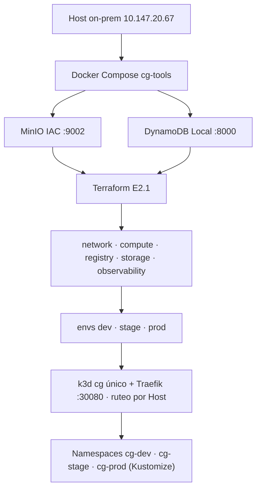
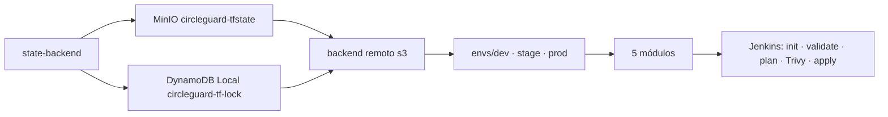
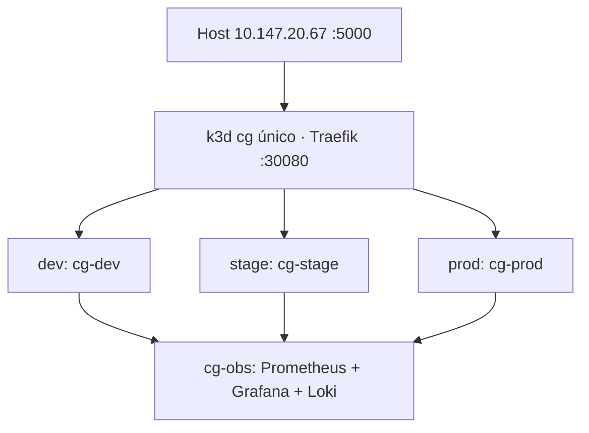
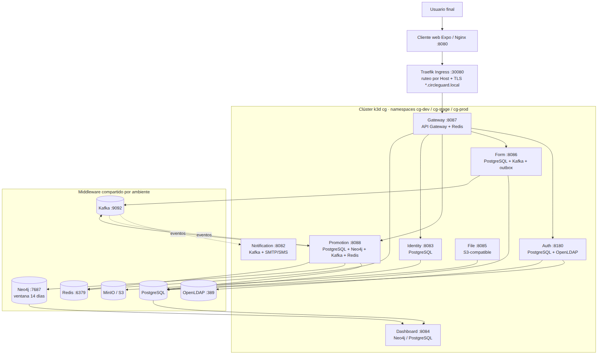
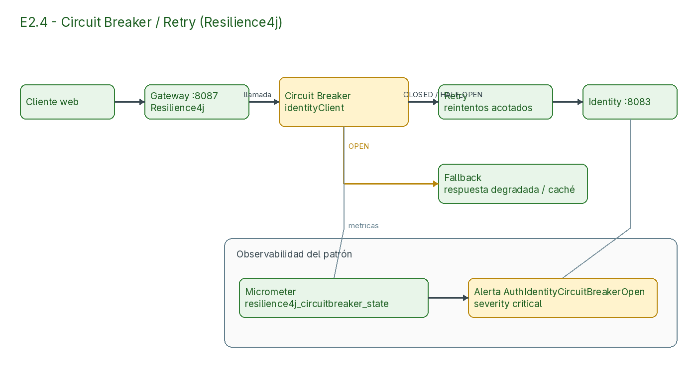
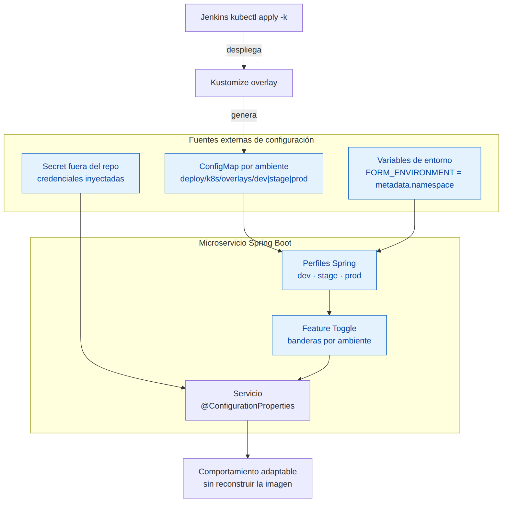
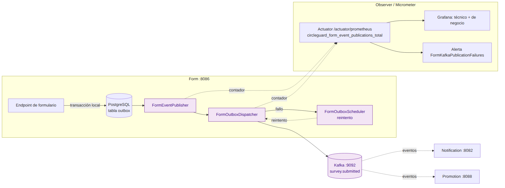

<!-- CG-DOC: Diagramas de infraestructura (Parte 2, E2.1). -->
# Diagramas de infraestructura (Parte 2, E2.1)

Los diagramas describen la infraestructura declarada con Terraform: módulos
reutilizables, tres ambientes parametrizados y el backend remoto del estado.

## 01 Arquitectura on-prem

Fuente: [`01-arquitectura-onprem.mmd`](01-arquitectura-onprem.mmd).

## 02 Flujo de Terraform

Fuente: [`02-flujo-terraform.mmd`](02-flujo-terraform.mmd).

## 03 Red y ambientes

Fuente: [`03-red-y-ambientes.mmd`](03-red-y-ambientes.mmd). Las claves de estado
son `platform/<env>/terraform.tfstate` y se configuran desde
`infra/terraform/envs/<env>/backend.hcl.example`.

## 04 Arquitectura general de servicios (Parte 2)

Vista general del sistema on-premise: cliente web → Traefik con TLS → API Gateway →
los ocho microservicios en los namespaces `cg-dev`/`cg-stage`/`cg-prod` y el
middleware (PostgreSQL, OpenLDAP, Kafka, Redis, Neo4j y MinIO/S3). Coherente con
`docs/arquitectura/ARQUITECTURA.md` y `deploy/k8s/base/apps.yml`.

Fuente: [`04-arquitectura-servicios.mmd`](04-arquitectura-servicios.mmd).

## 05 Circuit Breaker / Retry / Bulkhead — resiliencia (E2.4)

Circuit Breaker, Retry y Bulkhead con Resilience4j en gateway/identity, con
fallback y alerta crítica asociada. Evidencia y *compromisos* en
[`docs/patrones/PATRONES.md`](../patrones/PATRONES.md).

Fuente: [`05-circuit-breaker-retry-bulkhead.mmd`](05-circuit-breaker-retry-bulkhead.mmd).

## 06 Patrón de configuración (E2.4)

External Configuration y Feature Toggle mediante perfiles Spring, ConfigMaps por
ambiente y variables inyectadas desde Kustomize.

Fuente: [`06-patron-configuracion.mmd`](06-patron-configuracion.mmd).

## 07 Patrón adicional (E2.4)

Observer/Micrometer sobre arquitectura dirigida por eventos con outbox en
`form-service` (`FormEventPublisher` / `FormOutboxDispatcher` /
`FormOutboxScheduler`) y sus métricas en Actuator.

Fuente: [`07-patron-adicional.mmd`](07-patron-adicional.mmd).

> Las imágenes PNG se generaron desde los archivos `.mmd` con Mermaid CLI, que se
> conservan como fuente editable. Ningún nombre incluye fechas.
