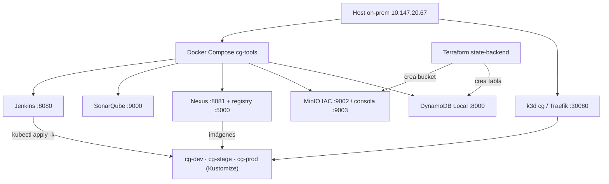
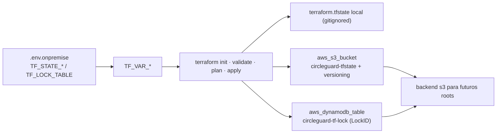
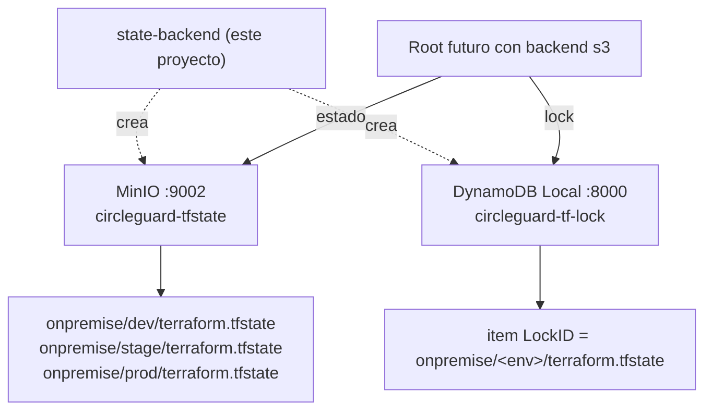

# Infrastructure diagrams

Terraform cubre únicamente el backend de estado (bucket S3 + tabla de lock). El despliegue de
aplicaciones sigue siendo Kustomize sobre el clúster k3d `cg`.

## 01 On-prem architecture

Fuente: [`01-arquitectura-onprem.mmd`](01-arquitectura-onprem.mmd).

## 02 Terraform flow

Fuente: [`02-flujo-terraform.mmd`](02-flujo-terraform.mmd).

## 03 Backend and endpoints

Fuente: [`03-backend-y-endpoints.mmd`](03-backend-y-endpoints.mmd). La plantilla de configuración
para esos roots es `infra/terraform/state-backend/backend.hcl.example`.
