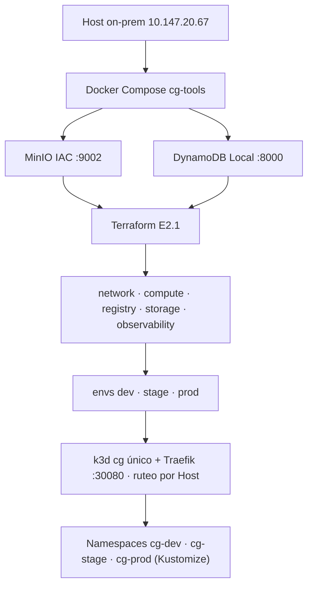
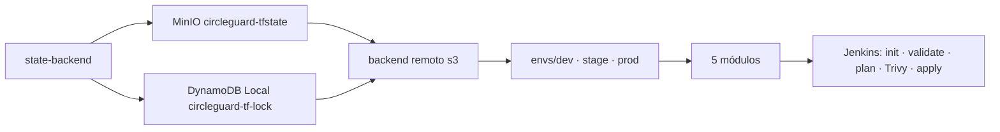
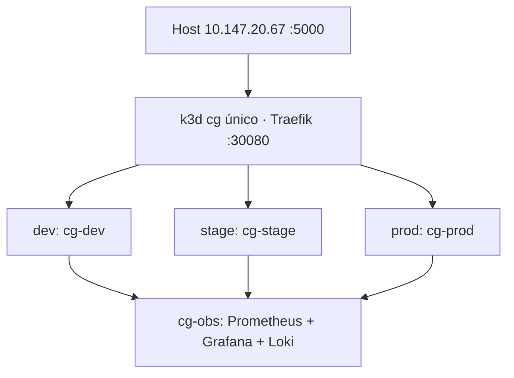

# Infrastructure diagrams (Parte 2, E2.1)

Los diagramas describen la infraestructura declarada con Terraform: módulos
reutilizables, tres ambientes parametrizados y el backend remoto del estado.

## 01 On-prem architecture

Fuente: [`01-arquitectura-onprem.mmd`](01-arquitectura-onprem.mmd).

## 02 Terraform flow

Fuente: [`02-flujo-terraform.mmd`](02-flujo-terraform.mmd).

## 03 Red y ambientes

Fuente: [`03-red-y-ambientes.mmd`](03-red-y-ambientes.mmd). Las claves de estado
son `platform/<env>/terraform.tfstate` y se configuran desde
`infra/terraform/envs/<env>/backend.hcl.example`.
