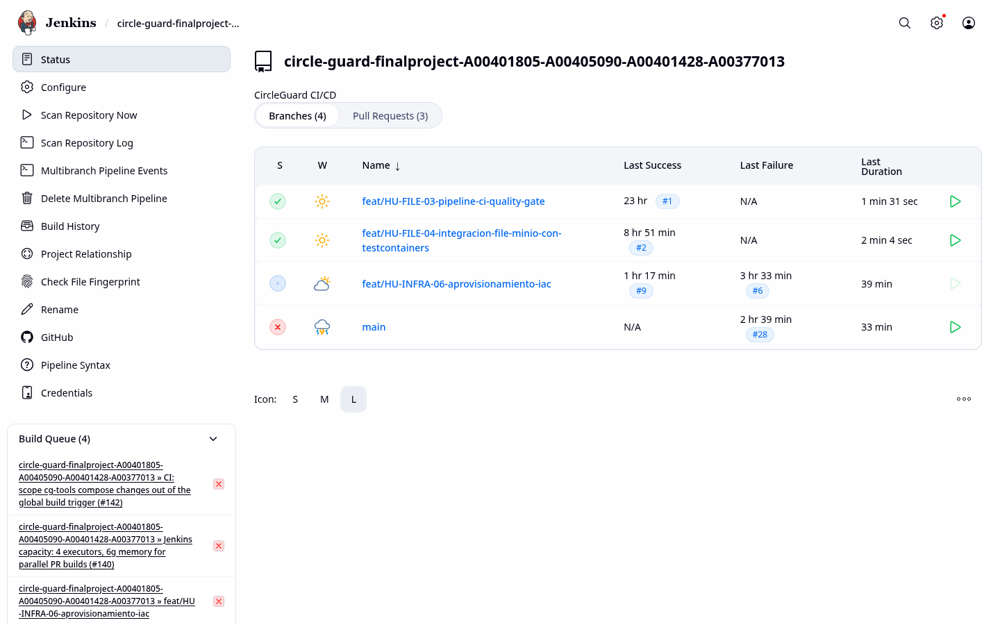
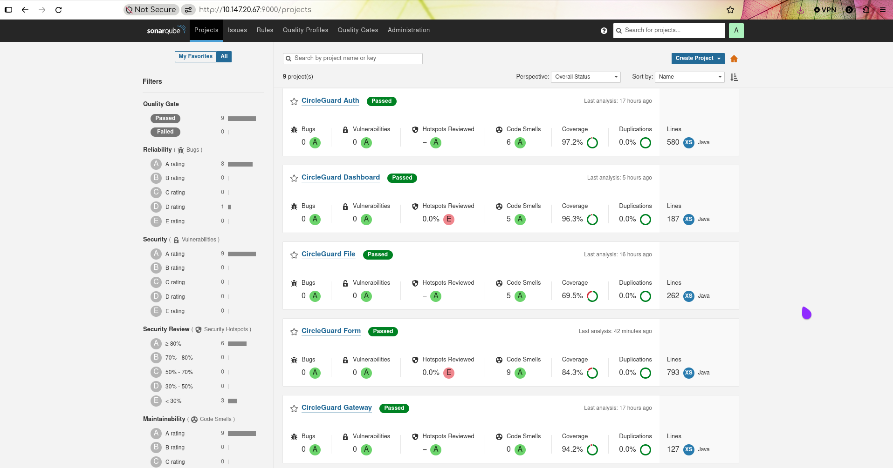
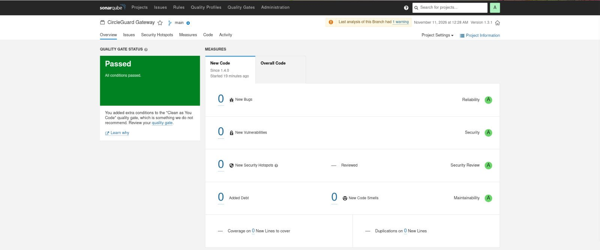
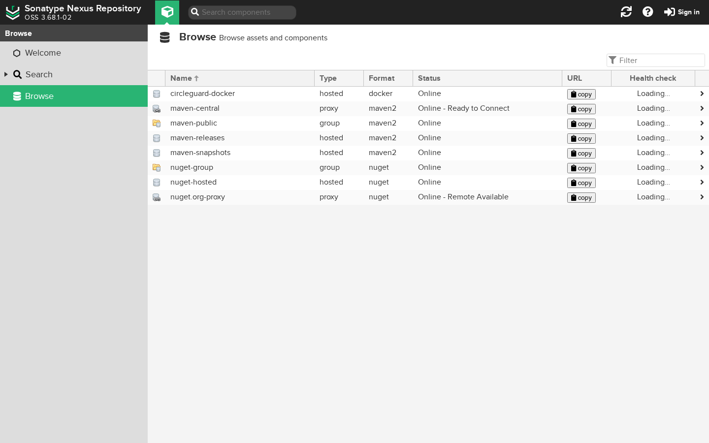
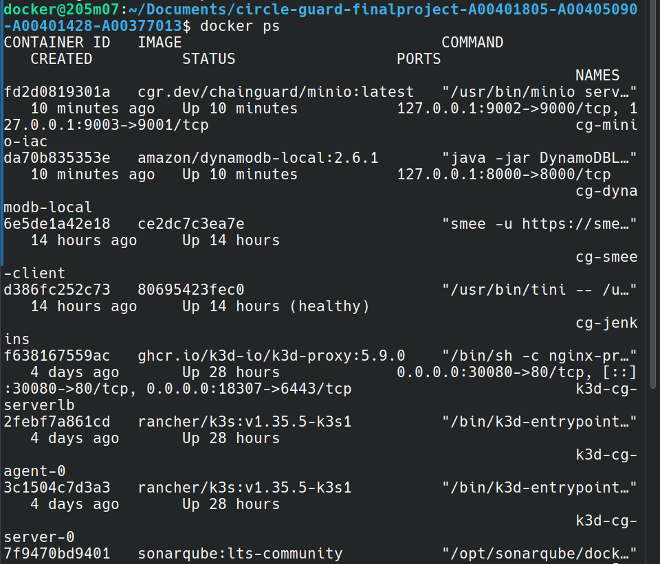
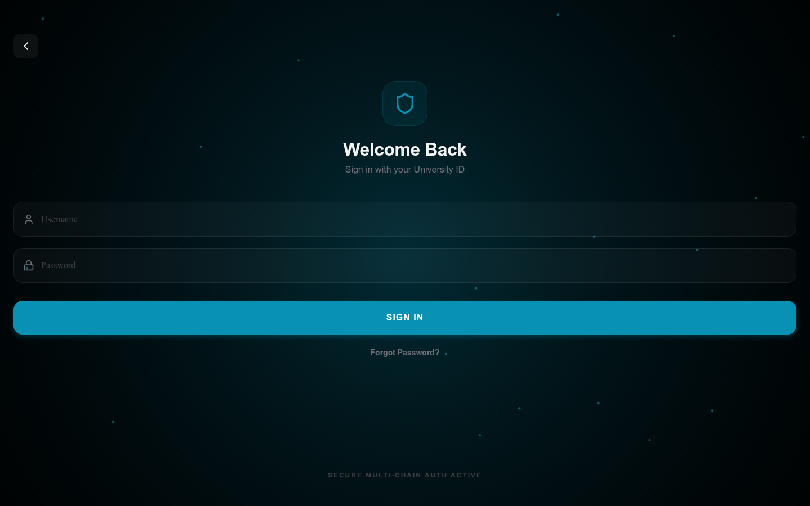
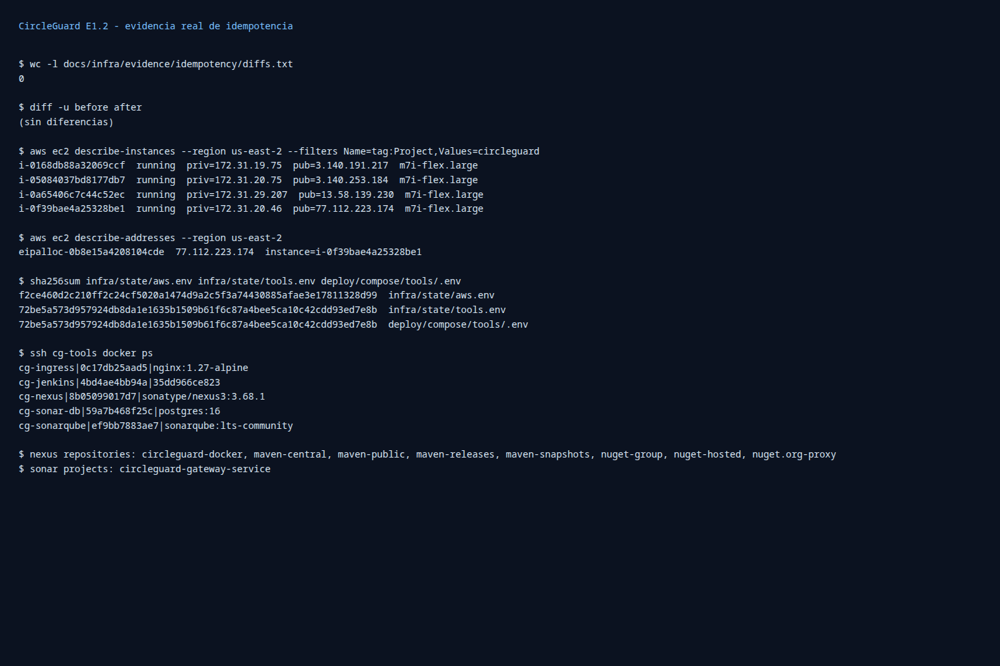
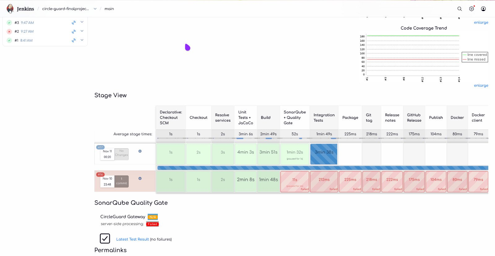

<!-- CG-DOC: E1.2 infrastructure report with AWS, CI/CD, idempotency, cost, and evidence. -->
# E1.2 - CircleGuard Cloud Infrastructure

> **Parte 1 (histórico).** The four-host AWS topology described here is frozen as historical evidence. The current platform is on-premise (`cg-tools` Compose + k3d `cg`); see [`../infra/migracion-onpremise.md`](../infra/migracion-onpremise.md) and [`../arquitectura/ARQUITECTURA.md`](../arquitectura/ARQUITECTURA.md).

## 1. Objective

Provision Jenkins, SonarQube, Nexus, and three isolated gateway environments using idempotent Bash scripts and Docker Compose.

## 2. Architecture

- Region: `us-east-2`.
- Four `m7i-flex.large` instances with Ubuntu 24.04.
- `cg-tools`: Jenkins, SonarQube, Nexus, private registry, and ingress.
- `cg-dev`, `cg-stage`, `cg-prod`: isolated gateway environments.
- One Elastic IP for tools.
- Private IPs for pipeline deployment.
- Ephemeral public IPs for screenshots.

Instance sizing and free-tier validation are recorded in [`../infra/aws-free-tier-validation.md`](../infra/aws-free-tier-validation.md) and [`../infra/environments.md`](../infra/environments.md); no AWS console capture is retained in the repository.

## 3. Security groups

- Jenkins `8080` public with authentication.
- SonarQube `9000` and Nexus `8081` restricted to teacher/admin.
- Application ingress `80/443` public.
- Registry `5000` and middleware private.

Port exposure and ingress rules are recorded in [`../infra/environments.md`](../infra/environments.md) and [`../infra/ci-cd-setup.md`](../infra/ci-cd-setup.md).

## 4. Tools

### Jenkins



### SonarQube





### Nexus



## 5. Environments



The `stage` and `prod` environments are documented in [`../infra/environments.md`](../infra/environments.md) and the on-premise namespaces in [`../infra/migracion-onpremise.md`](../infra/migracion-onpremise.md).

## 6. Application



## 7. Idempotency

A second bootstrap execution must not create or change AWS resources, secrets, or containers.



The comparison log and the `diff_lines=0` records are in [`../infra/evidencia/idempotency/IDEMPOTENCIA.md`](../infra/evidencia/idempotency/IDEMPOTENCIA.md).

## 8. Pipeline



## 9. Cost

```text
4 × m7i-flex.large × 180 h = 69.12 USD
EBS 130 GB proportional     =  2.56 USD
4 IPv4 × 180 h              =  3.60 USD
Total                       = 75.28 USD
```

The maintained breakdown and spot policy are in [`../costos/README.md`](../costos/README.md) and [`../costos/spot-policy.md`](../costos/spot-policy.md); no cost-console capture is retained.

## 10. Reproduction

```bash
export AWS_REGION=us-east-2
export ADMIN_CIDR="$(curl -s https://checkip.amazonaws.com)/32"
export TEACHER_CIDR=...
./infra/bootstrap/bootstrap-check.sh
./infra/bootstrap/bootstrap-all.sh
```

## 11. AI usage

See [`../../IAG_REGISTRO.md`](../../IAG_REGISTRO.md).

## 12. Evidence notes

Screenshots are stored under `docs/informe/evidencia/` (trazabilidad, github, jira) plus `docs/infra/evidencia/iac.png`. No passwords, tokens, or private keys are included.
