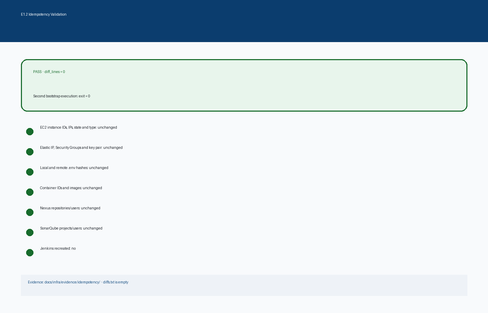

<!-- CG-DOC: Evidence report for idempotent CircleGuard infrastructure bootstrap. -->
# E1.2 - Informe de idempotencia

**Proyecto:** CircleGuard
**Rama de prueba:** `test/HU-INFRA-01-idempotencia`
**Rama del PR:** `feat/HU-GATEWAY-01-configurar-servidores`
**Región:** `us-east-2`
**Fecha:** 8 de noviembre de 2026

## 1. Objetivo

Demostrar que `./infra/bootstrap/bootstrap-all.sh` converge al mismo estado al ejecutarse dos veces, sin duplicar recursos AWS, rotar secretos, recrear contenedores ni duplicar usuarios o proyectos en Nexus y SonarQube.

## 2. Resultado

```text
Segunda ejecución: exit=0
Diferencia antes/después: 0 líneas
```

El archivo `diffs.txt` quedó vacío.



## 3. Invariantes verificados

| Elemento | Resultado |
|---|---|
| IDs de EC2 | Sin cambios |
| IPs privadas y públicas | Sin cambios |
| Elastic IP | Sin cambios |
| Security Groups y reglas | Sin cambios |
| Key pair | Sin cambios |
| Hash de `.env` local y remoto | Sin cambios |
| IDs e imágenes de contenedores | Sin cambios |
| Repositorios y usuarios Nexus | Sin cambios |
| Proyectos y usuarios SonarQube | Sin cambios |
| Jenkins recreado | No |

## 4. Evidencia

```text
docs/infra/evidence/idempotency/
├── README.md
├── diffs.txt
├── files.before
├── files.after
├── remote-env.before
├── remote-env.after
├── instances.before.json
├── instances.after.json
├── eips.before.json
├── eips.after.json
├── sgs.before.json
├── sgs.after.json
├── keys.before.json
├── keys.after.json
├── tools.containers.before.txt
├── tools.containers.after.txt
├── dev.containers.before.txt
├── dev.containers.after.txt
├── stage.containers.before.txt
├── stage.containers.after.txt
├── prod.containers.before.txt
├── prod.containers.after.txt
├── nexus-repos.before.json
├── nexus-repos.after.json
├── nexus-users.before.json
├── nexus-users.after.json
├── sonar-projects.before.json
├── sonar-projects.after.json
├── sonar-users.before.json
├── sonar-users.after.json
├── bootstrap-final-run.log
└── migration-run.log
```

## 5. Bugs encontrados y corregidos

### 5.1 El `.env` remoto no se copiaba completo al local

`bootstrap-all.sh` copiaba el `.env` remoto solo a `infra/state/tools.env`, no a `deploy/compose/tools/.env`. Eso hacía que el `SONAR_TOKEN` y las contraseñas del profesor se regeneraran en cada corrida.

Corrección:

- copiar `infra/state/tools.env` a `deploy/compose/tools/.env`;
- agregar `PROFESSOR_SONAR_PASSWORD` y `PROFESSOR_NEXUS_PASSWORD` al `.env` local.

### 5.2 Jenkins se reconstruía en cada corrida

`compose_up` usaba `--build` siempre. Aunque el contenedor no se recreaba, la etiqueta de imagen apuntaba a una imagen nueva y el contenedor quedaba en una imagen vieja.

Corrección:

- construir solo si la imagen `circleguard-tools-jenkins` no existe;
- ejecutar `compose up` sin `--build` cuando la imagen ya existe.

## 6. Cómo se validó

1. Verificar que PR-15 no estuviera construyendo.
2. Crear `test/HU-INFRA-01-idempotencia` desde el HEAD actual.
3. Capturar hashes de `.env`, recursos AWS, contenedores, Nexus y SonarQube.
4. Ejecutar `./infra/bootstrap/bootstrap-all.sh`.
5. Capturar el estado después.
6. Comparar con `diff`.
7. Confirmar `diffs.txt` vacío.
8. Commitear la evidencia en la rama de prueba.
9. Aplicar el fix al PR-15.

## 7. Conclusión

El bootstrap es idempotente para el alcance de E1.2. La segunda ejecución no cambió recursos, secretos, contenedores, repositorios ni usuarios. La evidencia queda separada en la rama de prueba y el fix de idempotencia está en el PR.
