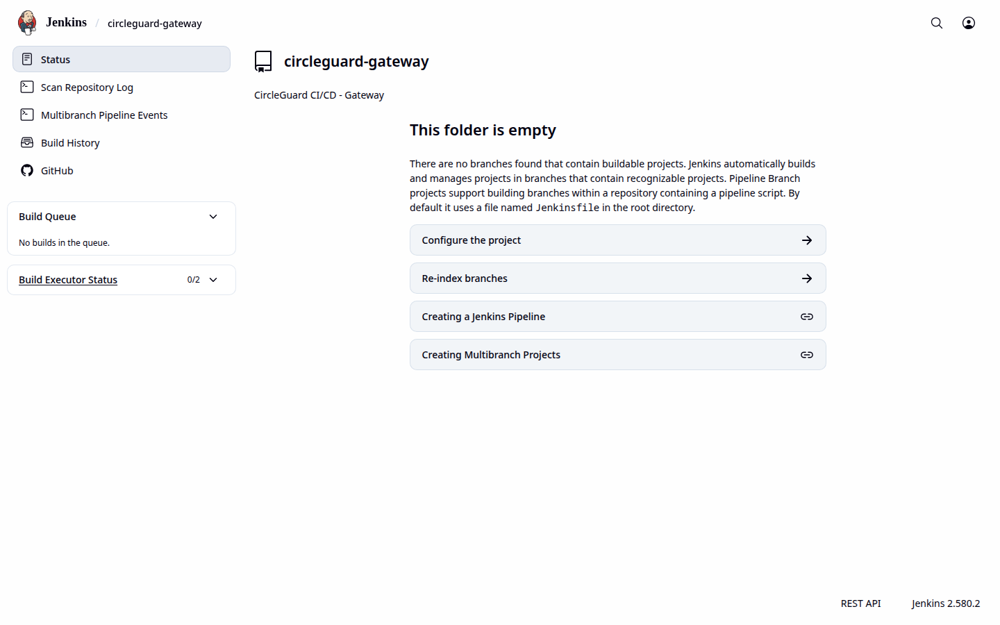
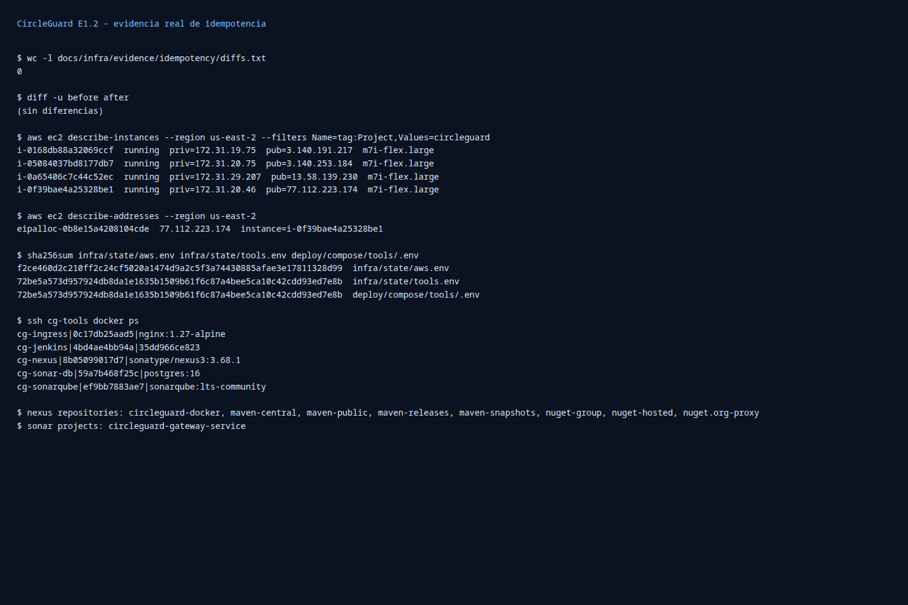
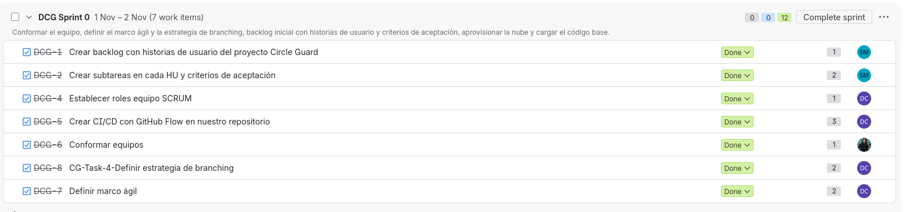
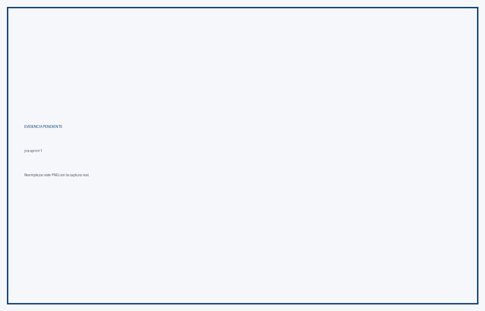
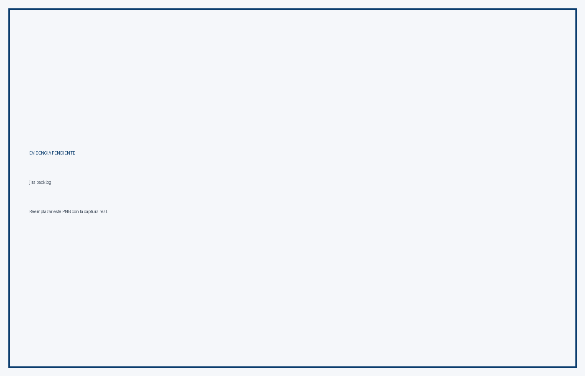
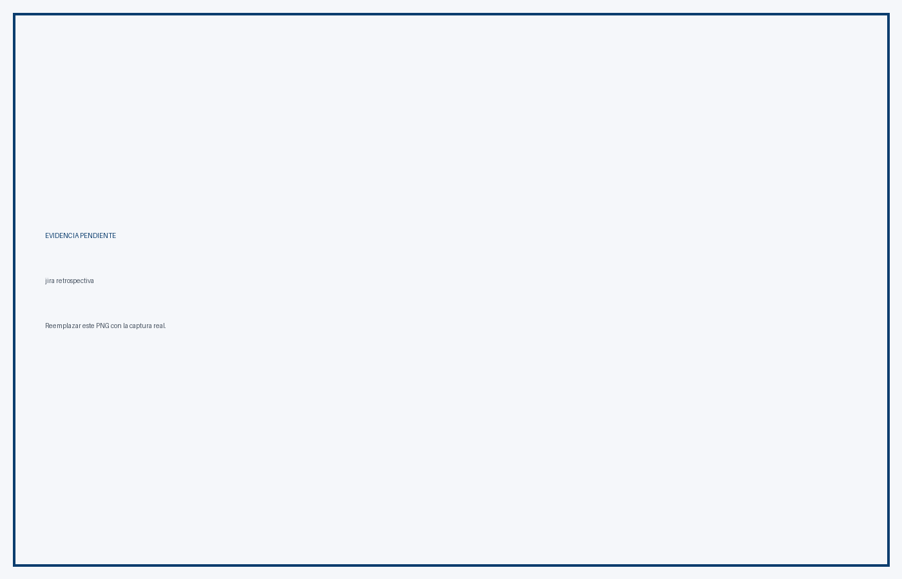

# CircleGuard — Informe Final de la Parte 1

**Versión evaluada:** `1.2.5`  
**Fecha de cierre:** 10 de noviembre de 2026  
**Equipo:** Daniela Castaño, Santiago Estrada, Faiber Piedrahita, Alejandro Quiñones  
**Repositorio:** `ingesoft5/circle-guard-finalproject-A00401805-A00405090-A00401428-A00377013`  
**Rama de entrega:** `main`  
**Entregable oficial:** este documento PDF (`E1.2-Informe-Final.pdf`)

---

## 1. Resumen ejecutivo

La Parte 1 de CircleGuard queda cerrada sobre la infraestructura AWS existente. La rama `main` está desplegada con la versión **1.2.5** y el pipeline multibranch de Jenkins ejecutó la cadena completa:

```text
Build → Publish a Nexus → Docker → Docker client → Deploy dev → E2E → Deploy stage → Approval prod → Deploy prod
```

El build **main #8** terminó en **SUCCESS** con tag `1.2.5`. Los dieciséis escenarios E2E pasaron, los tres ambientes quedaron aislados y saludables y el rollback se demostró con el build **#10**, que desplegó `1.2.0` en producción y luego fue restaurado a `1.2.5`.

| Criterio | Peso | Estado | Evidencia principal |
|---|---:|---|---|
| P1.1 Gestión ágil y branching | 2,0 % | Cumplido | Sprint 0 review, PR #42, ruleset 26333547, tag ruleset 26987068 |
| P1.2 Nube y automatización Bash | 2,0 % | Cumplido | 4 EC2, 3 ambientes aislados, scripts `infra/bootstrap-*` |
| P1.3 Empaquetamiento inmutable | 2,5 % | Cumplido | 9 imágenes `1.2.5`, Dockerfiles multi-stage, usuario no root, healthchecks |
| P1.4 Pipeline CI Jenkins | 2,5 % | Cumplido | Multibranch, webhook, Shared Library, SonarQube gate, build selectivo |
| P1.5 Entrega continua y promoción | 2,5 % | Cumplido | main #8, E2E 16/16, stage, aprobación, prod y rollback #10 |
| P1.6 Pruebas automatizadas | 3,5 % | Cumplido | Cobertura ≥60 % en los 5 núcleos, 3 integraciones y 16 E2E |
| P1.7 Change management y release notes | 1,5 % | Cumplido | `v1.1.1`, `v1.2.0`, `v1.2.5`, CHANGELOG y plantilla de cambios |
| P1.8 Documentación, video e IAG | 1,0 % | Cumplido | README, diagramas, IAG y este PDF; sustentación oral en lugar de video |

**Resultado técnico:** la plataforma, el pipeline y la promoción están operativos. El cierre documental queda cubierto por este PDF, las cinco capturas de Jira ya incorporadas y la bitácora de IAG. La demostración se realiza en la sustentación oral del equipo; no aplica video.

---

## 2. Infraestructura AWS

La cuenta operativa es `556880009270`, región `us-east-2`. Se mantienen cuatro instancias `m7i-flex.large` con Docker y Docker Compose.

| Host | Instance ID | IP privada | IP pública | Función |
|---|---|---|---|---|
| `cg-tools` | `i-014c4de36bf7ff9ca` | `172.31.20.5` | `3.131.150.169` | Jenkins, SonarQube, Nexus y registry |
| `cg-dev` | `i-021e09467c8902957` | `172.31.30.130` | `3.141.16.138` | Ambiente de desarrollo |
| `cg-stage` | `i-0fe3fb08585c690b1` | `172.31.23.240` | `18.220.99.102` | Ambiente de staging |
| `cg-prod` | `i-041a3a3e4b1ea2d3c` | `172.31.21.137` | `3.19.69.181` | Producción |

Security Groups:

- `circleguard-tools-sg`: `sg-0de205d35d465d041`.
- `circleguard-envs-sg`: `sg-04045455edcc6a0d3`.
- Key pair: `circleguard-e12-key`.
- Registry interno: `172.31.20.5:5000`.

Los tres ambientes usan redes Docker aisladas y volúmenes propios. El aprovisionamiento es idempotente mediante `infra/bootstrap/bootstrap-all.sh`, `bootstrap-tools.sh`, `bootstrap-envs.sh`, `bootstrap-github.sh` y `bootstrap-check.sh`.

---

## 3. Servicios y URLs

| Servicio | URL / endpoint | Estado |
|---|---|---|
| Jenkins | `http://3.131.150.169:8080/` | Healthy, build #8 y #10 exitosos |
| SonarQube | `http://3.131.150.169:9000/` | Healthy, quality gate bloqueante |
| Nexus | `http://3.131.150.169:8081/` | Healthy, images y Maven |
| Registry | `172.31.20.5:5000` | Imágenes `1.2.5` publicadas |
| Ingress | `http://3.131.150.169/` | Enruta a la web de dev |
| Web dev | `http://172.31.30.130:8081` | Healthy |
| Gateway dev | `http://172.31.30.130:8087` | Healthy |
| Web stage | `http://172.31.23.240:8081` | Healthy |
| Web prod | `http://172.31.21.137:8081` | Healthy |

Los puertos administrativos (`22`, `8080`, `8081`, `9000`) están restringidos a la IP de trabajo `<IP-DE-TRABAJO>/32`. El puerto `80` del ingress es el único expuesto públicamente. Nexus publica `5000` hacia los Security Groups de los ambientes y los healthchecks de E2E usan `8081` y `29092` desde tools.

---

## 4. Pipeline CI/CD

El job multibranch es:

```text
circle-guard-finalproject-A00401805-A00405090-A00401428-A00377013
```

La biblioteca compartida se carga con `@Library('circleguard@main')` y vive en `jenkins/vars/` (`ci.groovy`, `ciNotify.groovy`, `ciServices.groovy`, `ciVersion.groovy`).

Etapas del pipeline:

1. Checkout.
2. Resolve services (ejecución selectiva por servicio modificado o todos).
3. Build.
4. Unit Tests + JaCoCo.
5. SonarQube + Quality Gate bloqueante.
6. Integration Tests.
7. Package.
8. Git tag y release notes.
9. GitHub Release.
10. Publish a Nexus.
11. Docker y Docker client.
12. Deploy dev.
13. E2E Playwright.
14. Deploy stage.
15. Approval prod (input manual).
16. Deploy prod.
17. Rollback prod (`ROLLBACK_TAG`).

Evidencia principal:

- Build **main #8**: `http://3.131.150.169:8080/job/circle-guard-finalproject-A00401805-A00405090-A00401428-A00377013/job/main/8/`
- Build **main #10 (rollback)**: `http://3.131.150.169:8080/job/circle-guard-finalproject-A00401805-A00405090-A00401428-A00377013/job/main/10/`

---

## 5. Entrega continua y promoción

### 5.1 Flujo exitoso

El build **main #8** ejecutó la promoción completa:

- Deploy automático a `dev`.
- E2E contra dev: **16/16 tests passed**.
- Deploy automático a `stage` después de E2E.
- Pausa de aprobación manual para `prod`.
- Deploy a `prod` con tag `1.2.5`.
- Verificación de salud de los once contenedores de producción.

Servicios de producción verificados:

- `cg-auth-prod`, `cg-form-prod`, `cg-gateway-prod`, `cg-identity-prod`, `cg-promotion-prod` y `cg-web-prod` con imágenes `172.31.20.5:5000/circleguard-docker/*:1.2.5`.
- `cg-kafka-prod`, `cg-neo4j-prod`, `cg-openldap-prod`, `cg-postgres-prod` y `cg-redis-prod` healthy.
- Health `200` en `8087` (gateway), `8180` (auth), `8083` (identity), `8088` (promotion), `8086` (form) y `8081` (web).

### 5.2 Rollback demostrado

El build **main #10** se ejecutó con `ROLLBACK_TAG=1.2.0`:

- Desplegó prod con las seis imágenes core en `1.2.0`.
- Se verificaron health `200` en los seis servicios.
- Luego se ejecutó `deploy.sh prod 1.2.5` y prod volvió a `1.2.5`.
- Resultado final: prod healthy en `1.2.5`.

---

## 6. Pruebas y cobertura

### 6.1 Cobertura por servicio

| Servicio | Cobertura de líneas | Líneas cubiertas |
|---|---:|---:|
| auth | **97,98 %** | 194 / 198 |
| form | **86,43 %** | 121 / 140 |
| gateway | **100,00 %** | 49 / 49 |
| identity | **94,62 %** | 88 / 93 |
| promotion | **74,03 %** | 630 / 851 |

Cobertura agregada de los cinco servicios núcleo: **81,29 %** de líneas (1082 / 1331). El reporte global de JaCoCo del pipeline (#8) fue **88,37 %** de líneas, **96,62 %** de clases y **70,81 %** de métodos sobre el conjunto completo de módulos; no es comparable con la suma de los cinco núcleos.

### 6.2 Integraciones relevantes

1. **form → Kafka → promotion**: formulario de salud publicado en Kafka y consumido por promotion.
2. **gateway → Redis**: validación de acceso y almacenamiento de estado en Redis.
3. **auth → PostgreSQL**: persistencia y autenticación contra la base de datos.

### 6.3 E2E Playwright

La suite ejecutada en dev contiene 16 pruebas:

- `login.spec.ts`: 2.
- `health-form.spec.ts`: 2.
- `access-validation.spec.ts`: 9.
- `promotion-flow.spec.ts`: 3.

Resultado del pipeline: **16/16 passed**, con un worker y Chromium headless.

---

## 7. Gobernanza, change management y release notes

### 7.1 Protección de `main`

Ruleset de rama **26333547** (`github-actions`):

- 1 aprobación obligatoria.
- Descartar aprobaciones antiguas al hacer push.
- Aprobación del último push.
- Resolución obligatoria de conversaciones.
- Check obligatorio `continuous-integration/jenkins/pr-merge`.
- Política estricta de checks.
- Merge permitido por merge, squash o rebase.

Ruleset de tags **26987068** (`protect-release-tags`):

- Target `tag`.
- Patrón `refs/tags/v*`.
- Reglas `deletion` y `non_fast_forward`.

### 7.2 Sprint 0 y revisión por pares

- `docs/agil/sprint-0/review.md` contiene el acta del Sprint 0: 7/7 ítems, 12/12 puntos, demostración, métricas, decisiones y acciones.
- Acta completa: `docs/informe/Sprint-Review-Sprint-0.docx`.
- PR **#42** fusionado con el review, las release notes y el CHANGELOG.

### 7.3 Release notes y tags

Tags publicados: `v1.0.0`, `v1.0.1`, `v1.1.0`, `v1.1.1`, `v1.2.0`, `v1.2.1`, `v1.2.2`, `v1.2.3`, `v1.2.4`, `v1.2.5`, `v1.2.6`, `v1.2.7`.

`v1.2.6` es un tag documental sobre `ee17b5c` (merge de #42); las imágenes desplegadas siguen siendo `1.2.5`.

`v1.2.7` es el release más reciente en GitHub y también es documental. Las imágenes desplegadas en los tres ambientes siguen siendo `1.2.5`.

Notas de release:

- `docs/release-notes/v1.1.1.md`.
- `docs/release-notes/v1.2.0.md`.
- `docs/release-notes/v1.2.5.md`.
- `CHANGELOG.md` actualizado con las secciones `[1.2.5]`, `[1.2.0]` y `[1.1.1]`.

La plantilla de solicitud de cambio y la política de aprobación están en `docs/change-management.md`.

---

## 8. Seguridad

- Contenedores de servicios construidos con usuario no root; el cliente web usa `nginx-unprivileged` (`101:101`).
- Gateway, servicios core y middleware con `HEALTHCHECK` en los compose de dev, stage y prod.
- Jenkins con autenticación y autorización; SonarQube y Nexus con credenciales administrativas.
- Secrets fuera del repositorio: `infra/state/tools.env` está ignorado por Git.
- Puertos administrativos restringidos a `<IP-DE-TRABAJO>/32`; solo el ingress `80` es público.
- Tags `v*` protegidos contra borrado y force-push.
- El webhook anterior fue eliminado; solo queda el de `3.131.150.169`.

---

## 9. Costos

Las cuatro instancias `m7i-flex.large` se mantuvieron encendidas durante la ventana de ejecución. La estimación es de aproximadamente **USD 75,28 por 180 horas** para el conjunto, más almacenamiento EBS. Para la entrega se recomienda mantenerlas encendidas hasta la demostración y apagarlas después.

---

## 10. Problemas resueltos

| Problema | Causa | Solución |
|---|---|---|
| Nexus respondía HTTP 500 al publicar | Disco de tools al 90 %; OrientDB en read-only | Volumen EBS de 40 a 60 GB, `growpart` y `resize2fs`; 24 GB libres |
| `cg-openldap` no pasaba el healthcheck | `ldapsearch` anónimo devolvía `No such object` | Bind autenticado con el admin de LDAP |
| E2E fallaba en dev | Faltaban `AUTH_URL` e `IDENTITY_URL`; gateway se consultaba en la web | Variables en `Jenkinsfile` y `GATEWAY_URL` en el spec |
| Login E2E ambiguo | `getByText('SIGN IN')` coincidía con dos textos | Locator exacto |
| Segundo test de login esperaba diálogo | `Alert.alert` no genera diálogo en React Native Web | Validación de permanencia en `/login` |
| Push de imagen con digest mismatch | Nexus sin espacio durante el push | Limpieza, ampliación de disco y reintento |

---

## 11. Evidencias

### 11.1 URLs verificables

- Repositorio: `https://github.com/ingesoft5/circle-guard-finalproject-A00401805-A00405090-A00401428-A00377013`
- PR #42: `https://github.com/ingesoft5/circle-guard-finalproject-A00401805-A00405090-A00401428-A00377013/pull/42`
- Jenkins main #8: `http://3.131.150.169:8080/job/circle-guard-finalproject-A00401805-A00405090-A00401428-A00377013/job/main/8/`
- Jenkins main #10: `http://3.131.150.169:8080/job/circle-guard-finalproject-A00401805-A00405090-A00401428-A00377013/job/main/10/`
- SonarQube: `http://3.131.150.169:9000/`
- Nexus: `http://3.131.150.169:8081/`

### 11.2 Capturas del flujo



*Jenkins: acceso administrativo y ejecución del pipeline.*


*SonarQube: quality gate bloqueante.*


*Nexus: repositorios Maven y Docker.*


*JaCoCo: reporte de cobertura del gateway.*



*Bootstrap: ejecución idempotente de los scripts de infraestructura.*

### 11.2.1 Evidencias del tablero Jira



*Jira DCG: revisión del Sprint 0.*



*Jira DCG: revisión del Sprint 1.*



*Jira DCG: backlog priorizado.*


*Jira DCG: historias y criterios de aceptación.*



*Jira DCG: retrospectiva del equipo.*

### 11.3 Matriz de evidencias por criterio

| Criterio | Evidencia |
|---|---|
| P1.1 | Sprint 0 review, PR #42, ruleset 26333547, tag ruleset 26987068, capturas de Jira |
| P1.2 | Cuatro EC2, tres ambientes aislados, scripts `infra/bootstrap-*`, captura de idempotencia |
| P1.3 | Nueve imágenes `1.2.5`, Dockerfiles multi-stage, usuario no root, healthchecks |
| P1.4 | Jenkins multibranch, webhook, Shared Library, Sonar gate, build selectivo |
| P1.5 | main #8, E2E 16/16, stage, aprobación, prod healthy, rollback #10 |
| P1.6 | Tabla de cobertura, tres integraciones, 16 E2E, reportes JaCoCo |
| P1.7 | Release notes 1.1.1/1.2.0/1.2.5, CHANGELOG, tags y tag documental 1.2.6 |
| P1.8 | README, diagramas, `IAG_REGISTRO.md`, este PDF, capturas de Jira y sustentación oral |

---

## 12. Actividades de cierre

La plataforma y el pipeline están operativos y la evidencia documental está completa en este PDF. Las actividades restantes son de entrega y sustentación, no de infraestructura:

1. Sustentar oralmente la arquitectura, el pipeline y la promoción ante el docente. La demostración se hace en vivo; no se publica video.
2. Entregar este PDF regenerado junto con el README actualizado.
3. Ejecutar el ensayo final desde un clon limpio como verificación de reproducibilidad.

---

## 13. Uso de IAG

La bitácora completa está en `IAG_REGISTRO.md` (605 líneas), organizada por módulos y responsables:

- auth/identity: Faiber Piedrahita.
- gateway/infraestructura: Daniela Castaño.
- promotion: Alejandro Quiñones.

La bitácora incluye las decisiones, los prompts y la reflexión crítica sobre el uso de asistentes de IA en el desarrollo y la operación del proyecto.

---

## 14. Conclusión

La Parte 1 queda cerrada técnicamente con la release **1.2.5**. El pipeline ejecuta la cadena completa desde `main`, los tres ambientes están aislados, las pruebas E2E pasan, la cobertura supera el 60 % en los cinco servicios núcleo y el rollback está demostrado. La gobernanza de `main` y de los tags quedó configurada con reglas verificables.

El cierre documental se completa con este PDF, el acta del Sprint 0, las release notes y la bitácora de IAG. La demostración se realiza en la sustentación oral; no se publica video. Las capturas reales de Jira están incorporadas en la sección 11.2.1.
