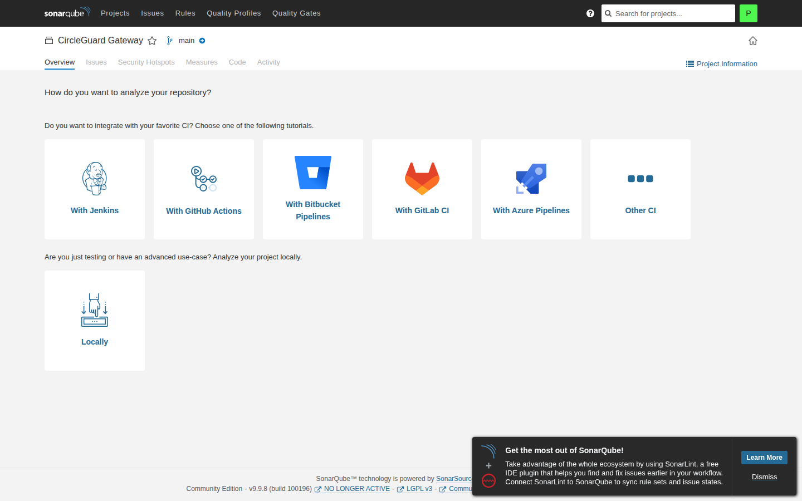
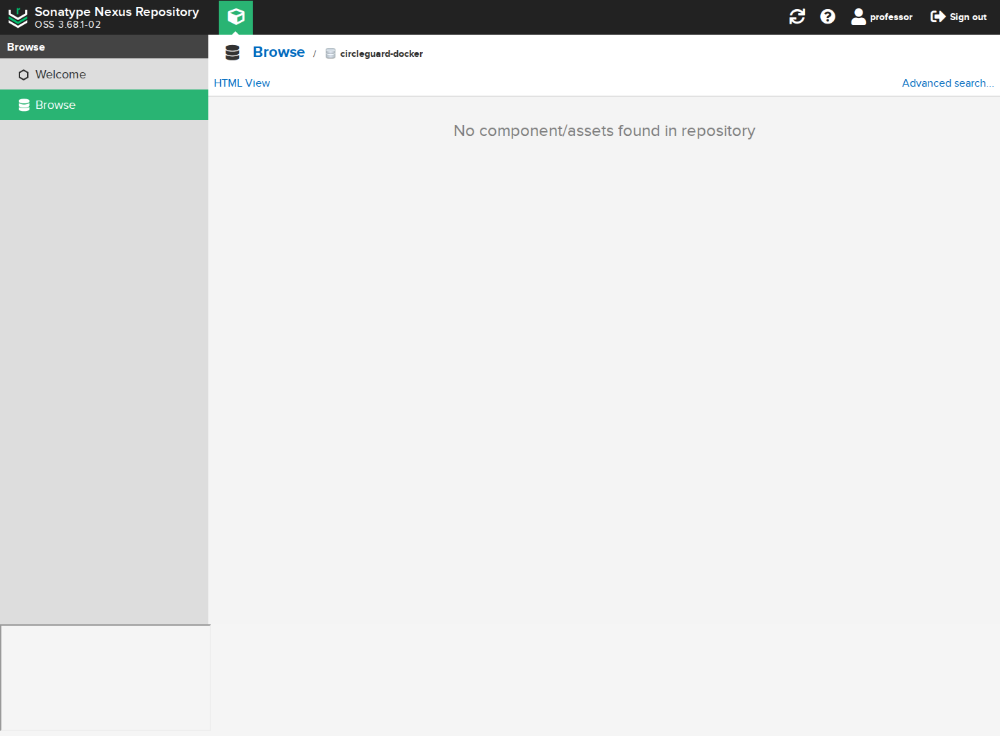

# E1.2 - Informe final de la rama

> **Nota de actualización (9 nov 2026):** este documento conserva la evidencia de la
> primera entrega E1.2 centrada en gateway. La infraestructura y el pipeline full-stack
> de la Parte 1 se documentan en `docs/infra/environments.md`,
> `docs/infra/ci-cd-setup.md` y el PR #38. Las IPs de la tabla son del aprovisionamiento
> inicial y pueden haber cambiado.

**Rama:** `feat/HU-GATEWAY-01-configurar-servidores`
**Región:** `us-east-2`
**Fecha:** 8 de noviembre de 2026
**Alcance:** microservicio gateway, servidores CI/CD y ambientes dev/stage/prod.

## 1. Resumen

Se aprovisionaron cuatro instancias EC2 `m7i-flex.large` con Ubuntu 24.04 en `us-east-2`, una Elastic IP para `cg-tools`, dos Security Groups y una llave SSH nueva. En `cg-tools` quedaron funcionando Jenkins, SonarQube, PostgreSQL, Nexus, el registro privado `5000` y un ingress Nginx.

El gateway tiene pruebas unitarias, integración real con Redis y E2E Playwright. La cobertura de líneas medida es **95.92 %**.

En la captura inicial del 8 de noviembre el job multibranch aún no había escaneado ramas
(**0 ramas**). La corrida posterior del gateway y la integración full-stack se registran
en `evidencia/jenkins-pr15.png`, `docs/infra/ci-cd-setup.md` y el PR #38.

## 2. Infraestructura

| Host | Instancia | IP privada | IP pública | Función |
|---|---|---|---|---|
| cg-tools | i-0f39bae4a25328be1 | 172.31.20.46 | 77.112.223.174 | Jenkins, SonarQube, Nexus, registro, ingress |
| cg-dev | i-0168db88a32069ccf | 172.31.19.75 | 3.141.13.185 | gateway + Redis |
| cg-stage | i-0a65406c7c44c52ec | 172.31.29.207 | 18.222.218.169 | gateway + Redis |
| cg-prod | i-05084037bd8177db7 | 172.31.20.75 | 3.16.131.65 | gateway + Redis |

| Recurso | Valor |
|---|---|
| Security Group tools | sg-0ed6257fcc34b0f5b |
| Security Group ambientes | sg-03ed767c4bbcbf5fe |
| Key pair | circleguard-e12-key |
| PEM | infra/state/circleguard-e12-key.pem |
| Registro Docker | 172.31.20.46:5000 |

## 3. Servicios

| Servicio | URL | Estado |
|---|---|---|
| Jenkins | http://77.112.223.174:8080 | 200 OK |
| SonarQube | http://77.112.223.174:9000 | 200 OK, UP |
| Nexus | http://77.112.223.174:8081 | 200 OK |
| Ingress | http://77.112.223.174/ | 502, gateway pendiente |
| Registro | 172.31.20.46:5000 | privado |

Contenedores en `cg-tools`:

```text
cg-jenkins     healthy
cg-sonarqube   healthy
cg-sonar-db    healthy
cg-nexus       healthy
cg-ingress     running
```

## 4. Evidencias con usuario professor

### Jenkins

Sesión iniciada como `professor`. El job `circleguard-gateway` está creado, pero el folder está vacío porque aún no se ha escaneado la rama.


### SonarQube

Sesión iniciada como `professor`. El proyecto `circleguard-gateway-service` existe; todavía no tiene análisis porque el pipeline no ha corrido.



### Nexus

Sesión iniciada como `professor`. El repositorio `circleguard-docker` existe; todavía no tiene imagen ni JAR porque el pipeline no ha publicado.



## 5. Cobertura y pruebas

```text
Líneas:         95.92 %
Instrucciones:  97.44 %
Ramas:          72.73 %
```

| Prueba | Resultado |
|---|---|
| Unitarias gateway | 16 pruebas, 0 fallos |
| Integración Redis | 3 pruebas, 0 fallos |
| E2E Playwright | 3 pruebas añadidas |

Reporte JaCoCo:

```text
services/circleguard-gateway-service/build/reports/jacoco/test/html/index.html
```

## 6. Commits de la rama

```text
dc353e9 docs ( informe ) : add e1.2 step by step pdf
32500ad docs ( infra ) : add e1.2 operations tutorial
46b367a fix ( infra ) : stabilize sonarqube and jenkins configuration
03e583a test ( gateway ) : add redis integration and e2e coverage
9de989f chore ( git ) : align github flow branch rules
c87f143 refactor ( infra ) : consolidate bootstrap scripts and remove generated files
7bcd41e feat ( infra ) : support four hosts, private registry and ingress
a1fb650 feat ( infra ) : use m7i-flex.xlarge and add cost controls
404428e docs ( git ) : document commit format and scope rules
```

## 7. Problemas resueltos

| Problema | Solución |
|---|---|
| SCP bloqueaba DescribeInstances en us-east-1 | Se trabajó en us-east-2 |
| Security Groups con dependencias cruzadas | Se revocaron reglas y se recrearon |
| SonarQube no iniciaba | `-Xms1g -Xmx1g` en Elasticsearch |
| SonarQube unhealthy | Healthcheck con `wget` |
| Jenkins JCasC fallaba con `fileOnMaster` | `directEntry` con `readFile` |
| Jenkins fallaba con `matrix` | `globalMatrix.entries` |
| Testcontainers no encontraba Docker | `docker-java.properties` con `api.version=1.44` |

## 8. Seguridad

| Puerto | Origen | Servicio |
|---|---|---|
| 22 | admin y SG-tools | SSH |
| 8080 | Internet | Jenkins autenticado |
| 9000 | teacher/admin | SonarQube |
| 8081 | teacher/admin | Nexus |
| 80 | Internet | ingress |
| 5000 | SG-envs | registro privado |
| 8087 | SG-tools | gateway |

`TEACHER_CIDR=0.0.0.0/0` deja SonarQube y Nexus abiertos. Cambiarlo por la IP del profesor cuando esté disponible.

## 9. Costos

```text
4 × m7i-flex.large × 180 h = 69.12 USD
EBS 130 GB proporcional     =  2.56 USD
4 IPv4 × 180 h              =  3.60 USD
Total                       = 75.28 USD
```

## 10. Qué falta

1. Escanear el job multibranch en Jenkins.
2. Ejecutar el pipeline de la rama.
3. Desplegar gateway en dev, stage y aprobar prod.
4. Ejecutar E2E contra dev.
5. Capturar Jenkins, Sonar, Nexus con pipeline y artefactos reales.
6. Repo privado antes del push final.
7. Apagar instancias al terminar.

### Escanear y ejecutar

```bash
source infra/state/aws.env
source infra/state/tools.env

crumb=$(curl -s -c /tmp/jcookies \
  -u "admin:${JENKINS_ADMIN_PASSWORD}" \
  "http://${TOOLS_IP}:8080/crumbIssuer/api/json" | jq -r .crumb)

curl -b /tmp/jcookies \
  -u "admin:${JENKINS_ADMIN_PASSWORD}" \
  -H "Jenkins-Crumb: ${crumb}" \
  -X POST "http://${TOOLS_IP}:8080/job/circleguard-gateway/build?delay=0"
```

### E2E

```bash
cd tests/e2e
npm install
npx playwright install --with-deps chromium
GATEWAY_URL=http://3.141.13.185:8087 npx playwright test
```

### Apagar

```bash
./infra/bootstrap/bootstrap-stop.sh
```

## 11. Credenciales

Están en:

```text
infra/state/tools.env
```

Usuarios:

```text
Jenkins:   admin / profesor
SonarQube: admin / professor
Nexus:     admin / nexus / professor
```

No incluir contraseñas, tokens ni la llave privada en capturas o informes.

## 12. Conclusión

La infraestructura E1.2 está levantada y las herramientas están saludables. El acceso del profesor quedó configurado en Jenkins, SonarQube y Nexus. El gateway supera el 60 % de cobertura y tiene integración real con Redis. Falta ejecutar el pipeline para que las capturas muestren ramas, análisis, artefactos y despliegues reales.
