<!-- CG-DOC: GW-CI-02 report on gateway-Redis integration testing with Testcontainers. -->
# GW-CI-02 — Integración Gateway–Redis con Testcontainers

**Historia de usuario:** GW-CI-02 — Integración Gateway–Redis con Testcontainers  
**Servicio:** `circleguard-gateway-service` (puerto 8087)  
**Entregable relacionado:** E1.6 — Pruebas automatizadas  
**Rama:** `feat/HU-GATEWAY-03-integracion-redis-testcontainers`  
**Pull request:** [#22](https://github.com/ingesoft5/circle-guard-finalproject-A00401805-A00405090-A00401428-A00377013/pull/22)  
**Commits (post-rebase):** `6432bb8`, `747f88d`, `0d0222d`, `8344497`, `a7ad652`  
**Última verificación:** 8 de noviembre de 2026, 18:31–18:32 (post-rebase sobre `main`)

> **Versión DOCX con capturas:** [`GW-CI-02-Validacion-Testcontainers.docx`](GW-CI-02-Validacion-Testcontainers.docx)

---

## 1. Alcance y criterios de aceptación

El objetivo es validar el flujo de validación de QR del gateway contra una instancia **real y efímera de Redis** levantada con Testcontainers, sin mocks, y ejecutarlo como una tarea Gradle independiente dentro del pipeline de Jenkins. La verificación se repitió después de rebasar la rama sobre `main` para confirmar que la integración sigue verde con el código actualizado.

| Criterio de la HU | Cumplimiento | Evidencia |
|---|---|---|
| `@SpringBootTest` + Testcontainers con `redis:7.2` | ✅ | `GatewayRedisIntegrationTest` + `AbstractRedisIntegrationTest`; Redis 7.2.17 |
| Sin mocks de Redis | ✅ | `StringRedisTemplate` conectado al contenedor real |
| Casos ACTIVE, RECOVERED, SUSPECT, CONTAGIED | ✅ | Pruebas parametrizadas + casos individuales |
| Estado ausente y token expirado | ✅ | `deniesWhenStatusIsMissing`, `deniesExpiredToken` |
| Siembra de estados antes de cada caso | ✅ | `@BeforeEach` → `flushDb()` + `seedStatus(...)` por UUID |
| Tarea Gradle `integrationTest` | ✅ | Registrada en `build.gradle.kts` |
| Etapa del pipeline | ✅ | Stage `Integration Tests` + `ci.integrationTest(service)` |
| Menos de 3 minutos | ✅ | 24 s, 25 s y 24 s en la verificación post-rebase |
| Limpieza de contenedores | ✅ | `count=0` tras la ventana de Ryuk |
| Tres ejecuciones consecutivas | ✅ | Tres corridas verdes, 9 pruebas cada una |
| Redis caído documentado (sin resiliencia) | ✅ | Sección 6 + `QrValidationServiceTest.shouldPropagateRedisFailure` |
| Reporte JUnit publicado como artefacto | ✅ | `junit` + `archiveArtifacts` en `jenkins/vars/ci.groovy` |
| Log del contenedor archivado | ✅ | `@AfterAll` escribe `redis-container.log`; Jenkins lo archiva |

> Esta integración es un extra del gateway y **no reemplaza** las tres integraciones entre servicios exigidas por el enunciado del proyecto.

---

## 2. Configuración implementada

### 2.1 Tarea Gradle

`services/circleguard-gateway-service/build.gradle.kts`:

- `tasks.test` excluye la etiqueta `@Tag("integration")` (`excludeTags`) para que las pruebas unitarias no requieran Docker.
- Se registra `integrationTest` en el grupo `verification`, con `includeTags("integration")`, `shouldRunAfter(test)`, timeout de 3 minutos y `outputs.upToDateWhen { false }` para que Jenkins siempre la ejecute.
- La tarea genera XML y HTML de JUnit; el gate de cobertura sigue calculándose solo con las pruebas unitarias.

```bash
./gradlew :services:circleguard-gateway-service:integrationTest
```

En WSL con el repositorio en `/mnt/c` (9p), el classpath tarda más que el timeout de 3 minutos. Para ejecutarla localmente sin cambiar el límite de CI, mueve las salidas de build a ext4 con el init script incluido:

```bash
./gradlew -I gradle/wsl-ext4.init.gradle.kts \
  :services:circleguard-gateway-service:integrationTest
```

GitHub Actions y Jenkins hacen checkout en ext4, por lo que no necesitan el script.

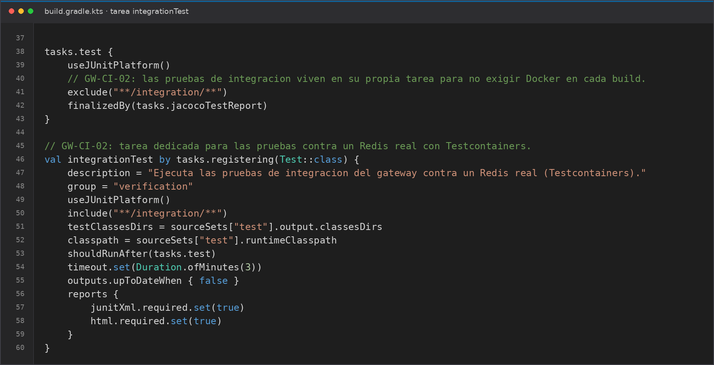

### 2.2 Clase base con el contenedor

`src/test/java/com/circleguard/gateway/integration/AbstractRedisIntegrationTest.java`:

- Contenedor estático `redis:7.2-alpine` con `--save "" --appendonly no` para evitar persistencia. La imagen resuelve a **Redis 7.2.17**, verificable en `redis-container.log`.
- `@DynamicPropertySource` inyecta host, puerto aleatorio, `qr.secret` y `jwt.secret`.
- `Wait.forLogMessage(".*Ready to accept connections.*\\n", 1)` garantiza que las pruebas no arranquen antes de que Redis esté listo.
- `flushDb()` antes de cada prueba y siembra de `user:status:<uuid>` con el estado correspondiente.
- `@AfterAll` escribe `build/integration-test/redis-container.log`.

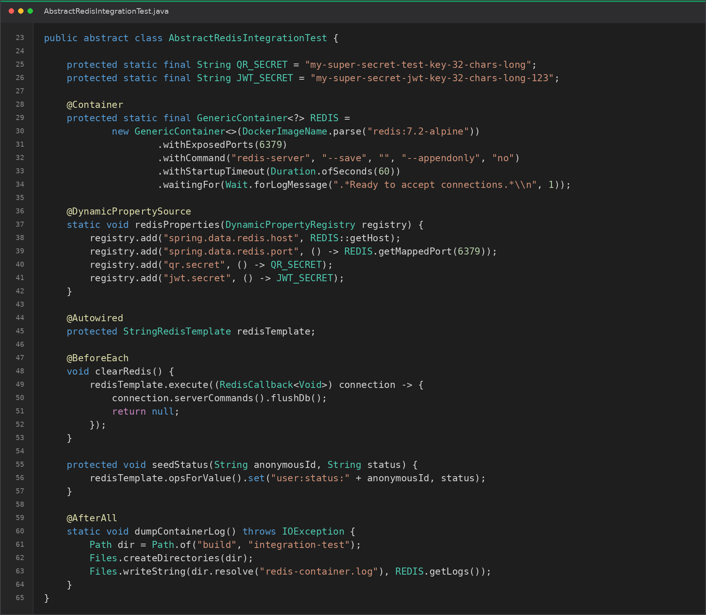

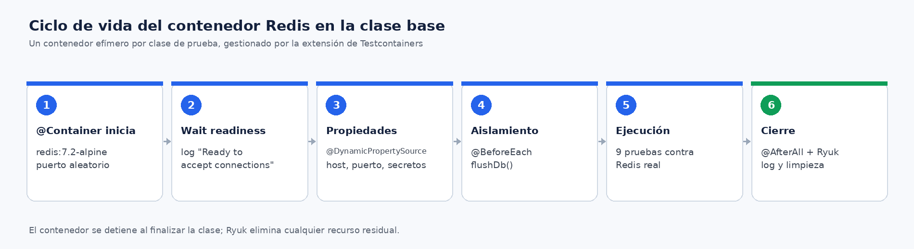

### 2.3 Perfil de prueba

`src/test/resources/application-test.yml` define Redis local, timeouts de 10 s y secretos de prueba. `@DynamicPropertySource` tiene prioridad sobre estos valores y es lo que conecta al puerto aleatorio del contenedor.

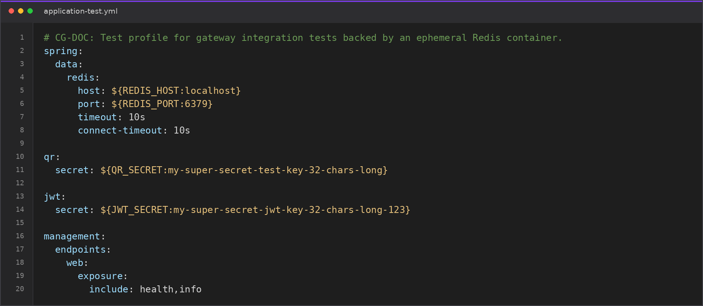

### 2.4 Pipeline

- `jenkins/vars/ci.groovy`: helper `integrationTest(service)` que ejecuta Gradle, publica JUnit (`allowEmptyResults: false`), archiva el log de Redis y falla el build si no se generaron resultados.
- `Jenkinsfile`: stage `Integration Tests` entre `SonarQube + Quality Gate` y `Package`, con timeout de 5 minutos y condicionado a que no sea un rollback.

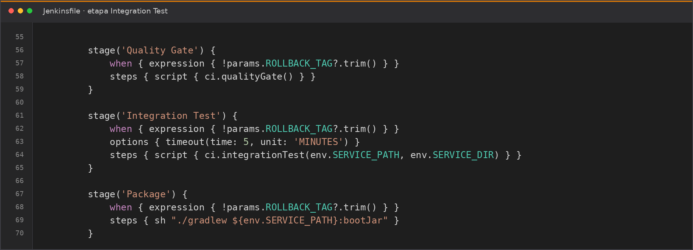

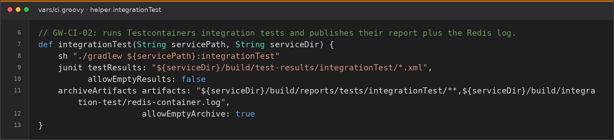

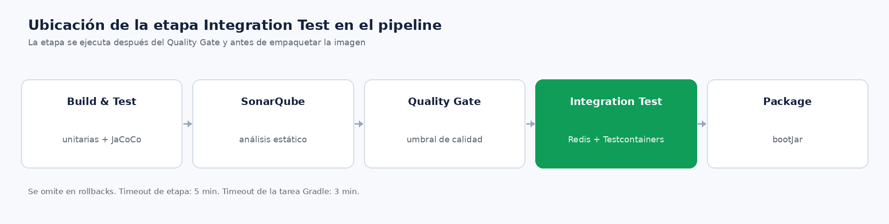

> **Nota:** las capturas `05-jenkinsfile.png`, `06-ci-helper.png` y `14-pipeline.png` se tomaron antes de integrar `main`; el pipeline actual usa el stage `Integration Tests` y la shared library en `jenkins/vars/ci.groovy`.

---

## 3. Casos cubiertos

`GatewayRedisIntegrationTest` contiene 9 ejecuciones de prueba (dos parametrizadas y tres individuales). Cada prueba usa un `UUID` propio y `@BeforeEach` limpia Redis antes de sembrar el estado, de modo que no hay dependencia entre casos.

| Caso | Semilla en Redis | Token | Resultado esperado | Resultado observado |
|---|---|---|---|---|
| `ACTIVE` | `user:status:<id>=ACTIVE` | válido (60 s) | `valid=true`, `GREEN` | ✅ `Welcome to Campus` |
| `RECOVERED` | `RECOVERED` | válido (60 s) | `valid=true`, `GREEN` | ✅ `Welcome to Campus` |
| `SUSPECT` | `SUSPECT` | válido (60 s) | `valid=false`, `RED` | ✅ `Access Denied: Health Risk Detected` |
| `CONTAGIED` | `CONTAGIED` | válido (60 s) | `valid=false`, `RED` | ✅ `Access Denied: Health Risk Detected` |
| `PROBABLE` | `PROBABLE` | válido (60 s) | `valid=false`, `RED` | ✅ `Access Denied: Health Risk Detected` |
| `CONFIRMED` | `CONFIRMED` | válido (60 s) | `valid=false`, `RED` | ✅ `Access Denied: Health Risk Detected` |
| `POTENTIAL` | `POTENTIAL` | válido (60 s) | `valid=false`, `RED` | ✅ `Access Denied: Health Risk Detected` |
| Estado ausente | sin clave | válido (60 s) | `valid=false`, `RED` | ✅ `Access Denied: Health Risk Detected` |
| Token expirado | `ACTIVE` | expiración `-1 s` | `valid=false`, `RED` | ✅ `Invalid or Expired Token` |

---

## 4. Resultados de las tres ejecuciones (post-rebase)

Comando utilizado, sobre la rama rebasada sobre `main` (`0755faa`):

```bash
./gradlew :services:circleguard-gateway-service:integrationTest
```

| Corrida | Resultado | Duración de pared | Tiempo JUnit | Pruebas | Fallos/errores/omitidas | Contenedores residuales |
|---|---|---|---|---|---|---|
| 1 | `BUILD SUCCESSFUL` | 24 s | 3.541 s | 9 | 0 / 0 / 0 | 0 tras Ryuk |
| 2 | `BUILD SUCCESSFUL` | 25 s | 3.628 s | 9 | 0 / 0 / 0 | 0 tras Ryuk |
| 3 | `BUILD SUCCESSFUL` | 24 s | 3.496 s | 9 | 0 / 0 / 0 | 0 tras Ryuk |

- **Total de las tres corridas:** 73 s de pared, muy por debajo del límite de 3 minutos por corrida.
- **27 ejecuciones de prueba** en total (9 por corrida), todas en verde.
- El XML de cada corrida declara `tests="9" skipped="0" failures="0" errors="0"`.
- Justo al terminar cada corrida puede verse el contenedor de Ryuk durante unos segundos; el Redis efímero ya fue eliminado. Tras ~20 s, `docker ps -a --filter label=org.testcontainers=true` queda completamente vacío.
- Como referencia, la verificación previa (antes del rebase) también fue verde con 28 s, 25 s y 26 s.

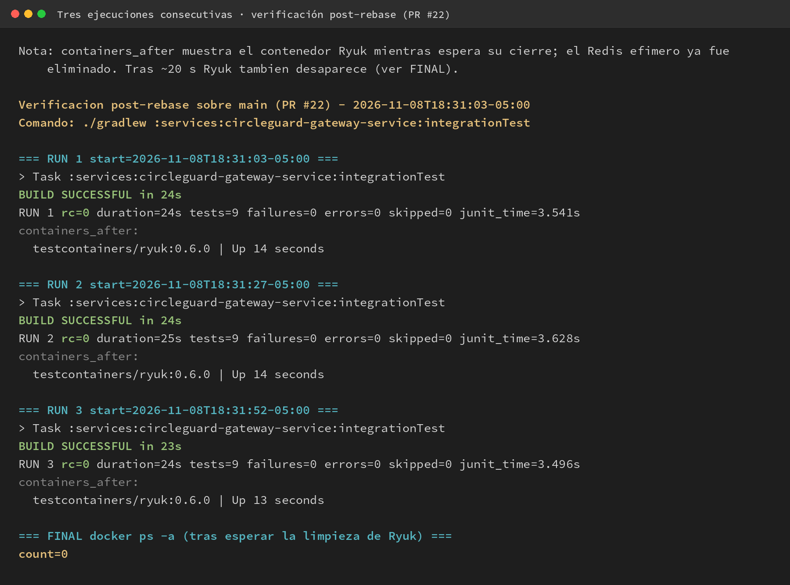

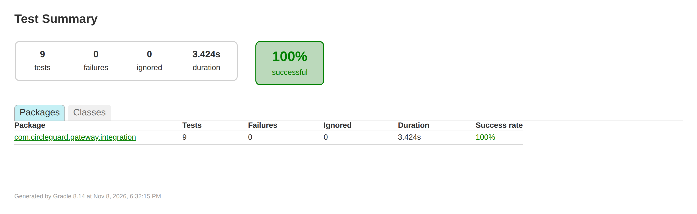

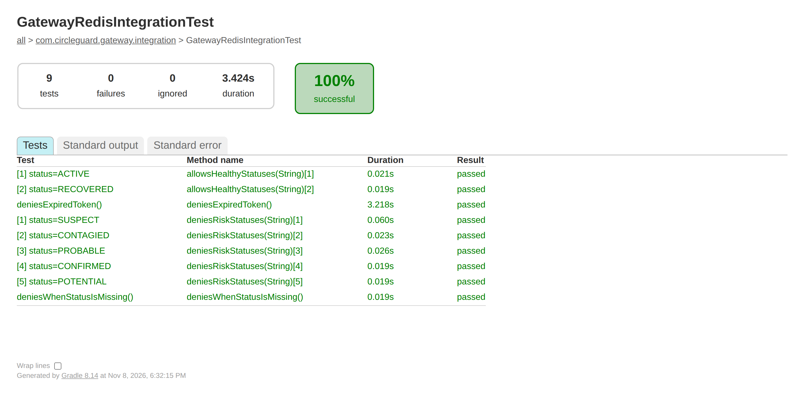

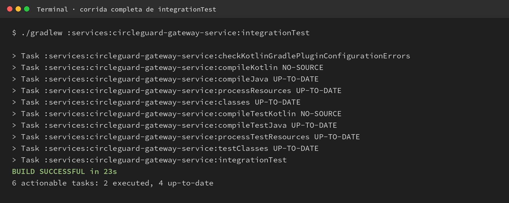

---

## 5. Evidencias

| Evidencia | Archivo |
|---|---|
| Salida de las tres corridas post-rebase | [`evidencia/gw-ci-02/post-rebase/3-runs.txt`](evidencia/gw-ci-02/post-rebase/3-runs.txt) |
| Logs completos de cada corrida | [`run1.log`](evidencia/gw-ci-02/post-rebase/run1.log.txt), [`run2.log`](evidencia/gw-ci-02/post-rebase/run2.log.txt), [`run3.log`](evidencia/gw-ci-02/post-rebase/run3.log.txt) |
| Reporte JUnit XML (post-rebase) | [`evidencia/gw-ci-02/post-rebase/junit-integrationTest.xml`](evidencia/gw-ci-02/post-rebase/junit-integrationTest.xml) |
| Log del contenedor Redis (post-rebase) | [`evidencia/gw-ci-02/post-rebase/redis-container.log.txt`](evidencia/gw-ci-02/post-rebase/redis-container.log.txt) |
| Capturas de la verificación post-rebase | [`15-tres-corridas-post-rebase.png`](evidencia/gw-ci-02/validacion/15-tres-corridas-post-rebase.png), [`16-reporte-junit-html.png`](evidencia/gw-ci-02/validacion/16-reporte-junit-html.png), [`17-detalle-pruebas-junit.png`](evidencia/gw-ci-02/validacion/17-detalle-pruebas-junit.png), [`18-corrida-integrationtest.png`](evidencia/gw-ci-02/validacion/18-corrida-integrationtest.png) |
| Evidencia previa (pre-rebase) | [`3-runs.txt`](evidencia/gw-ci-02/3-runs.txt), [`junit-integrationTest.xml`](evidencia/gw-ci-02/junit-integrationTest.xml), [`redis-container.log.txt`](evidencia/gw-ci-02/redis-container.log.txt) |
| Capturas de implementación (00–14) | [`validacion/`](evidencia/gw-ci-02/validacion/) |
| Stage de Jenkins | Se reporta automáticamente sobre el PR #22 y se archiva en el build |
| Reporte HTML de Gradle | `build/reports/tests/integrationTest/` (archivado por Jenkins) |

---

## 6. Comportamiento con Redis caído (solo documentación)

La HU pide documentar qué ocurre cuando Redis no está disponible; **no** se implementa resiliencia (retry, circuit breaker o caché local), pues corresponde a la Parte 2.

Comportamiento actual:

1. `QrValidationService.validateToken` consulta `user:status:<id>` mediante `StringRedisTemplate`.
2. Si Redis no responde, Spring Data Redis lanza `RedisConnectionFailureException`, que es una subclase de `DataAccessException`.
3. `ApiExceptionHandler` la captura y responde **HTTP 503 Service Unavailable** con:

```json
{
  "valid": false,
  "status": "RED",
  "message": "Service Unavailable: Health Status Unavailable"
}
```

4. La prueba unitaria `QrValidationServiceTest.shouldPropagateRedisFailure` evidencia que la excepción se propaga desde el servicio en lugar de devolver un resultado silencioso.

Consecuencia operativa: si Redis cae, el gateway **falla cerrado** (deniega el acceso con 503) y no concede permisos por defecto. Esto es coherente con el principio de seguridad del sistema, aunque implica indisponibilidad del control de acceso hasta que Redis se recupere.

---

## 7. Conclusión

La integración Gateway–Redis con Testcontainers queda implementada y verificada:

- Redis real, sin mocks, en un contenedor efímero (`redis:7.2-alpine`, Redis 7.2.17).
- Cobertura de los seis escenarios exigidos por la HU y de todos los estados de riesgo del dominio.
- Tarea `integrationTest` independiente, reproducible y siempre ejecutada en CI.
- Etapa de Jenkins con publicación de JUnit, reporte HTML y log del contenedor.
- Tres corridas consecutivas verdes post-rebase (24 s, 25 s y 24 s), sin contenedores residuales.
- Comportamiento ante caída de Redis documentado y respaldado por una prueba unitaria.

Con esto se aporta evidencia para el entregable **E1.6 (Pruebas automatizadas)** sin modificar la lógica de negocio, los contratos de API ni el código de producción.

---

## 8. Reproducibilidad

```bash
# 1) Pruebas unitarias + cobertura
./gradlew :services:circleguard-gateway-service:test \
  :services:circleguard-gateway-service:jacocoTestReport \
  :services:circleguard-gateway-service:jacocoTestCoverageVerification

# 2) Integración con Redis real
./gradlew :services:circleguard-gateway-service:integrationTest

# 3) Tres corridas consecutivas
for i in 1 2 3; do
  ./gradlew :services:circleguard-gateway-service:integrationTest
done

# 4) Verificar limpieza de Testcontainers
docker ps -a --filter label=org.testcontainers=true
```

Requisitos: Docker en ejecución, JDK 21 (toolchain de Gradle) y acceso a la imagen `redis:7.2-alpine`.
