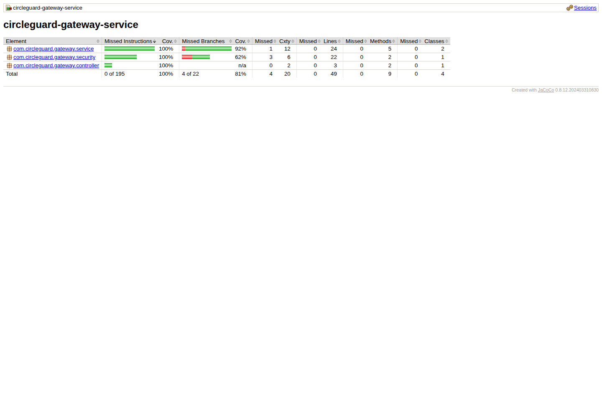
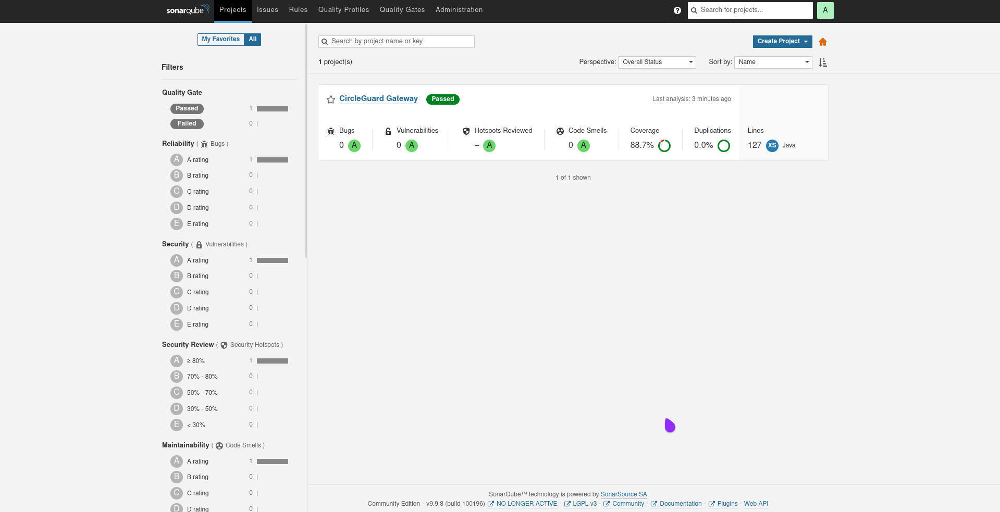
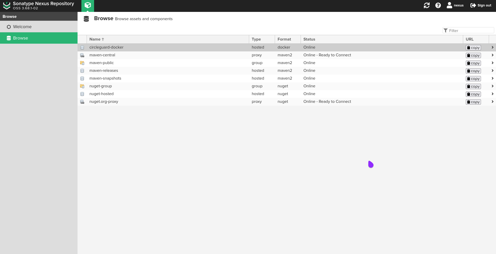
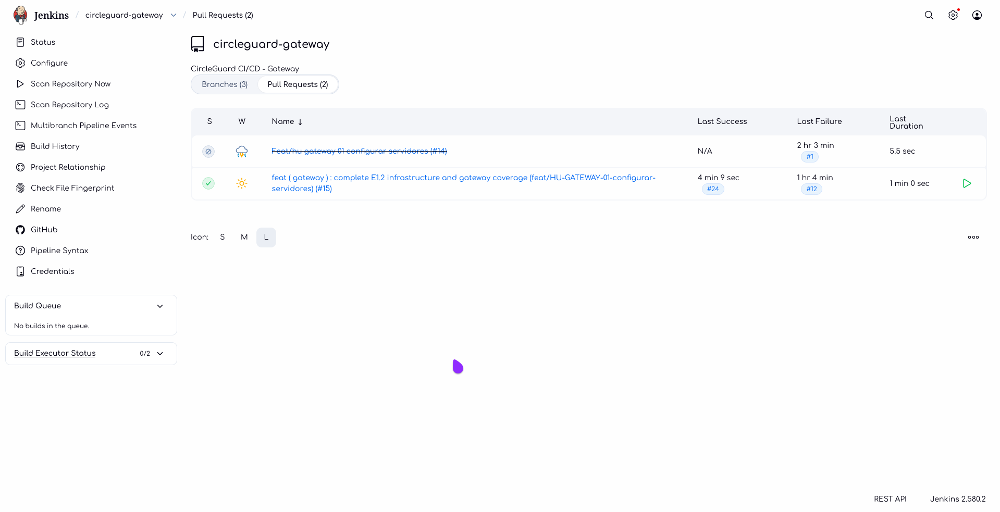

<!-- CG-DOC: Gateway coverage, integration, E2E, and quality evidence report. -->
# Gateway Coverage and Quality Report

## Scope

Only `circleguard-gateway-service`: unit tests, Redis integration, Playwright E2E, JaCoCo, SonarQube, and Nexus publication.

## Unit and integration coverage

```bash
./gradlew :services:circleguard-gateway-service:clean \
  :services:circleguard-gateway-service:test \
  :services:circleguard-gateway-service:jacocoTestReport \
  :services:circleguard-gateway-service:jacocoTestCoverageVerification
```

Target: line coverage >= 60 % (GW-CI-01). The threshold is enforced by
`jacocoTestCoverageVerification` (`minimum = 0.60`) and wired to the Gradle
`check` lifecycle.

Current result (JaCoCo 0.8.12, 24 tests, 0 failures):

| Metric | Covered / Total | Coverage |
|---|---:|---:|
| Instructions | 195 / 195 | 100.00 % |
| Branches | 18 / 22 | 81.82 % |
| **Lines** | **49 / 49** | **100.00 %** |
| Methods | 9 / 9 | 100.00 % |
| Classes | 4 / 4 | 100.00 % |



### Acceptance criteria -> tests

| GW-CI-01 criterion | Test |
|---|---|
| `ACTIVE` / `RECOVERED` -> `GREEN` | `QrValidationServiceTest.shouldAllowAllowedStatuses` |
| Risk statuses, `UNKNOWN` and `CLEAR` -> `RED` | `QrValidationServiceTest.shouldDenyRiskOrUnknownStatuses` |
| Missing Redis status -> `RED` | `QrValidationServiceTest.shouldDenyWhenStatusIsMissing` |
| Expired token -> `Invalid or Expired Token` | `QrValidationServiceTest.shouldDenyExpiredToken` |
| Invalid signature -> `Invalid or Expired Token` | `QrValidationServiceTest.shouldDenyTokenWithInvalidSignature` |
| Malformed, empty or null token -> `Invalid or Expired Token` | `QrValidationServiceTest.shouldDenyMissingOrMalformedToken` |
| Token without subject -> `Invalid or Expired Token` | `QrValidationServiceTest.shouldDenyTokenWithoutSubject` |
| Redis failure propagates | `QrValidationServiceTest.shouldPropagateRedisFailure` |
| Controller returns the service result | `GateControllerTest.shouldReturnValidationResult`, `shouldReturnDeniedResult` |
| Controller handles a missing `token` field | `GateControllerTest.shouldReturnDeniedWhenTokenIsMissing` |
| JWT filter builds authorities from `permissions` | `JwtAuthenticationFilterTest.shouldAuthenticateTokenWithPermissions` |
| JWT filter accepts a token without `permissions` | `JwtAuthenticationFilterTest.shouldAuthenticateTokenWithoutPermissions` |
| JWT filter ignores an invalid token | `JwtAuthenticationFilterTest.shouldNotAuthenticateInvalidToken` |

## Integration test

`GatewayRedisIntegrationTest` validates:

- `ACTIVE` status -> access allowed.
- `SUSPECT` status -> access denied.
- Missing status -> access denied.

It runs with the `test` task and uses Testcontainers (`redis:7.2-alpine`).

## E2E tests

Playwright validates:

1. Health endpoint returns `UP`.
2. Request without staff JWT returns 401/403.
3. Malformed staff JWT returns 401/403.

## SonarQube



## Nexus

Published artifact and image:

```text
<TOOLS_PRIVATE_IP>:5000/circleguard-docker/gateway:<TAG>
```



## Pipeline

The multibranch Jenkinsfile runs `ci.build`, `ci.unitTest` (JUnit + JaCoCo
gate) and `ci.integrationTest` for the gateway, followed by
`ci.archive(services)`, which publishes the JUnit XML and the JaCoCo HTML/XML
reports for every build, including failed builds. The shared library is loaded
from `main` (`jenkins/vars`).


