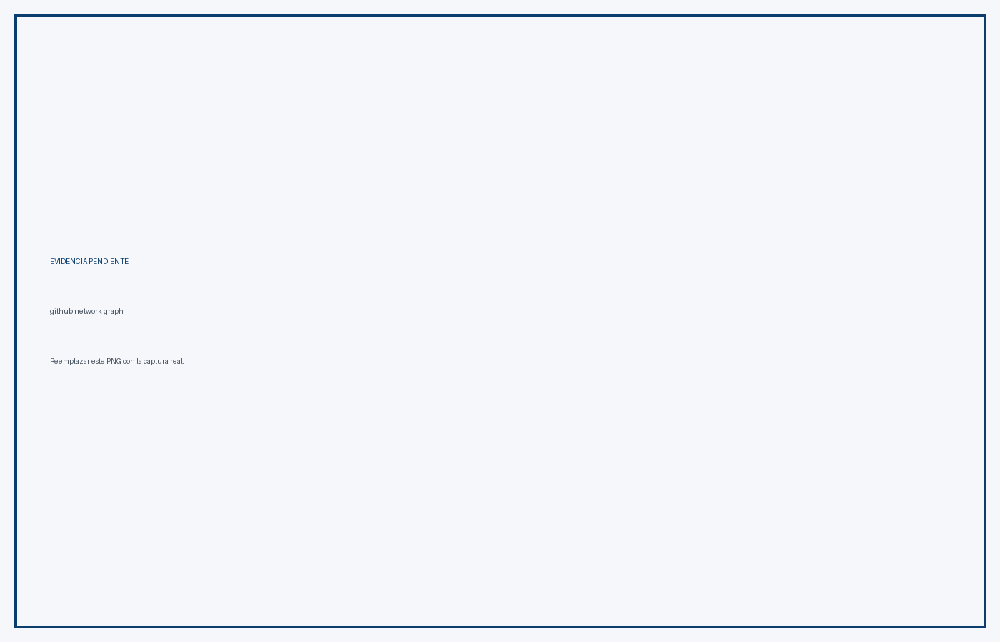
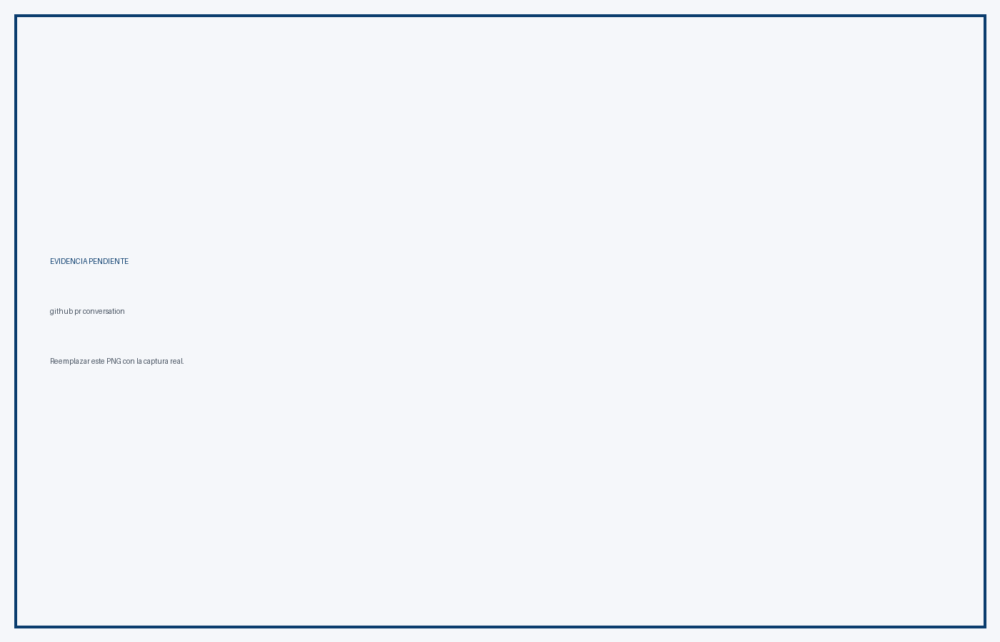
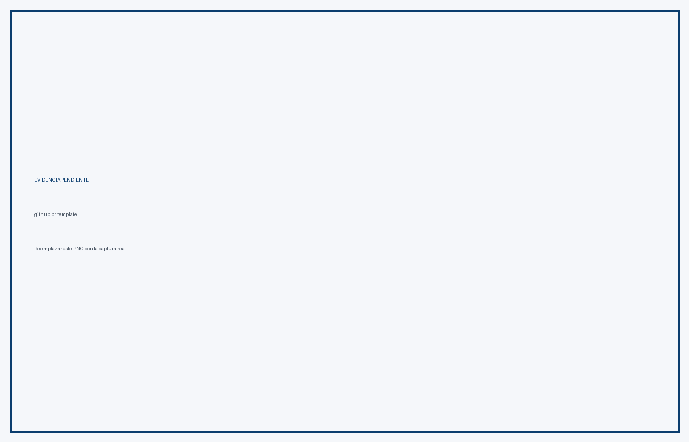
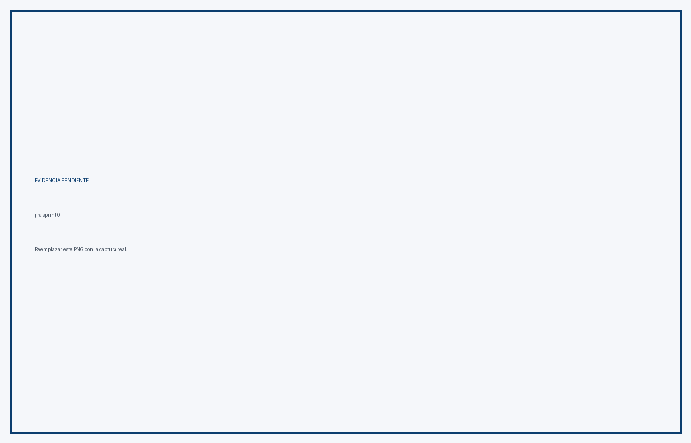
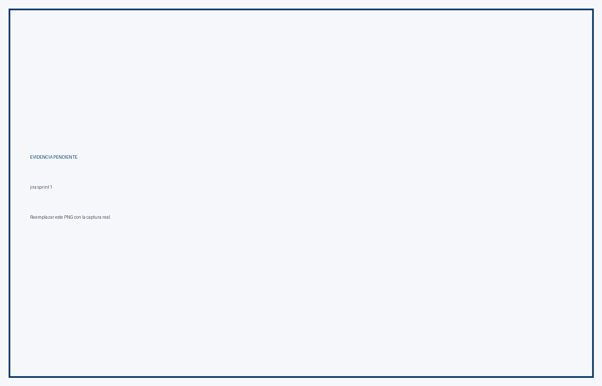
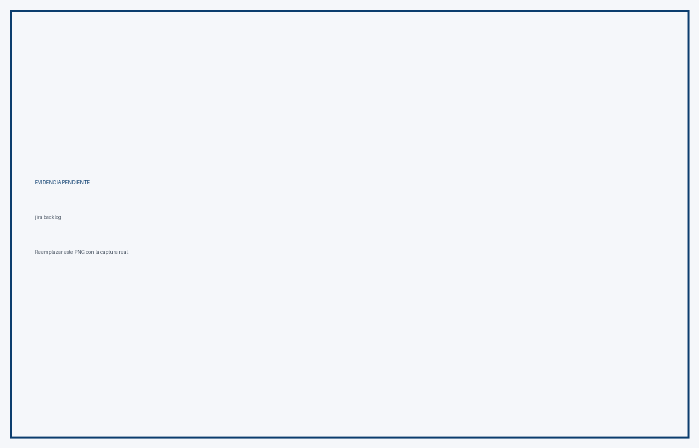

# P1.1 - Branching y GitHub Flow

**Proyecto:** CircleGuard
**Rama:** feat/HU-GATEWAY-01-configurar-servidores
**Estrategia:** GitHub Flow
**Fecha:** 8 de noviembre de 2026

## 1. Estrategia GitHub Flow

CircleGuard aplica GitHub Flow:

1. `main` siempre está en estado desplegable.
2. Cada rama se crea desde `main` y es de corta duración.
3. Los commits siguen Conventional Commits en inglés.
4. Todo cambio entra por Pull Request.
5. Se requiere al menos una aprobación de otro integrante.
6. Los checks de Jenkins deben pasar.
7. El merge se hace con Squash and Merge.
8. La rama se elimina después del merge.

La estrategia está documentada en `BRANCHING-STRATEGY.md`.

## 2. Estado de la rama

```text
Rama actual: feat/HU-GATEWAY-01-configurar-servidores
Base: main
Sincronización: merge de main sobre la rama
PR: pendiente de crear
Aprobación: pendiente
Checks Jenkins: pendientes
```

La rama `dev` es heredada y no forma parte de GitHub Flow. Se eliminará antes de la entrega.

## 3. Evidencia de GitHub

### Ramas


### Grafo de red



### Protección de main


### Pull Request



### Aprobación


### Checks


### Historial de commits


### Plantilla de PR



## 4. Evidencia de Jira

### Sprint 0



### Sprint 1



### Backlog



### Historias y criterios de aceptación


### Review y retrospectiva


## 5. Cumplimiento de la rúbrica P1.1

| Criterio | Evidencia | Estado |
|---|---|---|
| Tablero vivo | Capturas Jira | Pendiente de subir |
| Historias con criterios medibles | Capturas Jira | Pendiente de subir |
| Sprint 0 y Sprint 1 | Capturas Jira | Pendiente de subir |
| Review y retrospectiva | Capturas Jira | Pendiente de subir |
| Ramas protegidas | Ruleset de main | Pendiente de captura |
| PR revisados por pares | PR con aprobación | Pendiente de crear |
| Estrategia de branching | `BRANCHING-STRATEGY.md` | Cumple |

## 6. Evidencias que faltan subir

Reemplazar los PNG de ejemplo en:

```text
docs/informe/evidencia/github/
docs/informe/evidencia/jira/
```

Nombres esperados:

```text
github-branches.png
github-network-graph.png
github-ruleset-main.png
github-pr-conversation.png
github-pr-approval.png
github-pr-checks.png
github-commit-history.png
github-pr-template.png
jira-sprint-0.png
jira-sprint-1.png
jira-backlog.png
jira-historias.png
jira-retrospectiva.png
```

## 7. Conclusión

GitHub Flow está definido y la rama actual sigue la convención de nombres y commits. Para cerrar P1.1 falta crear el PR, obtener la aprobación, verificar los checks, hacer Squash and Merge y reemplazar las capturas de ejemplo con las evidencias reales de GitHub y Jira.
