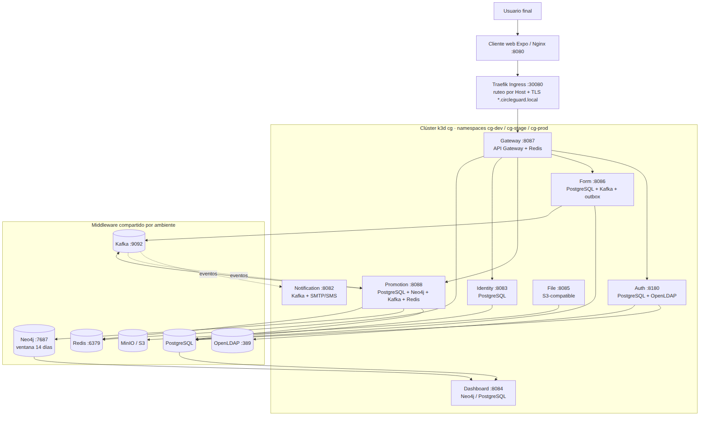
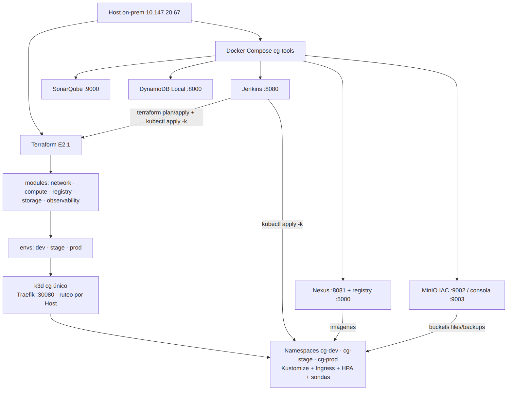
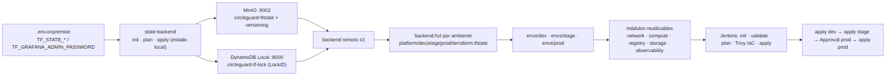
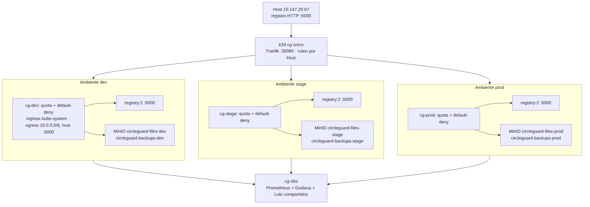
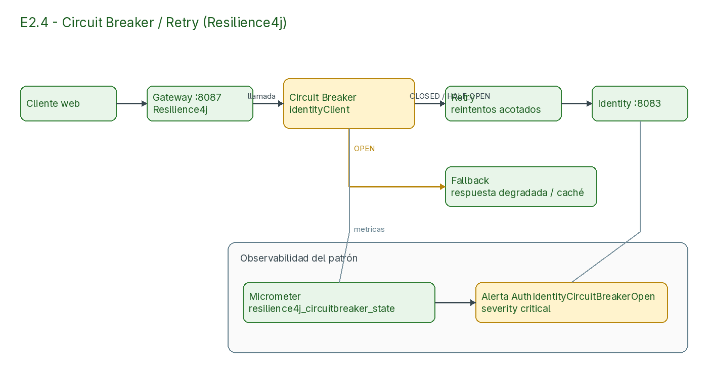
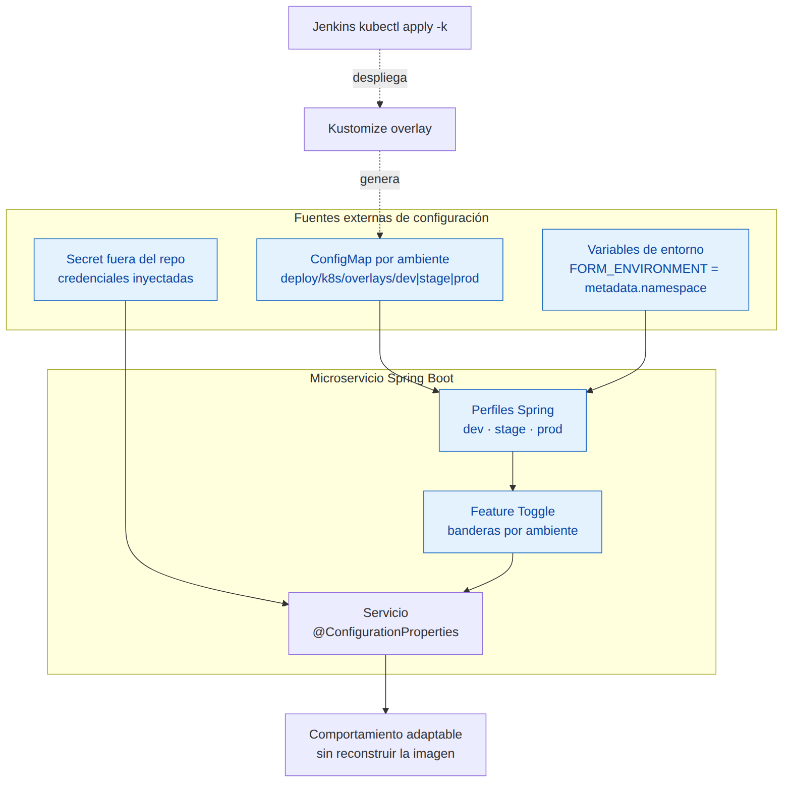
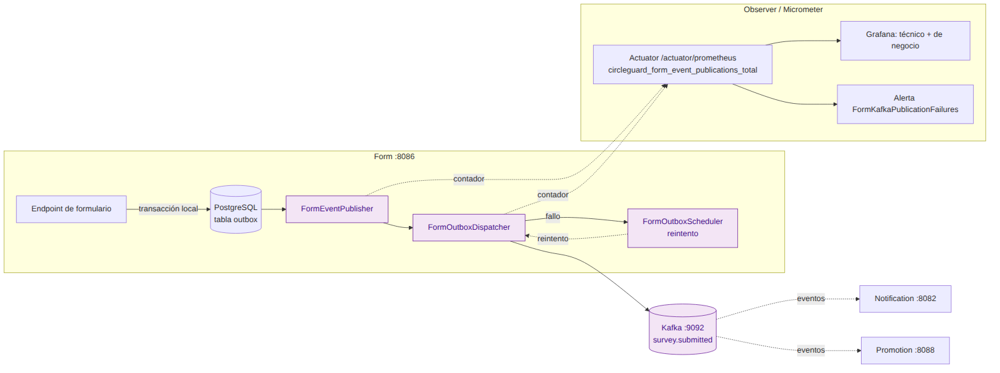

<!-- CG-DOC: 18. Arquitectura y patrones de diseño — CircleGuard. -->
# 18. Arquitectura y patrones de diseño — CircleGuard

> **Propósito.** Documentar la arquitectura implementada en la Parte 2 y los patrones de
> diseño verificados en el código, con su evidencia, propósito, *compromisos* y prueba.
> Este informe es la fuente de texto e imágenes que se incorpora al
> `CircleGuard_INFORME_FINAL.docx`. Todas las figuras se generaron desde su fuente
> Mermaid `.mmd`, conservada junto a cada PNG en `docs/diagramas/`. Ningún nombre
> incluye fechas.

## 1. Arquitectura general del sistema

CircleGuard es un sistema de rastreo de contactos y cercos sanitarios construido como
microservicios. El Cliente web Expo/Nginx (`:8080`) es el único punto de entrada de
usuario; todas las peticiones pasan por un API Gateway (`:8087`) desplegado detrás de
Traefik (`:30080`) con terminación TLS mediante el certificado comodín
`*.circleguard.local`. El clúster es un k3d único sobre el host on-prem
`10.147.20.67`, con tres namespaces aislados `cg-dev`, `cg-stage` y `cg-prod`.

Los ocho microservicios son Auth (`:8180`), Identity (`:8083`), Form (`:8086`),
Promotion (`:8088`), Gateway (`:8087`), Notification (`:8082`), File (`:8085`) y
Dashboard (`:8084`). El modelo de datos es híbrido: PostgreSQL para la bóveda de
identidades y datos relacionales, OpenLDAP para autenticación dual, Kafka para eventos
asíncronos, Redis para caché de estado de QR, Neo4j para el grafo temporal de 14 días y
compatible con MinIO/S3 para archivos y respaldos.

**Figura 1. Arquitectura general de servicios (Parte 2).**

*Fuente: [`04-arquitectura-servicios.mmd`](../diagramas/04-arquitectura-servicios.mmd).
Coherente con `docs/arquitectura/ARQUITECTURA.md` y `deploy/k8s/base/apps.yml`.*

La figura muestra el flujo completo: el usuario accede al cliente web, que se comunica
con Traefik; este enruta por cabecera `Host` al Gateway, y el Gateway distribuye hacia
los ocho servicios. Cada servicio consume únicamente el middleware que necesita
(*base de datos por servicio*): Auth usa PostgreSQL y LDAP, Identity usa PostgreSQL, Form
usa PostgreSQL y Kafka, Promotion usa PostgreSQL, Neo4j, Kafka y Redis, Notification
consume Kafka, File usa MinIO y Dashboard lee Neo4j/PostgreSQL. Los eventos de Kafka
alimentan a Notification y Promotion de forma asíncrona, y Neo4j/PostgreSQL alimentan
el Dashboard. Esta separación es la que permite desplegar, escalar y observar cada
servicio de manera independiente.

## 2. Infraestructura como código y entornos

La infraestructura se declara con Terraform en cinco módulos reutilizables — `network`,
`compute`, `registry`, `storage` y `observability` — parametrizados para tres ambientes
(`dev`, `stage`, `prod`). El estado remoto se guarda en MinIO con versionado y el
control de concurrencia en DynamoDB Local, de modo que Jenkins pueda ejecutar `plan` y `apply` sin
condiciones de carrera. La promoción de artefactos es la misma imagen semver en todos
los ambientes; solo cambia la configuración por overlay de Kustomize.

**Figura 2. Arquitectura on-premise.**

*Fuente: [`01-arquitectura-onprem.mmd`](../diagramas/01-arquitectura-onprem.mmd).*

La figura ubica los componentes en el host `10.147.20.67`: el stack `cg-tools` agrupa
Jenkins (`:8080`), SonarQube (`:9000`), Nexus con registry (`:8081`/`:5000`), MinIO
IAC (`:9002`/`:9003`) y DynamoDB Local (`:8000`). Terraform consume MinIO y DynamoDB
como backend, declara los cinco módulos y los aplica a los tres ambientes sobre el
clúster k3d `cg`. Traefik (`:30080`) enruta por `Host`; Jenkins dispara
`terraform plan/apply` y `kubectl apply -k`, Nexus publica las imágenes y MinIO
provee los buckets de archivos y respaldos a los namespaces de aplicación.

**Figura 3. Flujo de Terraform y estado remoto.**

*Fuente: [`02-flujo-terraform.mmd`](../diagramas/02-flujo-terraform.mmd).*

El flujo comienza en `.env.onpremise`, que aporta `TF_STATE_*` y
`TF_GRAFANA_ADMIN_PASSWORD`. El módulo `state-backend` crea el bucket
`circleguard-tfstate` en MinIO y la tabla `circleguard-tf-lock` en DynamoDB; sobre
ese backend remoto se construye el `backend.hcl` de cada ambiente, con claves
`platform/<env>/terraform.tfstate`. Las tres configuraciones raíz reutilizan los cinco módulos y
Jenkins ejecuta `init`, `validate`, `plan`, el gate de Trivy IaC y `apply`, con
aprobación manual para producción.

**Figura 4. Red y ambientes aislados.**

*Fuente: [`03-red-y-ambientes.mmd`](../diagramas/03-red-y-ambientes.mmd).*

El registro HTTP `:5000` y el clúster k3d sirven a los tres ambientes. Cada namespace
(`cg-dev`, `cg-stage`, `cg-prod`) tiene cuota de recursos y política `default-deny`
con excepciones controladas: ingress desde `kube-system` y egress hacia `10.0.0.0/8`
y el host `:5000`. Cada ambiente dispone de su propio registry y buckets MinIO
(`circleguard-files-<env>` y `circleguard-backups-<env>`), y todos reportan al
namespace `cg-obs`, compartido por Prometheus, Grafana y Loki. El aislamiento por
namespace evita que un incidente en dev afecte a stage o prod.

## 3. Patrones de diseño existentes identificados en código

| Patrón | Evidencia en el código |
| --- | --- |
| API Gateway | `services/circleguard-gateway-service` es el punto de entrada del campus. |
| Arquitectura orientada a eventos | `notification-service`, `form-service` y `promotion-service` consumen/publican temas de Kafka. |
| Base de datos por servicio | Cada microservicio declara su propio `application.yml` y esquema. |
| Cache-aside | `gateway-service` consulta Redis para el estado del QR con TTL corto. |
| Máquina de estados | `promotion-service` implementa Sospechoso → Probable → Confirmado con TTL de 14 días. |

## 4. Patrones implementados o mejorados

### 4.1 Resiliencia — Circuit Breaker, Retry y Bulkhead

**Propósito.** Proteger a los servicios de fallos en cascada cuando una dependencia
remota deja de responder. El Gateway y Auth/Identity aplican Resilience4j con un
circuito `identityClient`, reintentos acotados y un *fallback* degradado.

**Evidencia.** `services/circleguard-auth-service/src/main/java/com/circleguard/auth/client/IdentityClient.java`
(L48-49) declara `@CircuitBreaker(name = "identityClient", fallbackMethod = "fallbackAnonymousId")`
y `@Retry(name = "identityClient")`. El `application.yml` (L64-81) configura
`resilience4j.circuitbreaker.instances.identityClient` y
`resilience4j.retry.instances.identityClient`, con
`max-attempts: ${RETRY_IDENTITY_MAX_ATTEMPTS:3}` y
`wait-duration: ${RETRY_IDENTITY_WAIT_DURATION:500ms}`. El patrón se repite en
`FormOutboxDispatcher`, `IdentityAuditPublisher` y `PushServiceImpl`.

**Compromiso.** El circuito añade latencia al abrirse y requiere un *fallback*
significativo; a cambio evita saturar hilos y propagar la falla. El Bulkhead limita
el pool de hilos para aislar la concurrencia.

**Prueba.** Falla inyectada verificada por la alerta crítica
`AuthIdentityCircuitBreakerOpen`, que observa
`resilience4j_circuitbreaker_state{name="identityClient", state="open"} == 1`.

**Figura 5. Circuit Breaker, Retry y Bulkhead (resiliencia).**

*Fuente: [`05-circuit-breaker-retry-bulkhead.mmd`](../diagramas/05-circuit-breaker-retry-bulkhead.mmd).*

La figura muestra al Cliente web llamando al Gateway, donde el Circuit Breaker
`identityClient` decide entre CLOSED/HALF_OPEN —con Retry hacia Identity y Bulkhead
aislando la concurrencia— y OPEN, que desvía a un Fallback con respuesta degradada o
caché. El bloque de observabilidad indica que Circuit Breaker y Retry exportan
`resilience4j_circuitbreaker_state` vía Micrometer y que ese valor dispara la alerta
crítica `AuthIdentityCircuitBreakerOpen`.

### 4.2 Configuración — External Configuration y Feature Toggle

**Propósito.** Separar el comportamiento de cada ambiente del artefacto desplegado, de
modo que la misma imagen se comporte distinto en dev, stage y prod sin reconstruirse.

**Evidencia.** Perfiles Spring `dev`/`stage`/`prod` y ConfigMaps generados por los
overlays `deploy/k8s/overlays/*`; secretos inyectados desde fuera del repositorio;
`FORM_ENVIRONMENT` resuelto desde `metadata.namespace` del pod. Clases como
`FileStorageService`, `S3FileStorageService`, `FormObservabilityConfiguration`,
`NotificationTracingConfiguration` y `PromotionTracingConfiguration` leen la
configuración externa vía `@ConfigurationProperties`.

**Compromiso.** La centralización facilita el cambio sin reconstruir la imagen, pero introduce
dependencia del clúster para arrancar: si el ConfigMap no existe, el servicio no
inicia, lo que se mitiga con los manifiestos declarados y validados por Kustomize.

**Prueba.** Render offline de los tres overlays y verificación de que los ConfigMaps
proyectados resuelven y no colisionan (`deploy/k8s/components/form-observability/verify.py`).

**Figura 6. Patrón de configuración.**

*Fuente: [`06-patron-configuracion.mmd`](../diagramas/06-patron-configuracion.mmd).*

La figura muestra tres fuentes externas —ConfigMap por ambiente, Secret fuera del
repo y variables de entorno con `FORM_ENVIRONMENT = metadata.namespace`— que alimentan
los perfiles Spring del microservicio. Los perfiles activan banderas de Feature Toggle
que llegan al servicio mediante `@ConfigurationProperties` y producen un
comportamiento adaptable sin reconstruir la imagen. En los laterales, Kustomize genera
el ConfigMap y Jenkins lo despliega con `kubectl apply -k`.

### 4.3 Adicional — Observer/Micrometer con arquitectura dirigida por eventos y outbox

**Propósito.** Garantizar que un evento de negocio no se pierda entre la transacción
local y la publicación en Kafka, y exponer métricas del proceso para observabilidad.

**Evidencia.** En `form-service` están `FormEventPublisher`, `FormOutboxDispatcher`,
`FormOutboxScheduler`, `FormOutboxEvent` y `FormOutboxRepository`: el evento se persiste
en una tabla outbox de PostgreSQL dentro de la transacción local, el dispatcher lo
publica en Kafka (`survey.submitted`) y el scheduler reintenta ante fallos. Existen las
pruebas `FormOutboxDispatcherTest`, `FormOutboxSchedulerTest` y
`FormOutboxRecoveryIntegrationTest`. La métrica
`circleguard_form_event_publications_total` se expone en Actuator y alimenta la alerta
`FormKafkaPublicationFailures`.

**Compromiso.** La tabla outbox añade una escritura y requiere un proceso de reintento,
pero elimina la inconsistencia entre base de datos y broker; la instrumentación
Micrometer añade una sobrecarga de medición pequeña frente a la observabilidad de negocio
obtenida.

**Prueba.** Los tests de recuperación del outbox y la alerta
`FormKafkaPublicationFailures` validan tanto el reintento como la visibilidad de los
fallos de publicación.

**Figura 7. Patrón adicional: Observer y eventos con outbox.**

*Fuente: [`07-patron-adicional.mmd`](../diagramas/07-patron-adicional.mmd).*

La figura sigue el flujo dentro de Form: el endpoint escribe en la tabla outbox de
PostgreSQL en la misma transacción; `FormEventPublisher` y `FormOutboxDispatcher`
publican en Kafka, y `FormOutboxScheduler` reintenta ante fallo. Kafka distribuye los
eventos a Notification y Promotion. El bloque Observer/Micrometer recoge los contadores
`circleguard_form_event_publications_total` desde Actuator y los entrega a Grafana
(técnico y de negocio) y a la alerta `FormKafkaPublicationFailures`.

## 5. Trazabilidad con la rúbrica

Este informe cubre el entregable **E2.4** (patrones de diseño) y el criterio **P2.4**
del enunciado: patrones existentes identificados con evidencia en código, al menos tres
patrones nuevos o mejorados —uno de resiliencia, uno de configuración y uno adicional—
con propósito, *compromisos*, evidencia y prueba. La arquitectura y la infraestructura
documentadas aquí también sustentan **P2.2** (Terraform y diagramas coherentes con lo
desplegado) y **P2.10** (documentación coherente con la solución).

## 6. Fuentes y referencias

- Figuras 1–7: `docs/diagramas/*.mmd` y sus PNG generados con Mermaid CLI.
- Evidencia de patrones: `docs/patrones/Patrones_Diseno_CircleGuard.docx`.
- Manifiestos: `deploy/k8s/base/apps.yml`, `deploy/k8s/overlays/*`, `deploy/k8s/base/rbac.yml`.
- Código: `services/circleguard-*/src/main/java/**`.
- Índice de arquitectura: `docs/arquitectura/ARQUITECTURA.md` y `docs/arquitectura/pipeline.md`.
- Índice de diagramas: `docs/diagramas/DIAGRAMAS.md`.
