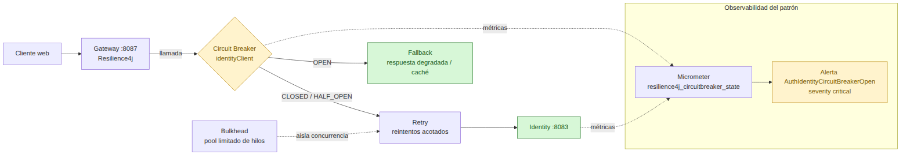
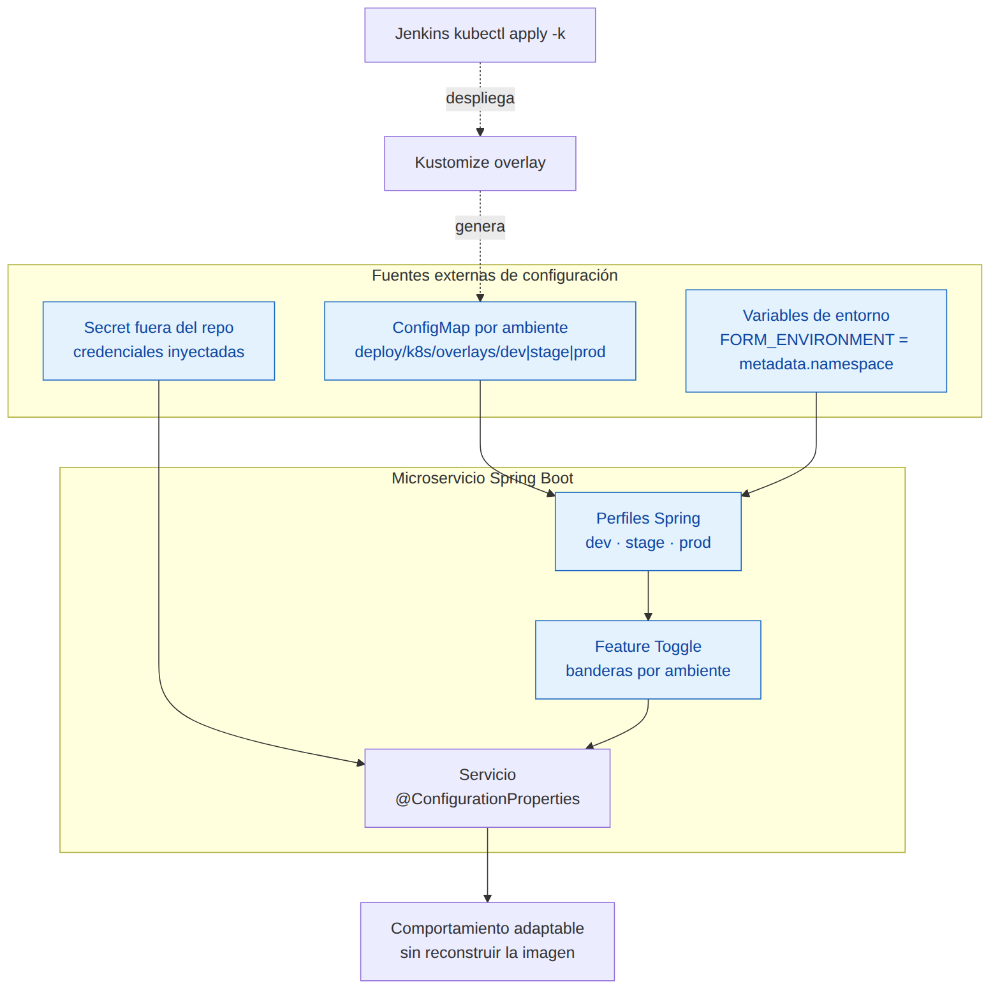
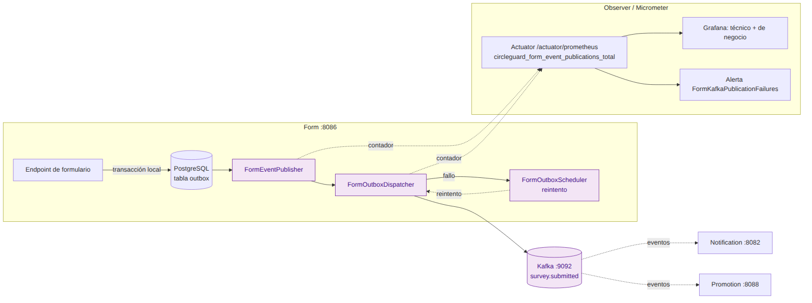

# CG-DOC: Patrones de diseño verificados en el código (E2.4)

## Patrones existentes (evidencia en código)

| Patrón | Evidencia |
| --- | --- |
| API Gateway | `services/circleguard-gateway-service` es el punto de entrada del campus. |
| Event-driven architecture | `notification-service`, `form-service` y `promotion-service` consumen/publican topics Kafka. |
| Database per service | Cada microservicio declara su propio `application.yml` y esquema. |
| Cache-aside | `gateway-service` consulta Redis para el estado del QR y TTL corto. |
| State machine | `promotion-service` implementa Sospechoso → Probable → Confirmado con TTL de 14 días. |

## Patrones implementados o mejorados

1. **Circuit Breaker / Retry (resiliencia)** — Resilience4j en `gateway-service`
   y `identity-service`, con pruebas de falla inyectada. *Trade-off*: latencia
   adicional al abrir el circuito frente a protección del downstream.
2. **External Configuration (configuración)** — perfiles Spring y ConfigMaps
   por ambiente en `deploy/k8s/overlays/*`. *Trade-off*: centralización vs.
   dependencia del cluster para arrancar.
3. **Observer/Micrometer instrumentation (adicional)** — contadores y
   histogramas en Actuator consumidos por Prometheus y Grafana. *Trade-off*:
   overhead de medición frente a observabilidad de negocio.

## Diagramas de patrones

Las figuras de los tres patrones implementados están en `docs/diagramas/`, con
su fuente Mermaid editable y la imagen PNG generada desde ella:

- Resiliencia (Circuit Breaker / Retry / Bulkhead):
  [`05-patron-resiliencia.mmd`](../diagramas/05-patron-resiliencia.mmd) ·
  
- Configuración (External Configuration / Feature Toggle):
  [`06-patron-configuracion.mmd`](../diagramas/06-patron-configuracion.mmd) ·
  
- Adicional (Observer/Micrometer + eventos con outbox):
  [`07-patron-adicional.mmd`](../diagramas/07-patron-adicional.mmd) ·
  

## 18. Arquitectura y patrones de diseño (texto + imágenes)

El [**`INFORME_ARQUITECTURA_PATRONES.md`**](INFORME_ARQUITECTURA_PATRONES.md) presenta
la arquitectura general, la infraestructura como código y los patrones de diseño, con
las 7 figuras —las tres de patrones en esta carpeta y las de arquitectura e
infraestructura en `../diagramas/`— y una explicación detallada bajo cada imagen.
Ese mismo contenido, en texto e imágenes, se incorpora al `CircleGuard_INFORME_FINAL.docx`.

## Documento de patrones

El documento [**`Patrones_Diseno_CircleGuard.docx`**](Patrones_Diseno_CircleGuard.docx)
recoge los patrones existentes identificados en código y los tres patrones
implementados o mejorados, con propósito, evidencia, *trade-offs*, prueba y
trazabilidad con E2.4/P2.4. Incluye las tres figuras de patrones en esta misma
carpeta:

- [`05-patron-resiliencia.png`](05-patron-resiliencia.png)
- [`06-patron-configuracion.png`](06-patron-configuracion.png)
- [`07-patron-adicional.png`](07-patron-adicional.png)

El índice completo de arquitectura e infraestructura está en
[`docs/diagramas/README.md`](../diagramas/README.md), incluida la vista general
de servicios [`04-arquitectura-servicios.mmd`](../diagramas/04-arquitectura-servicios.mmd).
