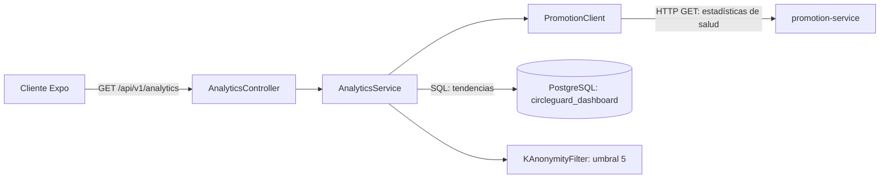

<!-- CG-DOC: Architecture, dependencies, build evidence, and technical findings for dashboard-service. -->
# dashboard-service: funcionamiento y estructura

Este documento registra el diagnóstico de `circleguard-dashboard-service` para HU-DASH-01. Describe el código existente y los requisitos conocidos para continuar con pruebas y empaquetado.

## Cómo funciona dashboard-service

`dashboard-service` ofrece datos agregados de salud y tendencias para las pantallas administrativas de CircleGuard. El cliente Expo consulta su API HTTP; el servicio obtiene los conteos actuales de `promotion-service` y consulta su propia base PostgreSQL para las tendencias. En los resultados por departamento y ubicación aplica reglas de privacidad para ocultar conteos pequeños.



El servicio aporta una vista de los estados de salud a nivel de campus y departamento. Se comunica con `promotion-service` por HTTP; no consume eventos Kafka ni se conecta directamente a la base de datos de ese microservicio.

## Organización

El código está en `src/main/java/com/circleguard/dashboard/`. `DashboardApplication.java` inicia Spring Boot.

| Paquete | Responsabilidad |
| --- | --- |
| `controller` | Expone los endpoints de analítica. |
| `service` | Consulta y prepara estadísticas, tendencias y protección de conteos pequeños. |
| `client` | Consulta la API HTTP de `promotion-service`. |
| `src/main/resources` | Contiene la configuración del servicio y la migración SQL. |
| `src/test` | Contiene las pruebas existentes del controlador. |

## Controlador y rutas HTTP

`AnalyticsController` expone las siguientes operaciones bajo `/api/v1/analytics`:

| Método | Ruta | Responsabilidad |
| --- | --- | --- |
| `GET` | `/api/v1/analytics/summary` | Devuelve el resumen de estados de salud obtenido de `promotion-service`. |
| `GET` | `/api/v1/analytics/health-board` | Devuelve las mismas estadísticas globales para el tablero de salud. |
| `GET` | `/api/v1/analytics/department/{department}` | Obtiene estadísticas del departamento y aplica `KAnonymityFilter`. |
| `GET` | `/api/v1/analytics/trends/{locationId}` | Consulta entradas por hora en una ubicación y oculta conteos inferiores a cinco. `locationId` es un UUID. |
| `GET` | `/api/v1/analytics/time-series` | Consulta conteos de estados por período. Acepta `period` (`hourly` por defecto; `daily` como alternativa) y `limit` (24 por defecto). |

## Servicios y cliente HTTP

| Clase | Responsabilidad |
| --- | --- |
| `AnalyticsService` | Obtiene resúmenes de `promotion-service` y consulta `entry_logs` y `status_events` mediante `JdbcTemplate`. |
| `KAnonymityFilter` | Enmascara conteos positivos menores que cinco; si la población del departamento está entre uno y cuatro, oculta el resultado completo. |
| `PromotionClient` | Realiza las dos consultas HTTP de estadísticas a `promotion-service` y devuelve un mapa de error si la llamada falla. |

El servicio no define entidades ni repositorios JPA propios; las consultas locales de `AnalyticsService` usan SQL mediante `JdbcTemplate`.

## Base de datos y migración

La base configurada es `circleguard_dashboard` en PostgreSQL. La única migración, `V1__initial_dashboard_schema.sql`, crea `entry_logs` con `location_id`, `entry_time` y `status`, además de un índice por ubicación y hora. Flyway está declarado en `build.gradle.kts` y las migraciones se encuentran en `src/main/resources/db/migration/`.

## Dependencias y configuración

| Dependencia | Uso | Configuración actual |
| --- | --- | --- |
| PostgreSQL | Guarda los registros consultados para tendencias. | `SPRING_DATASOURCE_URL` / `_USERNAME` / `_PASSWORD` (defaults locales en `application.yml`). En Kubernetes los dos primeros vienen de `dashboard-config` y la password de `cg-secrets`. |
| `promotion-service` | Provee los conteos de salud globales y por departamento. | `circleguard.promotion-service.url` se resuelve desde `PROMOTION_SERVICE_URL` (en clúster: `http://promotion:8088`). |
| Gradle y Java | Compilan el módulo con Spring Boot 3.2.4. | El wrapper solicita Gradle 8.14 y el proyecto requiere Java 21. |

`PromotionClient` consulta `GET /api/v1/health-status/stats` y `GET /api/v1/health-status/stats/department/{department}`. El servicio expone su API en el puerto `8084` (`SERVER_PORT`) y Actuator en `/actuator/health`, `/actuator/health/{liveness,readiness}` y `/actuator/prometheus`. Para empaquetarlo ya existe un `Dockerfile` cuyo contexto de construcción es la raíz del repositorio. `build.gradle.kts` también declara publicación en Nexus con `NEXUS_URL`, `NEXUS_USER` y `NEXUS_PASSWORD`.

## Verificación de compilación

Ejecutada el 17 de noviembre de 2026 desde la raíz del repositorio, en la rama `feat/HU-DASH-01-DIAGNOSTICO-DASHBOARD`:

```powershell
.\gradlew.bat :services:circleguard-dashboard-service:classes --console=plain
```

**Resultado:** `BUILD SUCCESSFUL in 32s`; Gradle reportó `3 actionable tasks: 3 executed` y el proceso terminó con código de salida 0. Gradle informó el uso de funciones obsoletas que serán incompatibles con Gradle 9.0. Esta verificación no inicia el servicio ni ejecuta pruebas.

## Hallazgos para las siguientes HU

1. `getTimeSeries` consulta `status_events`, pero no existe una migración que cree esa tabla. Si la consulta falla, el método devuelve datos simulados; la serie temporal no demuestra datos reales en ese caso.
2. `V1` crea `entry_logs`, pero no se encontró en el repositorio un proceso que inserte registros en esa tabla. Las tendencias por ubicación pueden quedar vacías aunque el servicio compile.
3. La configuración de PostgreSQL y el valor predeterminado de `promotion-service` usan `localhost`; `application.yml` contiene credenciales de desarrollo y `ddl-auto: update` junto con Flyway. Las pruebas que carguen todo el contexto y una ejecución en contenedor necesitan direcciones y credenciales apropiadas, además de las dependencias disponibles.
4. Ante un fallo de `promotion-service`, `PromotionClient` devuelve un mapa con `error` y el controlador responde con HTTP 200. Las pruebas deben distinguir ese resultado de una respuesta de estadísticas válida.
5. La prueba actual `AnalyticsControllerTest` cubre `health-board` y `trends`, con `AnalyticsService` simulado. Faltan pruebas directas del filtro de privacidad, del cliente HTTP y de las demás rutas; corresponden a la HU de pruebas.
6. El `Dockerfile` y la publicación en Nexus están configurados, pero esta HU solo verificó la compilación Gradle. La construcción de imagen y la publicación pertenecen a la HU de empaquetado.
