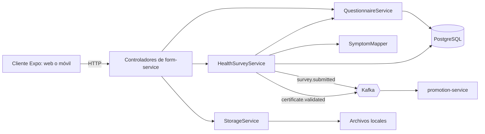

<!-- CG-DOC: Service documentation for form. -->
# form-service: funcionamiento y estructura

Este documento explica el funcionamiento, la estructura y las dependencias actuales de `circleguard-form-service` para el diagnóstico de HU-FORM-01.

## Cómo funciona form-service

`form-service` administra cuestionarios de salud dinámicos y recibe las respuestas asociadas a un identificador anónimo. También permite subir un certificado o resultado de prueba y registrar su validación. La entidad `HealthSurvey` usa `anonymousId` y no contiene campos de nombre o correo.

El cliente Expo consulta el cuestionario activo y envía las respuestas por HTTP. `HealthSurveyService` obtiene ese cuestionario, usa `SymptomMapper` para determinar si las respuestas indican síntomas y guarda la encuesta en PostgreSQL. Si el usuario adjunta un archivo, `StorageService` lo guarda en el sistema de archivos local y la encuesta conserva el nombre devuelto.



Después de guardar una encuesta, el servicio publica `survey.submitted` en Kafka. Si se aprueba un certificado, publica `certificate.validated`. `promotion-service` consume esos eventos para evaluar cambios en el estado de salud: puede marcar a una persona como `SUSPECT` cuando se detectan síntomas o intentar restaurar `ACTIVE` tras una aprobación. Esta comunicación es asíncrona; recibir la respuesta HTTP de `form-service` no confirma que `promotion-service` ya haya procesado el evento.

Dentro de CircleGuard, este servicio convierte los reportes de salud en señales para el sistema que gestiona los estados y cercos sanitarios. Las rutas y los datos de cada evento se detallan más adelante.

## Organización

El código principal está en `src/main/java/com/circleguard/form/`. `FormApplication.java` es el punto de entrada de Spring Boot. Las migraciones SQL están en `src/main/resources/db/migration/`.

| Paquete | Responsabilidad |
| --- | --- |
| `controller` | Expone las operaciones HTTP de cuestionarios, encuestas de salud, adjuntos y validación de certificados. |
| `service` | Implementa la lógica de cuestionarios, encuestas, detección de síntomas y almacenamiento de adjuntos. |
| `repository` | Accede a las entidades persistidas mediante Spring Data JPA. |
| `model` | Define las entidades y enumeraciones utilizadas por el servicio. |

## Controladores

| Clase | Ruta base | Responsabilidad |
| --- | --- | --- |
| `QuestionnaireController` | `/api/v1/questionnaires` | Lista, crea y activa cuestionarios; también consulta el cuestionario activo. |
| `HealthSurveyController` | `/api/v1/surveys` | Recibe y registra una encuesta de salud. |
| `AttachmentController` | `/api/v1/attachments` | Recibe un archivo adjunto y devuelve su nombre almacenado. |
| `CertificateValidationController` | `/api/v1/certificates` | Consulta encuestas pendientes y registra su validación. |

### Rutas HTTP existentes

| Método | Ruta | Operación |
| --- | --- | --- |
| `GET` | `/api/v1/questionnaires` | Lista los cuestionarios. |
| `GET` | `/api/v1/questionnaires/active` | Obtiene el cuestionario activo. |
| `POST` | `/api/v1/questionnaires` | Crea un cuestionario. |
| `POST` | `/api/v1/questionnaires/{id}/activate` | Activa un cuestionario. |
| `POST` | `/api/v1/surveys` | Envía una encuesta de salud. |
| `POST` | `/api/v1/attachments` | Sube un archivo mediante el campo `file`. |
| `GET` | `/api/v1/certificates/pending` | Lista las encuestas pendientes de validación. |
| `POST` | `/api/v1/certificates/{id}/validate` | Valida una encuesta con los parámetros `status` y `adminId`. |

## Servicios

| Clase | Responsabilidad |
| --- | --- |
| `QuestionnaireService` | Consulta, guarda y activa cuestionarios. |
| `HealthSurveyService` | Registra encuestas, consulta las pendientes, valida certificados y emite los eventos asociados. |
| `SymptomMapper` | Determina si las respuestas a un cuestionario activo indican síntomas. |
| `StorageService` | Guarda localmente los archivos adjuntos recibidos. |

## Repositorios y modelos

| Repositorio | Modelo | Uso principal |
| --- | --- | --- |
| `QuestionnaireRepository` | `Questionnaire` | Consulta cuestionarios y obtiene el activo por versión. |
| `QuestionRepository` | `Question` | Ofrece las operaciones JPA básicas para las preguntas. |
| `HealthSurveyRepository` | `HealthSurvey` | Consulta encuestas, incluidas las pendientes con adjunto. |

`Questionnaire` agrupa preguntas y su estado de activación. `Question` define el texto, tipo, opciones y orden de cada pregunta. `HealthSurvey` guarda el identificador anónimo, las respuestas y los datos de validación de una encuesta. Las enumeraciones `QuestionType` y `ValidationStatus` definen, respectivamente, los tipos de pregunta y los estados de validación.

## Migraciones de base de datos

| Migración | Cambio |
| --- | --- |
| `V1__initial_survey_schema.sql` | Crea `health_surveys` y un índice por identificador anónimo. |
| `V2__dynamic_questionnaire_schema.sql` | Crea `questionnaires` y `questions`, su relación y los índices de consulta. |
| `V3__add_responses_to_survey.sql` | Añade `responses` en formato JSONB a `health_surveys`. |
| `V4__add_attachment_to_survey.sql` | Añade la ruta del adjunto a `health_surveys`. |
| `V5__add_validation_status_to_survey.sql` | Añade el estado de validación y el identificador de quien validó la encuesta. |

## Dependencias y puntos de integración

**PostgreSQL** almacena los cuestionarios, sus preguntas y las encuestas de salud en la base `circleguard_form`. Los repositorios acceden a estos datos mediante Spring Data JPA y Flyway aplica las migraciones SQL descritas arriba. La conexión se define en `src/main/resources/application.yml`.

**Kafka** permite comunicar lo ocurrido con una encuesta a otros servicios. `HealthSurveyService` publica mensajes en estos temas:

| Tema | Cuándo se publica | Qué recibe `promotion-service` |
| --- | --- | --- |
| `survey.submitted` | Después de guardar una encuesta enviada a `POST /api/v1/surveys`. | El identificador anónimo, si se detectaron síntomas y la marca de tiempo. Si hay síntomas, solicita el cambio de estado a `SUSPECT`. |
| `certificate.validated` | Después de aprobar la validación de una encuesta en `POST /api/v1/certificates/{id}/validate`. | El identificador anónimo, el estado `APPROVED`, el identificador del administrador y la marca de tiempo. Solicita el cambio de estado a `ACTIVE`. |

La dirección de Kafka se configura en `application.yml`. **`promotion-service`** escucha ambos temas en `SurveyListener` y procesa los mensajes; `form-service` no le hace llamadas HTTP directas.

## Empaquetado Docker (DCG-21)

Ejecuta la construcción desde la raíz del repositorio, porque Gradle configura allí los módulos:

```bash
docker build \
  -f services/circleguard-form-service/Dockerfile \
  -t circleguard-form-service:1.0.0-dcg21 .
```

La primera etapa usa la imagen oficial de Gradle 8.14 con JDK 21 y ejecuta únicamente `bootJar` de Form. Así funciona sin Gradle instalado en el equipo ni `gradle-wrapper.jar` local. La segunda etapa contiene el JRE 21 y el JAR ejecutable, y utiliza UID/GID `10001:10001`. Ambas bases están fijadas por digest; para actualizarlas hay que verificar los nuevos digests y repetir la validación.

`Dockerfile.dockerignore` excluye compilaciones locales, pruebas, archivos de entorno y claves. También excluye el código de los otros servicios, conservando sus scripts Gradle para configurar el proyecto. La imagen se etiqueta con versión, nunca con `latest`.

### Configuración al ejecutar

| Variable | Uso |
| --- | --- |
| `FORM_DB_PASSWORD` | Contraseña obligatoria de PostgreSQL, sin valor predeterminado en el JAR. |
| `SPRING_DATASOURCE_URL` | URL JDBC de la base `circleguard_form`, accesible desde el contenedor. |
| `SPRING_DATASOURCE_USERNAME` | Usuario de PostgreSQL; el valor local predeterminado es `admin`. |
| `SPRING_KAFKA_BOOTSTRAP_SERVERS` | Dirección de Kafka accesible desde el contenedor. |

Por ejemplo, con PostgreSQL y Kafka disponibles como `postgres` y `kafka` en una red Docker llamada `circleguard`:

```bash
# Define FORM_DB_PASSWORD en tu entorno antes de ejecutar este comando.
docker run -d --name circleguard-form \
  --network circleguard \
  -p 127.0.0.1:8086:8086 \
  --env FORM_DB_PASSWORD \
  --env SPRING_DATASOURCE_URL=jdbc:postgresql://postgres:5432/circleguard_form \
  --env SPRING_DATASOURCE_USERNAME=admin \
  --env SPRING_KAFKA_BOOTSTRAP_SERVERS=kafka:9092 \
  circleguard-form-service:1.0.0-dcg21
```

La base debe existir antes del arranque; Flyway aplica las migraciones de Form. Kafka debe anunciar una dirección alcanzable desde esa red, por ejemplo `kafka:9092`. El Compose de desarrollo anuncia `localhost:9092`, por lo que su configuración actual está orientada a ejecutar los servicios Java en el equipo anfitrión.

La variable `FORM_DB_PASSWORD` también es necesaria para `bootRun` local. Las pruebas que cargan PostgreSQL obtienen sus credenciales de Testcontainers.

Los adjuntos se escriben en `/tmp/circleguard-uploads`, con permisos para el usuario de la aplicación. Para conservarlos al recrear el contenedor, el entorno de ejecución debe montar almacenamiento con permisos para UID `10001`.

### Comprobaciones y futura integración con Jenkins

```bash
docker image inspect --format '{{.Config.User}}' circleguard-form-service:1.0.0-dcg21
docker run --rm --entrypoint id circleguard-form-service:1.0.0-dcg21
docker run --rm --entrypoint java circleguard-form-service:1.0.0-dcg21 -version
docker logs circleguard-form
curl -i http://localhost:8086/api/v1/questionnaires
```

El usuario debe ser `10001:10001`, Java debe ser 21 y el endpoint debe devolver HTTP `200`. Los logs permiten comprobar el arranque de Spring y las migraciones Flyway.

En Jenkins, ejecutar `./gradlew :services:circleguard-form-service:check --console=plain` antes de construir la imagen. Esta comprobación necesita Docker para Testcontainers y genera los reportes JUnit y JaCoCo de HU2. El clon de CI utiliza el Gradle Wrapper versionado en el repositorio, incluido `gradle-wrapper.jar`; el Dockerfile usa Gradle de su imagen de compilación. La construcción de la imagen usa el comando anterior y no necesita acceso al socket Docker desde sus etapas. La publicación en el registro y el pipeline compartido corresponden a las siguientes subtareas.

### Resultado de la validación local de DCG-21

Validación realizada el 6 de noviembre de 2026 con la imagen `1.0.0-dcg21` en Linux amd64:

| Comprobación | Resultado |
| --- | --- |
| Construcción desde fuentes con `bootJar` | Correcta, Gradle 8.14.6 de la base fijada. |
| Imagen final | 160 812 532 bytes (153,36 MiB); JRE Temurin 21.0.13+9 y sin Gradle. |
| Usuario efectivo | UID/GID `10001:10001`. |
| Configuración del JAR | Contraseña externa mediante `FORM_DB_PASSWORD`; sin dependencias de prueba ni archivos de credenciales. |
| Arranque sobre PostgreSQL vacío | Cinco migraciones Flyway aplicadas correctamente. |
| Consulta de cuestionarios | HTTP `200`. |
| Carga de adjunto | HTTP `200`; contenido escrito y leído en `/tmp/circleguard-uploads`. |
| Envío de encuesta con fiebre | HTTP `200`; recibido en `survey.submitted` con clave igual a `anonymousId`, `hasSymptoms=true` y marca de tiempo numérica. |
| `check` de Form | 35 pruebas, 0 fallos, 0 omitidas. |
| JaCoCo, cobertura de líneas | 86,43 % (121 de 140); supera el mínimo del 60 %. |

La comprobación de arranque utilizó PostgreSQL 16 y Kafka/ZooKeeper 7.6.0 en una red temporal, con Kafka anunciando `kafka:9092` y la contraseña suministrada solo al ejecutar. Se eliminaron los contenedores, sus volúmenes temporales y la red al finalizar; la imagen construida queda disponible localmente.
